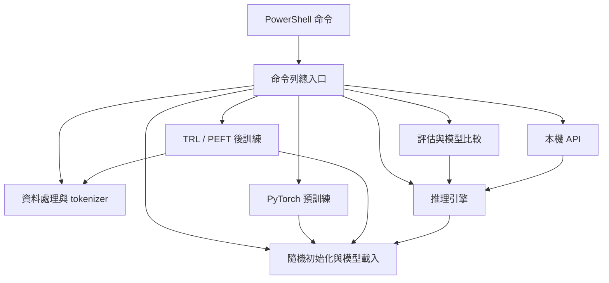
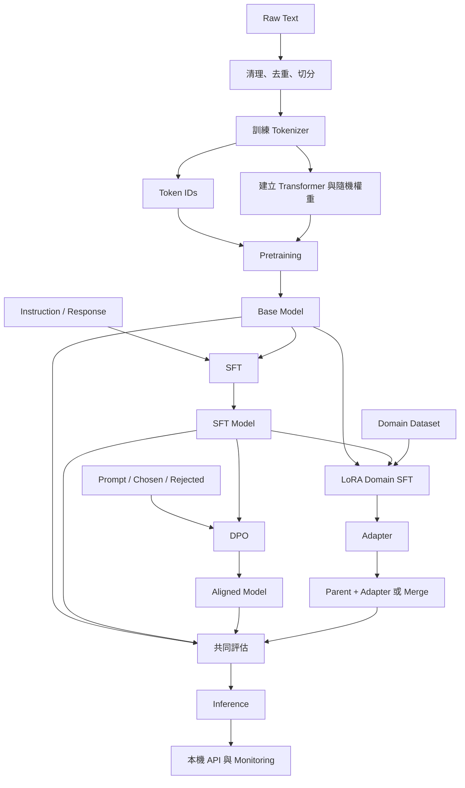

|                                |     |
| ------------------------------ | --- |
| [[#### 建立MiniLLM 並實際跑通完整訓練]]   |     |
| [[#### 解釋這個MiniLLM repo的檔案結構]] |     |
|                                |     |
|                                |     |

#### 建立MiniLLM 並實際跑通完整訓練
```
我想在 Laptop 上建立一套完整的 Mini LLM在C:\LLM\MiniLLM  
從零預訓練 → 後訓練 → 微調 → 推理.  
要從 GitHub 的 MiniMind 開始，搭配 nanoGPT 與 Hugging Face TRL，建立一套能在 laptop 實際運作的 LLM Training Laboratory。  
目標不是單純下載一個小模型並與它聊天，而是親手操作完整的 LLM Lifecycle，包括：

- 從零建立 Transformer Model，理解 Pretraining 前的模型如何初始化。
- 準備 Raw Dataset，進行 Cleaning、Tokenization、Train/Validation Split。
- 執行 Pretraining，觀察 Loss、Gradient、Optimizer 與 Checkpoint。
- 執行 Supervised Fine-Tuning（SFT），讓 Base Model 學習遵循指令。
- 執行 LoRA Fine-Tuning，理解 Parameter-Efficient Fine-Tuning。
- 執行 DPO Preference Alignment，理解 Post-training。
- 執行 Inference，觀察 Temperature、Top-p、KV Cache 等設定。
- 保存所有 Dataset、Model Weights、Tokenizer、Configuration、Metrics，並比較各階段模型的差異。

要建立的完整 Pipeline  
Raw Text Dataset  
TXT / JSONL / Parquet

Data Processing  
Clean · Deduplicate · Split

Tokenizer Training  
Vocabulary · Token IDs

STAGE 1  
Pretraining from Scratch  
Random Weights → Next-token Prediction  
輸出：Base Model Checkpoint

STAGE 2  
Supervised Fine-Tuning (SFT)  
Instruction / Response Dataset  
輸出：Instruction Model

STAGE 3  
Preference Alignment (DPO)  
Prompt · Chosen · Rejected  
輸出：Aligned Model

STAGE 4 · OPTIONAL BRANCH  
Domain Adaptation (LoRA)  
Base/SFT Model + Domain Dataset  
輸出：LoRA Adapter

Evaluation → Inference → Deployment  
Metrics · Generation · API · Monitoring

注意：這是一條方便教學的主要流程，SFT、LoRA、DPO 不一定只能依照圖中的順序進行。LoRA 是參數更新方法，可以應用於 SFT 或其他訓練階段；DPO 通常從已完成 SFT 的模型開始。  
在每個階段，你都應保存獨立的 Model Checkpoint 與 Evaluation Results，才能清楚觀察每一種訓練對模型產生的影響
```
# 在 Laptop 上建立一套完整的 Mini LLM：從零預訓練 → 後訓練 → 微調 → 推理

我最推薦你從 GitHub 的 MiniMind 開始，搭配 nanoGPT 與 Hugging Face TRL，建立一套能在 laptop 實際運作的 LLM Training Laboratory。

你的目標不是單純下載一個小模型並與它聊天，而是親手操作完整的 LLM Lifecycle，包括：

- 從零建立 Transformer Model，理解 Pretraining 前的模型如何初始化。
    
- 準備 Raw Dataset，進行 Cleaning、Tokenization、Train/Validation Split。
    
- 執行 Pretraining，觀察 Loss、Gradient、Optimizer 與 Checkpoint。
    
- 執行 Supervised Fine-Tuning（SFT），讓 Base Model 學習遵循指令。
    
- 執行 LoRA Fine-Tuning，理解 Parameter-Efficient Fine-Tuning。
    
- 執行 DPO Preference Alignment，理解 Post-training。
    
- 執行 Inference，觀察 Temperature、Top-p、KV Cache 等設定。
    
- 保存所有 Dataset、Model Weights、Tokenizer、Configuration、Metrics，並比較各階段模型的差異。
    

這套流程可以在沒有昂貴 GPU 的情況下學習，但必須依照 laptop 的記憶體及 GPU 選擇模型規模。

## 一、我推薦的 5 個 GitHub Repository


1. [MiniMind](https://github.com/jingyaogong/minimind)

最推薦

完整從零訓練小型 LLM 的教學專案。 包含模型架構、Tokenizer、Pretraining、SFT、LoRA、DPO、RL 及 Inference。2026 年版本提供 64M 參數的 MiniMind-3，也有 26M 的舊版小模型，非常適合練習完整 pipeline。


GitHub

+1


2. [nanoGPT](https://github.com/karpathy/nanoGPT)

最適合理解 Transformer 和 Pretraining 的底層原理。 程式架構簡單，可以把模型縮到數百萬參數，在 CPU 上訓練。提供 Tiny Shakespeare Dataset、Training Script 與 Inference Script。原作者已將它定位為舊版教學專案。


GitHub

+1


3. [nanochat](https://github.com/karpathy/nanochat)

更現代的端到端 LLM Training Framework。 涵蓋 Tokenization、Pretraining、Finetuning、Evaluation、Inference，並能研究 Scaling Laws。官方主要 benchmark 針對高階 GPU，普通 laptop 應縮小模型及資料規模。


GitHub

+1


4. [SmolLM / SmolLM2](https://github.com/huggingface/smollm)

最適合學習如何使用現成 Pretrained Model。 具有 135M、360M 與 1.7B 等模型版本，可以練習 Load Weights、SFT、Evaluation、Inference，也提供訓練相關程式碼。


GitHub


5. [Hugging Face Smol Course](https://github.com/huggingface/smol-course)

最適合學習現代 Post-training。 涵蓋 SFT、Evaluation、DPO、RL 與 Synthetic Data，可與 Hugging Face Transformers、PEFT、TRL 配合。部分課程預設較大模型，需要縮小規模才能在普通 laptop 訓練。


GitHub

+1

### 如何選擇？

|你的學習目標|最佳 Repo|
|---|---|
|看懂並修改 Transformer、Attention、Loss、Backpropagation|nanoGPT|
|親手從 Random Weights 訓練出 Chat Model|MiniMind|
|學習較現代的 Pretraining Pipeline|nanochat|
|使用已預訓練模型練習 Fine-tuning|SmolLM2|
|熟悉 SFT、DPO、PEFT、Alignment|Smol Course|

我的建議是：

主要專案使用 MiniMind，第一個練習使用 nanoGPT，後續再把 Hugging Face TRL 整合進來。

這樣既可以看到完整訓練流程，也能理解真實企業 LLM Engineer 使用的軟體工具。

## 二、你要建立的完整 Pipeline

Raw Text Dataset

TXT / JSONL / Parquet

Data Processing

Clean · Deduplicate · Split

Tokenizer Training

Vocabulary · Token IDs

STAGE 1

Pretraining from Scratch

Random Weights → Next-token Prediction

輸出：Base Model Checkpoint

STAGE 2

Supervised Fine-Tuning (SFT)

Instruction / Response Dataset

輸出：Instruction Model

STAGE 3

Preference Alignment (DPO)

Prompt · Chosen · Rejected

輸出：Aligned Model

STAGE 4 · OPTIONAL BRANCH

Domain Adaptation (LoRA)

Base/SFT Model + Domain Dataset

輸出：LoRA Adapter

Evaluation → Inference → Deployment

Metrics · Generation · API · Monitoring

注意：這是一條方便教學的主要流程，SFT、LoRA、DPO 不一定只能依照圖中的順序進行。LoRA 是參數更新方法，可以應用於 SFT 或其他訓練階段；DPO 通常從已完成 SFT 的模型開始。

在每個階段，你都應保存獨立的 Model Checkpoint 與 Evaluation Results，才能清楚觀察每一種訓練對模型產生的影響。

## 三、Laptop 硬體需要多強？

要先區分兩個任務：

1. 訓練一個小模型以了解演算法：1M–30M 參數就很有學習價值。
    
2. 訓練一個可以正常回答各種問題的 LLM：即使只有 100M–500M 參數，也需要相對大量的高品質資料與運算。
    

你現在的目標是第一種，因此不需要一開始就使用 1B、7B 或 8B 模型。

依 Laptop 的 GPU 選擇模型

CPU only

4 GB VRAM

8 GB VRAM

16+ GB VRAM

建議：1M–10M 參數的 Tiny GPT使用 nanoGPT 的小模型設定。能操作 Pretraining、Checkpoint、Inference；小資料 SFT、DPO 可以嘗試，但訓練會比較慢。

以上是保守的起始實驗規模，不是硬體上限或保證能完整訓練的規格。實際可行性受到 RAM、序列長度、Batch Size、Optimizer、訓練精度與 Windows 環境影響。

在 Windows 11 可以先使用 PowerShell 查詢硬體：

```
# CPU 與記憶體
Get-CimInstance Win32_Processor |
  Select-Object Name

Get-CimInstance Win32_ComputerSystem |
  Select-Object TotalPhysicalMemory

# NVIDIA GPU（若已安裝 NVIDIA 驅動）
nvidia-smi
```

如果 laptop 沒有 NVIDIA GPU，我建議先以 CPU 跑 nanoGPT；如果有 NVIDIA GPU，則可以直接開始 MiniMind。

## 四、第一個實驗：用 nanoGPT 從零訓練 Transformer

這是我最推薦你先做的實際動手練習。

目標是建立約 1M–2M 參數級的 Tiny GPT，從 Random Initialization 開始 Pretraining，而不是下載 GPT-2 權重。

### Step 1：建立 Python 環境

在 Windows PowerShell 執行：

```
mkdir D:\LLM-Lab
cd D:\LLM-Lab

git clone https://github.com/karpathy/nanoGPT.git
cd nanoGPT

py -3.11 -m venv .venv
.\.venv\Scripts\Activate.ps1

python -m pip install --upgrade pip
pip install torch numpy transformers datasets tiktoken tqdm
```

這裡先以 CPU 版本作為通用起點；有 NVIDIA GPU 時，應依 [PyTorch 官方安裝頁](https://pytorch.org/get-started/locally/) 選擇對應 CUDA 版本，並驗證：

```
import torchprint(torch.__version__)print(torch.cuda.is_available())
```

### Step 2：產生 Pretraining Dataset

執行：

```
python data/shakespeare_char/prepare.py
```

這份小型 Shakespeare 資料會進行字元級 Tokenization，產生：

```
nanoGPT/
├── data/
│   └── shakespeare_char/
│       ├── input.txt
│       ├── train.bin
│       ├── val.bin
│       ├── meta.pkl
│       └── prepare.py
├── model.py
├── train.py
└── sample.py
```

各檔案的用途：

|檔案|作用|
|---|---|
|`input.txt`|原始文字|
|`prepare.py`|Tokenization 與 Train/Val 切分|
|`train.bin`|訓練 Token IDs|
|`val.bin`|驗證 Token IDs|
|`meta.pkl`|字元 Vocabulary 與映射資訊|
|`model.py`|Transformer 架構|
|`train.py`|Optimizer、Forward、Backward、Training Loop|
|`sample.py`|Autoregressive Inference|

這是實際存在於 nanoGPT 的入門資料處理路徑。


GitHub

### Step 3：開始 Pretraining

下面是我建議的 CPU 小模型設定：

```
python train.py config/train_shakespeare_char.py `
  --device=cpu `
  --compile=False `
  --dtype=float32 `
  --init_from=scratch `
  --n_layer=4 `
  --n_head=4 `
  --n_embd=64 `
  --block_size=64 `
  --batch_size=8 `
  --max_iters=500 `
  --lr_decay_iters=500 `
  --eval_interval=100 `
  --eval_iters=10 `
  --always_save_checkpoint=True
```

這個設定的重點是縮小：

- Transformer Layers：4
    
- Attention Heads：4
    
- Embedding Dimension：64
    
- Context Window：64 字元
    
- Training Iterations：500
    

它不是一個有實用聊天能力的模型，但非常適合觀察 Pretraining 的基本機制。

### Step 4：觀察訓練過程

在每次 Iteration，主要發生：

\[ X\rightarrow Embedding\rightarrow Transformer\rightarrow Logits \]

再計算：

\[ L=-\frac{1}{N}\sum_{i=1}^{N}\log P(x_{i+1}\mid x_{\le i}) \]

接著執行：

```
logits, loss = model(X, Y)loss.backward()optimizer.step()optimizer.zero_grad()
```

這段是概念化的 PyTorch 訓練循環；實際 nanoGPT 還有 Gradient Accumulation、Learning Rate Scheduling、Evaluation、Checkpoint Saving 等細節。

請特別觀察：

1. Training Loss 是否下降。
    
2. Validation Loss 是否下降。
    
3. Learning Rate 如何變化。
    
4. 每次訓練 Iteration 的耗時。
    
5. 是否發生 Overfitting。
    

### Step 5：執行 Inference

完成訓練後：

```
python sample.py `
  --out_dir=out-shakespeare-char `
  --device=cpu `
  --start="ROMEO:"
```

你可能得到一些模仿 Shakespeare 對話格式的文字，雖然語意未必通順。

這時你已經完成了一個真正的 LLM 原型：從零建立權重、準備 Dataset、Pretraining、儲存 Checkpoint、重新載入並產生文字。

### Step 6：認識 Model Checkpoint

Checkpoint 一般儲存在：

```
out-shakespeare-char/
└── ckpt.pt
```

可以用以下程式觀察模型參數（只載入可信來源的 checkpoint）：

```
import torchckpt = torch.load(    "out-shakespeare-char/ckpt.pt",    map_location="cpu",    weights_only=False,)print(ckpt.keys())print(ckpt["model_args"])print(ckpt.get("iter_num"))print(ckpt.get("best_val_loss"))
```

由於這個舊版 nanoGPT 使用了包含 Python 物件的 checkpoint 格式，上例設定 `weights_only=False`；不要用它讀取不可信的 `.pt` 檔案。

在這個階段，建議你再做三次實驗：改變 Transformer Layers（2、4、6）、改變 Context Length（32、64、128），以及比較不同 Learning Rate 對 Loss 的影響。

## 五、第二個實驗：MiniMind 完整 Pretraining → SFT → DPO

完成 nanoGPT 後，接下來就不只是模仿文章，而是要讓模型學習接受 Instructions，並嘗試偏好對齊。

MiniMind 是比較符合這個目標的選擇。

### Step 1：下載 MiniMind

```
cd D:\LLM-Lab

git clone https://github.com/jingyaogong/minimind.git

cd minimind

py -3.11 -m venv .venv
.\.venv\Scripts\Activate.ps1

pip install -r requirements.txt
```

MiniMind 2026 年已經有新版模型與新的 Dataset 格式，因此應遵照當前版本 README 對應的訓練程式，不應混用舊版 MiniMind2 的檔案配置與新版 MiniMind-3 模型。


GitHub

### Step 2：準備三種不同的 Dataset

這是理解完整 pipeline 最重要的地方。

A. Pretraining Dataset

學習目標：預測下一個 Token。

```
{"text":"The Earth revolves around the Sun."}
{"text":"A neural network consists of layers."}
{"text":"Machine learning uses training data."}
```

模型學的是文字分布與語言規律，而不是明確的問答規則。

B. SFT Dataset

學習目標：根據 User Instruction 產生 Assistant Response。

```
{
  "messages": [
    {"role":"user","content":"What is a GPU?"},
    {"role":"assistant","content":"A GPU is a processor designed for parallel computation."}
  ]
}
```

這是通用對話資料結構的示例。實際進入 Training Script 前，需要轉成該模型 Chat Template 接受的格式。

C. DPO Preference Dataset

學習目標：讓模型提高 Preferred Response 的相對機率。

```
{
  "prompt":"Explain overfitting.",
  "chosen":"Overfitting occurs when a model learns training-specific patterns and generalizes poorly.",
  "rejected":"Overfitting means training is always successful."
}
```

這三個欄位是典型 DPO 格式。實際使用前，應配合 Tokenizer 與 Chat Template 做前處理。

### Step 3：執行各階段訓練

MiniMind 的實際流程可以整理成：

```
Random Initialization
       |
       v
Pretraining
       |
       +--> pretrained_model/
       |
       v
Supervised Fine-tuning
       |
       +--> sft_model/
       |
       v
Direct Preference Optimization
       |
       +--> dpo_model/
       |
       v
Inference / Evaluation
```

另外可以由 Pretrained 或 SFT Model 分支進行：

```
Pretrained / SFT Model
       |
       v
LoRA Training
       |
       +--> lora_adapter/
       |
       v
Load Base + Adapter
       |
       v
Inference
```

這裡我建議你先以各階段 100–500 Steps 進行 Pipeline Smoke Test，確認完整執行、儲存、載入與推理，再決定是否增加訓練步數。

100–500 Steps 不代表模型會訓練成功，而是確認程式、資料、GPU 與 Checkpoint 的完整鏈路能運作。

## 六、我建議你建立的 LLM Laboratory 資料夾

實際學習時，我建議把程式、Dataset、模型權重、訓練紀錄分開保存，而不是全部混在 Repository 裡。

以下是你可以自行建立的實驗室結構，不是 MiniMind 原始 Repo 的預設目錄。

D:\LLM-Lab

repos/

nanoGPT、MiniMind、Smol Course 原始碼

datasets/raw/

原始文字資料

datasets/processed/

清理、切分及 Tokenization 後的資料

datasets/sft/

Instruction / Response 資料

datasets/preference/

DPO Chosen / Rejected 資料

tokenizer/

Tokenizer、Vocabulary、Chat Template

configs/

Model、Training、Optimizer、Scheduler 設定

checkpoints/pretrain/

Base Model 權重

checkpoints/sft/

SFT Model 權重

checkpoints/dpo/

DPO Model 權重

adapters/lora/

LoRA Adapter 權重

evaluations/

不同模型的測試結果

logs/

Loss、Learning Rate、Memory、Throughput

inference/

Inference Scripts、API、生成結果

### 各種訓練應保留哪些檔案？

|階段|主要輸入|主要輸出|
|---|---|---|
|Tokenizer|Raw text|`tokenizer.json`、Vocabulary|
|Pretraining|Token IDs、Model Config|Base Model Weights、Optimizer State|
|SFT|Base Model、Instruction Dataset|SFT Checkpoint|
|LoRA|Base Model、Domain Dataset|Adapter Weights、Adapter Config|
|DPO|SFT Model、Preference Dataset、Reference Policy|Aligned Model|
|Evaluation|Model、Test Dataset|Loss、Accuracy、Preference Metrics|
|Inference|Weights、Tokenizer、Generation Config|Generated Text、Latency Metrics|

還應保存資料版本、Random Seed、Git Commit、Package Versions、Training Config，以及用來恢復訓練的 Scheduler 和 RNG State（適用時）。這些是確保實驗可重現的關鍵。

## 七、建議完成的 8 個實驗

LLM Training Lab 進度

0 / 8

Experiment 1 — 從 Random Weights 建立 Tiny GPT

nanoGPT · 理解 Transformer、Embedding、Attention、Next-token Prediction

Experiment 2 — 研究 Tokenizer

nanoGPT / Hugging Face · 比較 Character、BPE、Vocabulary Size

Experiment 3 — Pretraining 與 Scaling

MiniMind · 比較模型參數量、資料量、Loss、Training Time

Experiment 4 — SFT Instruction Tuning

MiniMind / TRL · 比較 Base Model 與 SFT Model 的問答能力

Experiment 5 — Full Fine-tuning vs LoRA

MiniMind / PEFT · 比較 Trainable Parameters、VRAM、訓練結果

Experiment 6 — DPO Preference Alignment

TRL · 比較 Chosen / Rejected Response 的 Log Probability

Experiment 7 — Inference Optimization

PyTorch / Transformers · 測試 KV Cache、Temperature、Top-p、Tokens/sec

Experiment 8 — Evaluation 與 Deployment

Transformers / FastAPI · 比較 Checkpoints、建立本地 API

## 八、額外建議：用同一組問題比較各階段的 Model

訓練不同階段後，建議使用完全相同的 Held-out Test Set 評估。

例如在開始之前先保留 50–100 道測試問題，這些問題不能進入任何訓練資料。

|測試題目|Pretrained|SFT|DPO|
|---|---|---|---|
|What is machine learning?|記錄輸出|記錄輸出|記錄輸出|
|Explain gradient descent.|記錄輸出|記錄輸出|記錄輸出|
|What is overfitting?|記錄輸出|記錄輸出|記錄輸出|
|Explain a Transformer.|記錄輸出|記錄輸出|記錄輸出|

以上是測試設計，而不是預期結果。對非常小、訓練資料有限的模型，SFT 或 DPO 後未必會產生合理回答。

你應該比較的指標包括：

- Pretraining：Train Loss、Validation Loss、Perplexity。
    
- SFT：Held-out Answer Quality、Instruction Following。
    
- DPO：Preference Accuracy、Chosen vs Rejected Log-probability Margin。
    
- Inference：Time to First Token、Tokens/sec、Peak Memory。
    
- Training Efficiency：Steps/sec、Trainable Parameters、Peak VRAM。
    

另外，DPO 不是 Reinforcement Learning 的完整替代練習。如果未來想理解 RLHF、PPO、GRPO，應再增加 Reward Model、Rollout、Policy Optimization 等實驗。

## 九、最後的技術路線建議

第一階段：nanoGPT（CPU 也能開始）

先從 1M–2M 參數左右的小模型開始，真正理解 Model Architecture、Forward/Backward、Optimizer、Checkpoint、Inference。

第二階段：MiniMind（完整 Training Pipeline）

使用 26M–64M 模型，完成 Pretraining、SFT、LoRA、DPO，建立完整的 Dataset 與 Model Versioning。

第三階段：Hugging Face（較接近 Production）

使用 Transformers、Datasets、PEFT、TRL、Accelerate，學習模型部署、量化與訓練評估。從 SmolLM2-135M 等小模型開始。

這三個階段會讓你從「理解模型如何訓練」逐步進入「能設計、實驗和評估完整 LLM Pipeline」的程度。

### 我還需要確認你的 Laptop 規格

這會直接決定適合 2M、26M、64M 還是 135M 的模型，以及能不能在本機完成 SFT、DPO 與 LoRA。

CPU 型號

RAM

8 GB

16 GB

32 GB

64 GB+

GPU 型號或顯示記憶體

依硬體規格設計完整實作教學

最重要的是：我建議你最後不只得到一個可以聊天的模型，而是得到一套可以重複實驗的 LLM Training Laboratory。 每次修改 Dataset、Model Architecture、Loss Function、Learning Rate、SFT/DPO 策略，都能重新訓練、比較結果，這才是對學習 LLM Engineering 最有價值的部分。


#### 解釋這個MiniLLM repo的檔案結構
```
請詳細解釋這個repo的檔案結構每個檔案的作用是甚麼, 以及詳細解釋完整的 LLM Lifecycle的的每一步驟是甚麼以及跟那些檔案有關
```
1. **實驗程式**：定義資料處理、模型初始化、訓練、評估與推理怎麼執行。
2. **實驗設定與原始資料**：決定模型大小、訓練步數，以及模型要學習什麼。
3. **實驗產物**：保存 tokenizer、權重、checkpoint、metrics 和各階段的比較結果。

其中，**MiniMind 提供主模型架構；我們的程式負責預訓練迴圈；TRL 負責 SFT、DPO；PEFT 負責 LoRA；nanoGPT 是獨立的預訓練對照模型。**

以下依照目前磁碟上的實際程式說明。我們建立的程式檔會逐一解釋；第三方套件、上游圖片與快取則按用途說明。

---

先看整個目錄的分工：

```
C:\LLM\MiniLLM\
│
├─ README.md                    操作手冊
├─ requirements.txt             主要 Python 套件版本
├─ requirements.lock.txt        完整套件版本快照
├─ upstream-lock.json           MiniMind / nanoGPT 的固定版本
├─ .gitignore                   不納入 Git 的檔案規則
│
├─ configs\                     實驗設定
│  ├─ smoke.json
│  ├─ laptop.json
│  └─ laptop-check.json
│
├─ minillm\                     實驗室的主要 Python 程式
│  ├─ __init__.py
│  ├─ __main__.py
│  ├─ common.py
│  ├─ data.py
│  ├─ modeling.py
│  ├─ pretrain.py
│  ├─ posttrain.py
│  ├─ evaluate.py
│  ├─ inference.py
│  └─ api.py
│
├─ scripts\                     PowerShell 入口與驗證工具
│  ├─ setup.ps1
│  ├─ lab.ps1
│  ├─ smoke.ps1
│  ├─ monitor.ps1
│  ├─ verify_services.py
│  └─ report_validation.py
│
├─ data\
│  └─ demo\                     原始教學資料
│
├─ artifacts\                   每次實驗的獨立產物
│  ├─ smoke\
│  └─ laptop-check\
│
├─ reports\                     環境、測試與服務驗證結果
├─ tests\                       行為正確性測試
├─ vendor\                      MiniMind / nanoGPT 原始碼
├─ .venv\                       本專案的 Python 執行環境
└─ .cache\                      套件、資料與測試快取
```

**最外層的五個檔案，負責操作與版本重現。**

|檔案|作用|
|---|---|
|[README.md](C:/LLM/MiniLLM/README.md)|繁中操作手冊，包含環境安裝、資料格式、各階段命令、續訓、推理與 API 操作。|
|[requirements.txt](C:/LLM/MiniLLM/requirements.txt)|固定主要依賴，例如 Transformers、TRL、PEFT、Datasets、TensorBoard、FastAPI。|
|[requirements.lock.txt](C:/LLM/MiniLLM/requirements.lock.txt)|記錄實際安裝後的完整套件版本，包含間接依賴，讓環境更容易重建。|
|[upstream-lock.json](C:/LLM/MiniLLM/upstream-lock.json)|固定 MiniMind、nanoGPT 的 GitHub URL、commit 和授權資訊，避免上游更新後行為改變。|
|[.gitignore](C:/LLM/MiniLLM/.gitignore)|排除虛擬環境、快取、模型產物、大型原始資料和 vendor 等檔案。這些檔案仍保存在磁碟，只是不預設交給 Git 管理。|

需要分清楚：**套件版本、上游程式版本、資料版本、模型設定，都是重現實驗的一部分。** 只保存模型權重，無法完整回答「這個模型是怎麼訓練出來的」。

---

**`minillm` 是整套 laboratory 的核心。**

|檔案|作用與主要內容|
|---|---|
|[__init__.py](C:/LLM/MiniLLM/minillm/__init__.py)|將目錄標示為 Python package，目前主要放套件說明。|
|[__main__.py](C:/LLM/MiniLLM/minillm/__main__.py)|命令列總入口。解析 `prepare`、`init`、`pretrain`、`sft`、`dpo`、`lora`、`infer` 等命令，再呼叫對應模組。|
|[common.py](C:/LLM/MiniLLM/minillm/common.py)|共用工具：JSON/JSONL 讀寫、SHA256、隨機種子、CPU/CUDA 選擇、精度選擇、實驗路徑、版本紀錄和硬體檢測。|
|[data.py](C:/LLM/MiniLLM/minillm/data.py)|原始資料讀取、格式統一、清理、去重、切分、教學資料生成、BPE tokenizer 訓練、token binary 建立，以及 SFT prompt/completion 格式化。|
|[modeling.py](C:/LLM/MiniLLM/minillm/modeling.py)|載入 MiniMind 模型類別，提供 `LabMiniMind` 相容層、隨機初始化、權重統計，以及完整模型／LoRA adapter 載入。|
|[pretrain.py](C:/LLM/MiniLLM/minillm/pretrain.py)|原生 PyTorch 預訓練：抽取 token windows、forward、loss、backward、AdamW 更新、梯度裁切、validation、checkpoint 和續訓。也負責 nanoGPT 對照訓練。|
|[posttrain.py](C:/LLM/MiniLLM/minillm/posttrain.py)|使用 TRL 執行 SFT、DPO，使用 PEFT 執行 LoRA。處理 completion masking、batch padding、累積梯度 loss、reference model、訓練紀錄與續訓身分檢查。|
|[evaluate.py](C:/LLM/MiniLLM/minillm/evaluate.py)|在相同評估資料上比較各階段模型：raw loss、perplexity、SFT/domain completion loss、偏好配對、固定 prompt 生成和 cache benchmark。|
|[inference.py](C:/LLM/MiniLLM/minillm/inference.py)|`Engine` 推理介面：載入模型與 tokenizer、套用 chat template、處理 sampling 設定、產生文字、計時，以及 cached/uncached 比較。|
|[api.py](C:/LLM/MiniLLM/minillm/api.py)|將推理引擎包成 FastAPI，提供健康檢查、文字生成與簡單服務 metrics。|

這些模組的呼叫關係是：

````

````

幾個特別值得閱讀的函式：

|函式／類別|你可以學到什麼|
|---|---|
|`clean()`|原始文字如何正規化。|
|`split_rows()`|為何相同文件或 prompt 必須留在同一個 partition。|
|`prepare()`|資料到 tokenizer、token stream 的完整轉換。|
|`fresh_model()`|模型如何依架構設定和實際 vocabulary 建立。|
|`LabMiniMind._init_weights()`|預訓練前的權重如何初始化。|
|`pretrain.train()`|一個真正的訓練 step 做了哪些事。|
|`CompletionCollator`|不同長度資料如何 padding，以及如何遮罩 prompt。|
|`completion_ce()`|如何只對回答計算 loss，並正確處理 gradient accumulation。|
|`posttrain.train()`|SFT、DPO、LoRA 的分支差異。|
|`Engine.generate()`|推理如何從 prompt 走到生成 token。|

---

**`scripts` 讓你不用每次手動處理 Python 路徑和啟動細節。**

|檔案|作用|
|---|---|
|[setup.ps1](C:/LLM/MiniLLM/scripts/setup.ps1)|檢查 Python 3.12、下載固定上游版本、建立 `.venv`、安裝 PyTorch 與依賴，最後執行環境檢查。|
|[lab.ps1](C:/LLM/MiniLLM/scripts/lab.ps1)|日常操作入口。切到專案根目錄，使用專案的 Python 執行 `python -m minillm`，並傳遞你的命令參數。|
|[smoke.ps1](C:/LLM/MiniLLM/scripts/smoke.ps1)|一次執行微型完整流程，再跑 nanoGPT，最後更新比較報告。|
|[monitor.ps1](C:/LLM/MiniLLM/scripts/monitor.ps1)|啟動 TensorBoard，讀取指定 run 的訓練曲線。|
|[verify_services.py](C:/LLM/MiniLLM/scripts/verify_services.py)|暫時啟動 API 和 TensorBoard，透過真正 HTTP 驗證，結束後關閉自己啟動的服務。|
|[report_validation.py](C:/LLM/MiniLLM/scripts/report_validation.py)|從已存在的實測產物整理驗證報告；它不會重新訓練模型。|

例如：

```
cd C:\LLM\MiniLLM
.\scripts\lab.ps1 pretrain --run my-lab
```

實際執行路徑是：

```
lab.ps1
  → 專案 .venv 的 Python
  → python -m minillm
  → __main__.py 解析 pretrain
  → pretrain.py 的 train()
```

`all` 命令包含 MiniMind 主流程和 LoRA 分支；**nanoGPT 是由 `smoke.ps1` 額外呼叫的**。`merge`、API 和 TensorBoard 也需要另外啟動。

---

**`configs` 決定一次實驗的規模。**

|檔案|設定與用途|
|---|---|
|[smoke.json](C:/LLM/MiniLLM/configs/smoke.json)|hidden 128、2 layers，執行 40 steps 預訓練、20 SFT、10 DPO、15 LoRA，快速驗證機制。|
|[laptop.json](C:/LLM/MiniLLM/configs/laptop.json)|hidden 512、8 layers，設定較長訓練：2000／500／200／300 steps。|
|[laptop-check.json](C:/LLM/MiniLLM/configs/laptop-check.json)|保留 laptop 架構與 batch 設定，但每階段只跑 2 steps，用於硬體適配檢查。|

各設定欄位的意義如下：

|欄位|意義|
|---|---|
|`seed`|隨機種子，影響資料切分、初始化、抽樣等。|
|`device`|`auto` 自動使用 CUDA，沒有 CUDA 時使用 CPU。|
|`vocab_size`|BPE 訓練的 vocabulary 目標上限。|
|`hidden_size`|每個 token 的內部向量維度。|
|`num_hidden_layers`|Transformer block 數量。|
|`num_attention_heads`|Query attention heads 數量。|
|`num_key_value_heads`|Key/Value heads 數量；少於 Query heads 時使用 GQA。|
|`intermediate_size`|Feed-forward network 的中間維度。|
|`block_size`|預訓練 prediction window，以及 SFT/DPO 配對長度限制。|
|`max_position_embeddings`|模型設定的最大位置容量。|
|`batch_size`|一次 microbatch 的資料數量。|
|`gradient_accumulation_steps`|累積幾個 microbatches 才更新一次權重。|
|`*_steps`|各階段的 optimizer update 次數。|
|`*_lr`|各階段 learning rate。|
|`warmup_ratio`|前面多少比例的 steps 用來逐漸提高 learning rate。|
|`weight_decay`|AdamW 的權重衰減強度。|
|`max_grad_norm`|梯度裁切門檻。|
|`save_steps` / `eval_steps`|保存與評估的間隔。|
|`lora_r` / `lora_alpha`|LoRA 的低秩維度與更新縮放設定。|
|`dpo_beta`|DPO loss 中，policy/reference 相對 log-probability 的尺度參數。|

**訓練長度與推理容量要分開看。** 例如 smoke 的 `block_size=128`，模型的位置容量是 512。推理可以接受容量內的序列，但短序列訓練不代表模型已經學會良好處理更長上下文。

另外，設定 `vocab_size=1024` 不表示最後一定有 1024 個 tokens。目前教學語料的實際 vocabulary 是 **835**；模型 embedding 依照這個實際數量建立。

---

**原始資料與處理後資料放在不同位置。**

目前原始教學資料位於 [data/demo](C:/LLM/MiniLLM/data/demo)：

|檔案|內容與用途|
|---|---|
|[pretrain.jsonl](C:/LLM/MiniLLM/data/demo/pretrain.jsonl)|一般文字文件，用來學習 next-token prediction。|
|[sft.jsonl](C:/LLM/MiniLLM/data/demo/sft.jsonl)|指令與正確回答，用來做 instruction tuning。|
|[dpo.jsonl](C:/LLM/MiniLLM/data/demo/dpo.jsonl)|同一 prompt 的 chosen/rejected 回答，用來學習偏好。|
|[domain.jsonl](C:/LLM/MiniLLM/data/demo/domain.jsonl)|LLM laboratory 領域問答，用於 LoRA domain SFT。|
|[source.json](C:/LLM/MiniLLM/data/demo/source.json)|資料來源、授權與教學用途說明。|

這些資料是本地程式生成的，目的在於驗證流程。預訓練資料還故意加入空白、控制字元和重複文件，以驗證清理功能。

你自己的語料可以另放在 `C:\LLM\MiniLLM\data\raw\`，再透過 `prepare` 指定來源。

---

**`artifacts` 是一次實驗的完整紀錄。**

`--run smoke` 對應 [artifacts/smoke](C:/LLM/MiniLLM/artifacts/smoke)，`--run laptop-check` 對應另一個獨立目錄。

```
C:\LLM\MiniLLM\artifacts\smoke\
│
├─ config.json
├─ data\
│  ├─ manifest.json
│  ├─ pretrain\
│  ├─ sft\
│  ├─ dpo\
│  └─ domain\
│
├─ tokenizer\
├─ initialized\
├─ base\
├─ sft\
├─ dpo\
├─ lora\
├─ merged\
├─ nanogpt\
├─ tensorboard\
├─ evaluation\
└─ api_requests.jsonl
```

各目錄代表模型生命週期的一個狀態：

|目錄|保存什麼|
|---|---|
|`initialized`|尚未訓練的隨機初始化模型。|
|`base`|完成預訓練的完整模型。|
|`sft`|完成指令微調的完整模型。|
|`dpo`|完成偏好對齊的完整模型。|
|`lora`|LoRA adapter，使用時需要它的 parent model。|
|`merged`|將 LoRA 更新合併後的完整模型。|
|`nanogpt`|獨立 GPT 架構的初始化、訓練結果和對照 metrics。|
|`tensorboard`|訓練曲線 event files。|
|`evaluation`|各階段評估、生成樣本與共同報告。|

產物裡有些檔名會反覆出現，因為每個階段都需要自己的獨立版本：

|檔案類型|作用|
|---|---|
|run 根目錄的 `config.json`|整次實驗的設定快照。|
|模型目錄的 `config.json`|模型架構設定，供載入權重時重建網路。|
|`model.safetensors`|完整模型權重。|
|`adapter_model.safetensors`|LoRA adapter 權重，不包含完整 parent model。|
|`adapter_config.json`|LoRA rank、alpha、target modules 等設定。|
|`tokenizer.json`|Vocabulary、BPE merges、編碼與解碼規則。|
|`tokenizer_config.json`|Hugging Face tokenizer 行為設定。|
|`special_tokens_map.json`|PAD、BOS、EOS 等特殊 token 的對應。|
|`chat_template.jinja`|user／assistant 訊息如何轉成文字序列。|
|`generation_config.json`|模型附帶的生成設定；本實驗室推理時還會明確傳入 CLI 設定。|
|`weight_stats.json`|每個參數 tensor 的名稱、形狀、數量、mean/std 與是否可訓練。|
|`lineage.json`|模型的 parent、階段、套件版本、上游 commit，以及後訓練的資料／parent 身分紀錄。|
|`metrics.jsonl`|隨訓練進行追加的逐步紀錄。|
|`initial_eval.json`|預訓練開始時的 validation 結果。|
|`final_metrics.json`|該階段完成後的 metrics 摘要。|
|`trainer_state.json`|HF Trainer 的 global step、log history 等狀態。|
|`training_args.bin`|HF Trainer 的訓練參數序列化檔。|
|模型產物中的 `README.md`|Trainer／PEFT 產生的模型卡或 adapter 說明，不是專案根目錄的操作手冊。|

處理後資料也有明確用途：

|檔案|作用|
|---|---|
|各資料類型的 `train.jsonl`|已清理、格式統一的訓練資料。|
|各資料類型的 `validation.jsonl`|保留用於評估的資料。|
|預訓練的 `train.bin` / `validation.bin`|`int32` token IDs，可用 memory map 讀取。|
|[manifest.json](C:/LLM/MiniLLM/artifacts/smoke/data/manifest.json)|資料來源 SHA256、清理計數、切分方式、token 數與 tokenizer 身分。|

**模型權重與訓練 checkpoint 的差別尤其重要。**

模型權重保存「模型現在知道什麼」；可續訓 checkpoint 還要保存「optimizer 現在走到哪裡」。

原生預訓練的 checkpoint，例如 [base/checkpoint-10](C:/LLM/MiniLLM/artifacts/smoke/base/checkpoint-10)，包含：

- 完整模型權重與 tokenizer。
- `training_state.pt`：optimizer、scheduler、step、CPU/CUDA RNG、配置與資料 manifest 身分。
- `metrics.json`：checkpoint 對應的評估紀錄。

TRL 的 checkpoint，例如 [sft/checkpoint-10](C:/LLM/MiniLLM/artifacts/smoke/sft/checkpoint-10)，使用分開的檔案：

|檔案|作用|
|---|---|
|`optimizer.pt`|AdamW 的動量與平方梯度等狀態。|
|`scheduler.pt`|Learning-rate scheduler 狀態。|
|`rng_state.pth`|隨機數狀態。|
|`trainer_state.json`|訓練步數與歷史紀錄。|
|`training_args.bin`|訓練參數。|
|模型或 adapter 權重|checkpoint 當下的可學習參數。|

**只載入權重再建立新 optimizer，屬於重新開始一段訓練；不等於精確續訓。**

nanoGPT 另使用 `initialized.pt`、`final.pt`、`model_config.json` 和 `generation.json`，因為它是另一套原生 PyTorch 模型。

---

**`reports` 與 `tests` 用來驗證實驗室本身。**

|檔案|作用|
|---|---|
|[tests/test_lab.py](C:/LLM/MiniLLM/tests/test_lab.py)|測試資料切分、tokenizer、masking、causal attention、KV cache、保存重載、LoRA 凍結、續訓一致性與 API。|
|[environment.json](C:/LLM/MiniLLM/reports/environment.json)|實際 GPU、RAM、CUDA 與套件版本。|
|[tests.txt](C:/LLM/MiniLLM/reports/tests.txt)|unittest 執行輸出。|
|[services.json](C:/LLM/MiniLLM/reports/services.json)|API HTTP 回應、服務 metrics 和 TensorBoard scalar tags 的驗證結果。|
|[api-server.log](C:/LLM/MiniLLM/reports/api-server.log)|API 驗證時的服務日誌。|
|[tensorboard-server.log](C:/LLM/MiniLLM/reports/tensorboard-server.log)|TensorBoard 驗證時的服務日誌。|
|[validation.md](C:/LLM/MiniLLM/reports/validation.md)|人類可閱讀的實测摘要。|
|[validation_summary.json](C:/LLM/MiniLLM/reports/validation_summary.json)|程式可讀取的驗證摘要。|

這裡要區分：

- **程式正確性測試**：確認梯度、mask、cache、續訓等機制正確。
- **模型能力評估**：確認模型回答是否有用、正確、符合需求。

目前 11 項測試通過，證明實作機制可運作；模型能力還需要更完整的資料與評估。

---

**`vendor` 保存上游原始碼，主流程只使用其中一部分。**

MiniMind 最重要的是 [model_minimind.py](C:/LLM/MiniLLM/vendor/minimind/model/model_minimind.py)，它定義實際的 Transformer：

|類別／函式|作用|
|---|---|
|`MiniMindConfig`|模型架構設定。|
|`RMSNorm`|對 hidden states 做 RMS normalization。|
|RoPE 相關函式|將位置資訊加入 Query/Key。|
|`Attention`|Q/K/V projections、causal attention、GQA 和 KV cache。|
|`FeedForward`|使用 gated activation 的前饋網路。|
|`MiniMindBlock`|Attention、normalization、MLP 和 residual connections。|
|`MiniMindModel`|Embedding、多個 blocks、最後 normalization。|
|`MiniMindForCausalLM`|加入輸出 head、next-token loss 和生成迴圈。|
|`MOEFeedForward`|上游的 MoE 實作；目前本實驗室設定沒有啟用。|

其他上游檔案的用途：

|上游檔案／群組|用途與目前關係|
|---|---|
|[model_lora.py](C:/LLM/MiniLLM/vendor/minimind/model/model_lora.py)|MiniMind 自己的 LoRA 實作；目前主流程使用 PEFT。|
|[lm_dataset.py](C:/LLM/MiniLLM/vendor/minimind/dataset/lm_dataset.py)|上游各種訓練資料類別；目前主流程使用我們的資料處理模組。|
|[train_tokenizer.py](C:/LLM/MiniLLM/vendor/minimind/trainer/train_tokenizer.py)|上游 tokenizer 訓練。|
|[train_pretrain.py](C:/LLM/MiniLLM/vendor/minimind/trainer/train_pretrain.py)|上游原生預訓練。|
|[train_full_sft.py](C:/LLM/MiniLLM/vendor/minimind/trainer/train_full_sft.py)|上游全參數 SFT。|
|[train_dpo.py](C:/LLM/MiniLLM/vendor/minimind/trainer/train_dpo.py)|上游原生 DPO。|
|[train_lora.py](C:/LLM/MiniLLM/vendor/minimind/trainer/train_lora.py)|上游原生 LoRA 訓練。|
|[trainer_utils.py](C:/LLM/MiniLLM/vendor/minimind/trainer/trainer_utils.py)|上游的 LR、logging、checkpoint、distributed training 等工具。|
|[train_distillation.py](C:/LLM/MiniLLM/vendor/minimind/trainer/train_distillation.py)|Teacher/student 蒸餾訓練。|
|[train_ppo.py](C:/LLM/MiniLLM/vendor/minimind/trainer/train_ppo.py)、[train_grpo.py](C:/LLM/MiniLLM/vendor/minimind/trainer/train_grpo.py)|上游更進階的 reinforcement learning 訓練。|
|[train_agent.py](C:/LLM/MiniLLM/vendor/minimind/trainer/train_agent.py)、[rollout_engine.py](C:/LLM/MiniLLM/vendor/minimind/trainer/rollout_engine.py)|Agent/tool-use 訓練與 rollout 支援。|
|[eval_llm.py](C:/LLM/MiniLLM/vendor/minimind/eval_llm.py)|上游模型測試入口。|
|[convert_model.py](C:/LLM/MiniLLM/vendor/minimind/scripts/convert_model.py)|上游模型格式轉換工具。|
|[serve_openai_api.py](C:/LLM/MiniLLM/vendor/minimind/scripts/serve_openai_api.py)、[chat_api.py](C:/LLM/MiniLLM/vendor/minimind/scripts/chat_api.py)、[web_demo.py](C:/LLM/MiniLLM/vendor/minimind/scripts/web_demo.py)|上游服務、API 客戶端和網頁展示工具。|
|[eval_toolcall.py](C:/LLM/MiniLLM/vendor/minimind/scripts/eval_toolcall.py)|上游 tool calling 評估。|

上游附帶的 tokenizer 檔也保留下來，但**目前實驗使用的是自己重新訓練的 tokenizer**。

nanoGPT 的主要檔案如下：

|檔案／群組|作用|
|---|---|
|[model.py](C:/LLM/MiniLLM/vendor/nanogpt/model.py)|GPT 模型定義；我們的對照訓練直接使用它。|
|[train.py](C:/LLM/MiniLLM/vendor/nanogpt/train.py)|上游原始訓練入口；我們目前使用共用預訓練迴圈。|
|[sample.py](C:/LLM/MiniLLM/vendor/nanogpt/sample.py)|上游文字生成入口。|
|[bench.py](C:/LLM/MiniLLM/vendor/nanogpt/bench.py)|訓練效能 benchmark。|
|[configurator.py](C:/LLM/MiniLLM/vendor/nanogpt/configurator.py)|上游的設定檔／命令列覆寫機制。|
|[config](C:/LLM/MiniLLM/vendor/nanogpt/config)|Shakespeare、GPT-2 訓練、微調和評估範例設定。|
|[data](C:/LLM/MiniLLM/vendor/nanogpt/data)|Shakespeare/OpenWebText 的原始資料準備範例。|
|[scaling_laws.ipynb](C:/LLM/MiniLLM/vendor/nanogpt/scaling_laws.ipynb)、[transformer_sizing.ipynb](C:/LLM/MiniLLM/vendor/nanogpt/transformer_sizing.ipynb)|模型大小、計算需求與 scaling 的探索 notebook。|

兩個上游的 README、LICENSE、圖片和 assets 是說明、授權與展示資料；它們不參與目前的訓練計算。

TRL、PEFT 等已安裝套件在 [`.venv`](C:/LLM/MiniLLM/.venv) 裡，不在 vendor。`__pycache__` 是 Python 自動產生的編譯快取，通常不需要閱讀或修改。

---

接著把這些檔案串成完整 LLM lifecycle：

````

````

**第一步：定義實驗與確認硬體。**

在訓練前，你先決定：

- 模型架構多大。
- 要使用哪個 tokenizer。
- 每次看多少 tokens。
- 一次更新使用多少資料。
- 訓練幾個 steps。
- 要記錄與比較哪些指標。

本 repo 由設定檔決定這些條件，`doctor` 則執行真實 CUDA 運算並記錄 GPU、RAM 和版本。

```
cd C:\LLM\MiniLLM
.\scripts\lab.ps1 doctor
```

相關程式是共用工具模組的 `doctor()`；結果寫到環境報告。

`prepare` 會將選用設定複製到該 run。之後各階段讀取這份快照，而不是一直依賴外部設定檔。

---

**第二步：取得 Raw Dataset。**

不同訓練目標需要不同資料。

預訓練使用一般文字：

```
{"text":"Transformer uses attention to connect tokens."}
```

SFT 使用指令與回答：

```
{"instruction":"Explain SFT.","output":"SFT trains a model on instruction-response examples."}
```

DPO 使用偏好配對：

```
{"prompt":"What is 2 + 3?","chosen":"5","rejected":"9"}
```

LoRA domain SFT 使用特定領域的指令與回答，格式可以和 SFT 相同。

資料模組的 `read_rows()` 支援：

- TXT：空白行分隔文件，供預訓練使用。
- JSONL：每行一個 JSON record。
- Parquet：以 batches 讀取欄位資料。

Raw data 在這個階段仍然是文字，還不是神經網路能直接計算的 tensor。

---

**第三步：Cleaning、Deduplication 和 Train/Validation Split。**

資料模組依序做三件事。

首先是清理：

- Unicode NFKC 正規化。
- 統一換行。
- 移除控制字元。
- 壓縮空白。
- 移除空紀錄。

接著統一資料格式，例如把 `instruction/output` 轉成 `messages`。

最後做精確去重和分組切分。切分概念是：

```
SHA256(seed + normalized document/prompt)
    → 固定分配到 train 或 validation
```

約 10% 的 hash buckets 用於 validation，因此不是精確的 90/10 筆數比例。

同一 prompt 的不同回答必須留在同一側，否則模型可能訓練時已見過相同題目，評估結果就容易被高估。

目前 smoke 的資料結果是：

|類型|Train|Validation|
|---|---|---|
|Pretraining|262 文件|19 文件|
|SFT|102 筆|18 筆|
|DPO|102 配對|18 配對|
|Domain|75 筆|5 筆|

這裡做的是**精確去重與相同 prompt 分組**，尚未消除近似、語意相同或模板相似的資料。目前也只有 train/validation，沒有另外建立獨立 test set。

---

**第四步：訓練 Tokenizer。**

Tokenizer 決定文字如何變成整數序列：

```
文字 → tokens → token IDs
```

Token 不一定是一個完整單字，也不一定是一個中文字；byte-level BPE 可以把文字拆成較小片段，再學習常見片段的合併規則。

本 repo 的 `prepare()`：

1. 建立 byte-level BPE。
2. 使用完整 byte alphabet。
3. 只從 pretraining 的 train partition 學習 vocabulary。
4. 加入 PAD、BOS、EOS 和 chat special tokens。
5. 保存 tokenizer 和 chat template。

**訓練 tokenizer 與訓練 Transformer 是兩件不同的事。** Tokenizer 學習文字切分規則；Transformer 學習 token 序列的條件機率。

所有模型階段使用相同 token IDs。若換 tokenizer，原本 embedding 的每一列就可能對應到不同文字，不能直接沿用原權重。

---

**第五步：Tokenization 與建立訓練輸入。**

預訓練文字經 tokenizer 轉換後，在每份文件末尾加入 EOS，接成 token stream，保存為 binary。

例如概念上：

```
文件 A 的 IDs → EOS → 文件 B 的 IDs → EOS
```

Memory map 讓程式能按位置讀取 token windows，而不必先把整個 binary 檔複製進一般 Python list。

目前 smoke 有：

- 8,388 個訓練 tokens。
- 678 個 validation tokens。

SFT 和 DPO 的格式不同，因此不直接使用這份預訓練 binary；它們在後訓練時，將 prompt 和回答 tokenization。

這個 repo 會對過長的 SFT/DPO 配對報錯，讓你明確決定增加 context 或縮短資料。

---

**第六步：建立 Transformer 並隨機初始化。**

這一步決定網路結構，但模型還沒有透過資料學習。

一個 token 經過模型的主要路徑是：

```
Token ID
  → Embedding vector
  → Transformer blocks
  → Final normalization
  → Output projection
  → Vocabulary logits
```

Transformer block 裡：

- **Attention**：讓目前位置利用前面 tokens 的資訊。
- **Causal mask**：阻止位置看到後面的答案。
- **RoPE**：提供位置資訊。
- **GQA**：讓多個 Query heads 分享較少的 Key/Value heads。
- **Feed-forward network**：對每個位置的表示做非線性轉換。
- **Residual connections**：幫助資訊與梯度通過多層網路。

`fresh_model()` 根據配置及实际 vocabulary 建立模型。

初始化規則在 `LabMiniMind._init_weights()`：

- Linear、Embedding：Normal(0, 0.02)。
- RMSNorm scale：1。
- Linear bias：若存在則設為 0。
- 輸入 embedding 和輸出 head 分享權重。

所以「隨機初始化」不表示每個 tensor 都是隨機數。

```
.\scripts\lab.ps1 init --run my-lab
```

輸出是 `initialized` 模型。你可以查看權重統計，或對它做推理，觀察尚未訓練時的輸出。

---

**第七步：Pretraining from Scratch。**

目標是學習：

> 已知前面的 tokens，下一個 token 應該是什麼？

假設一段 token sequence 是：

```
[t0, t1, t2, t3]
```

訓練目標包含：

```
看到 t0         → 預測 t1
看到 t0,t1      → 預測 t2
看到 t0,t1,t2   → 預測 t3
```

所有位置可以在同一次 forward 裡計算，causal attention 保證每個位置只使用允許的前文。

Loss 是 next-token cross entropy：

\[ L_{\text{pretrain}} = -\frac{1}{N}\sum_t \log p_\theta(x_{t+1}\mid x_{\le t}) \]

一次 optimizer step 的工作順序是：

1. 從訓練 token stream 抽取 windows。
2. Forward，取得 logits。
3. 計算正確下一個 token 的 loss。
4. Backward，計算每個可訓練參數的 gradient。
5. 累積 microbatch gradients。
6. 裁切 gradient norm。
7. AdamW 更新權重。
8. 更新 learning-rate scheduler。
9. 依間隔評估與保存 checkpoint。

**Gradient 告訴 optimizer，參數變動會如何影響 loss；optimizer 利用 gradient 與歷史狀態，決定實際更新。**

單 GPU 的有效 batch 數大致是：

\[ \text{effective batch} = \text{batch size} \times \text{gradient accumulation steps} \]

Laptop 設定是 \(2\times8=16\) 個 windows／optimizer update。預訓練每個 window 有 256 個 next-token targets，因此每次更新處理 4,096 個 targets。

MiniMind 使用 `L+1` 個輸入 tokens 計算 `L` 個 shifted targets；nanoGPT 則以 `L` 個輸入和右移 targets 計算相同數量的預測目標。

```
.\scripts\lab.ps1 pretrain --run my-lab
```

輸出為 Base Model。此時模型可能學會文字模式和一些知識，但不一定會遵循使用者指令。

---

**第八步：Supervised Fine-Tuning，讓 Base Model 學習回答指令。**

SFT 從 Base weights 接著訓練，架構與 tokenizer 不變。

指令會先套用 chat template：

```
<|im_start|>user
What is 2 + 3?<|im_end|>
<|im_start|>assistant
5<|im_end|>
```

我們希望模型讀懂問題，並學習生成回答。因此：

- Prompt 參與 forward，提供上下文。
- Prompt 不計入直接的 token loss。
- 回答與 EOS 計入 loss。
- Padding 不計入 loss。

`CompletionCollator` 將 prompt 和 padding 的 labels 設為 `-100`。這是 loss 的忽略標記，不是 vocabulary 中的 token ID。

Prompt 被遮罩後仍然能影響模型計算；它只是沒有被當成需要生成的監督目標。

`completion_ce()` 對回答 tokens 的 loss 求和，再按監督 token 數正規化。這能讓不同回答長度下的 gradient accumulation 對應到完整 batch 的計算。

TRL 的 `SFTTrainer` 負責訓練排程、optimizer、evaluation 和 checkpoint；completion-only training 也是 TRL 支援的正式訓練方式。[TRL SFT 文件](https://huggingface.co/docs/trl/v0.24.0/en/sft_trainer)

```
.\scripts\lab.ps1 sft --run my-lab
```

輸出為完整的 Instruction Model，這個分支更新全模型參數。

---

**第九步：DPO，從指令能力進一步學習偏好。**

SFT 示範一個回答；DPO 提供同一題的兩個回答，以及哪一個比較好。

本 repo 預設載入兩份 SFT 模型：

- **Policy model**：接受更新。
- **Reference model**：凍結，作為比較基準。

令 prompt 為 \(x\)，chosen 為 \(y^+\)，rejected 為 \(y^-\)，DPO 比較的是：

\[ \Delta = \left[ \log \pi_\theta(y^+\mid x) - \log \pi_{\text{ref}}(y^+\mid x) \right] - \left[ \log \pi_\theta(y^-\mid x) - \log \pi_{\text{ref}}(y^-\mid x) \right] \]

本 repo 使用 sigmoid loss：

\[ L_{\text{DPO}}=-\log \sigma(\beta\Delta) \]

它促使 policy 相對於 reference，更偏向 chosen 而不是 rejected。

DPO 不要求另外訓練一個獨立 reward model，也不需要像 PPO 那樣在這個訓練流程中執行 rollout。這是 DPO 原始方法的重要特性。[DPO 論文](https://arxiv.org/abs/2305.18290)

```
.\scripts\lab.ps1 dpo --run my-lab
```

輸出為 Aligned Model。要觀察的 metrics 包含 DPO loss、reward margin 和偏好 accuracy。

**DPO loss 和預訓練 cross entropy 是不同目標，數字不能直接互相比大小。** 而目前教學偏好是程式生成的加法配對，還不能代表廣泛的人類偏好。

---

**第十步：LoRA Domain Adaptation。**

LoRA 是「怎麼更新參數」的方法；SFT、DPO 是「用什麼目標訓練」。

本 repo 的 LoRA 分支使用 domain 指令資料，做 SFT：

```
SFT Model + Domain instruction data
    → PEFT LoRA
    → Adapter
```

對原始矩陣 \(W\)，LoRA 使用：

\[ W'=W+\frac{\alpha}{r}BA \]

其中原始 \(W\) 凍結，只有低秩矩陣 \(A\)、\(B\) 被更新。[LoRA 論文](https://arxiv.org/abs/2106.09685)

例如 \(W\) 是 \(512\times512\)：

- 全矩陣有 262,144 個參數。
- 若 \(r=8\)，兩個低秩矩陣合計 \(8\times512+512\times8=8,192\) 個參數。

本 repo 對 attention 和 MLP projections 加入 LoRA，包括 `q_proj`、`k_proj`、`v_proj`、`o_proj`、`gate_proj`、`up_proj`、`down_proj`。

```
.\scripts\lab.ps1 lora --run my-lab --parent sft
```

也可以選 Base 或 DPO 作 parent。

目前 smoke 的 adapter 有 38,912 個可訓練參數，約占包含 adapter 後模型的 7.21%。低比例可減少 optimizer state，但 forward 和 activation 計算仍然存在。

使用 adapter 推理時，載入程式會確認 parent weights 的 SHA256，避免把 adapter 接到錯誤模型。

若要產生獨立完整模型：

```
.\scripts\lab.ps1 merge --run my-lab
```

合併後權重寫到 `merged`，原始 parent 和 adapter 仍保留。

---

**第十一步：用共同評估資料比較各階段。**

各階段的訓練 loss 不同，因此需要共同評估協議。

評估程式對每個模型使用相同的：

- Raw validation windows。
- Held-out SFT 回答。
- Held-out domain 回答。
- DPO 配對。
- 固定生成 prompts。
- KV cache benchmark。

```
.\scripts\lab.ps1 evaluate --run my-lab
```

主要指標：

|指標|說明|
|---|---|
|Raw validation loss|模型對保留文字的 next-token prediction 表現。|
|Perplexity|在這個評估中是 `exp(loss)`；只有相同 tokenizer、資料與協議下才適合比較。|
|SFT completion loss|對保留指令回答的預測表現。|
|Domain completion loss|對領域回答的預測表現。|
|Chosen win rate|chosen 的回答 log-probability 是否高於 rejected。|
|Preference margin|chosen/rejected 的分數差異。|
|Generation samples|真正看模型生成什麼，補足單一數字看不到的問題。|

目前 [比較報告](C:/LLM/MiniLLM/artifacts/smoke/evaluation/comparison.md) 顯示：

|階段|Raw loss|SFT 回答 loss|Domain 回答 loss|
|---|---|---|---|
|Initialized|6.7693|6.8037|6.7083|
|Base|4.2932|6.4739|6.4639|
|SFT|4.3272|4.8764|6.0428|
|DPO|4.3283|4.9068|6.0253|
|LoRA|4.3388|4.9434|5.8047|

這可以觀察到各訓練目標的影響：預訓練降低 raw loss；SFT 改善指令回答；domain LoRA 改善領域回答。

但資料量很小且模板相似，所以這些結果是機制示範。偏好分數也使用整段回答的 log-probability sum，會受回答長度影響。

---

**第十二步：Inference，使用權重生成文字。**

推理不做 backward，也不更新模型權重。

過程是：

```
Prompt
  → Chat template
  → Token IDs
  → Forward
  → 選出下一個 token
  → 加到序列末端
  → 重複
  → Decode 成文字
```

訓練通常一次計算多個位置；生成則需要依序決定下一個 token，因為後面的輸入依賴剛產生的結果。

Sampling 設定控制如何選 token：

|設定|作用|
|---|---|
|Temperature|調整 logits 尺度；較低通常更集中，較高通常更分散。|
|Top-k|僅保留機率最高的 k 個候選；本實驗 `0` 表示關閉。|
|Top-p|保留累積機率達到門檻的候選集合。|
|Greedy|每次取最高分 token。|
|Max new tokens|限制本次新增 token 數。|
|EOS|生成終止標記。|

```
.\scripts\lab.ps1 infer --run smoke --stage sft `
  --prompt "Explain SFT." --temperature 0.8 --top-p 0.9
```

**KV cache 保存已處理 tokens 的 Key/Value tensors**，讓下一次生成不用重算全部前文的 K/V。它仍需要計算新 token，並讓新的 Query 與前文 Key/Value 做 attention。

這裡有三種完全不同的「cache／保存」：

- 磁碟 `.cache`：套件與資料快取。
- Training checkpoint：長期保存模型和訓練狀態。
- KV cache：一次生成過程中的暫時 attention 狀態。

`*_cache.json` 保存的是 benchmark 結果，不是實際 KV tensors。目前 KV cache 也不跨 API requests 沿用。

---

**第十三步：Deployment 與 Monitoring。**

API 將推理引擎變成可被其他程式呼叫的本機服務：

```
.\scripts\lab.ps1 serve --run smoke --stage dpo --port 8000
```

提供：

|Endpoint|作用|
|---|---|
|`/health`|查看服務與模型狀態。|
|`/v1/chat/completions`|發送單一 user message，取得生成結果。|
|`/metrics`|查看 request 數、生成 tokens 和累積生成時間。|

目前支援非串流、單一 user message，並以 lock 序列化模型生成。它是本機教學部署，不包含完整多使用者排程與公開服務功能。

訓練監控另由 TensorBoard 提供：

```
.\scripts\monitor.ps1 -Run smoke
```

你可以觀察 loss、gradient norm、learning rate，以及各階段的訓練指標。

服務監控的紀錄則存於 `api_requests.jsonl`，保存 token 數、延遲與生成設定，不保存 prompt/response。

**推理和監控不會自動讓模型學習。** 若要形成下一輪 lifecycle，需要另外整理新資料或偏好標註，建立新 run，重新訓練與評估。目前 repo 沒有自動回訓機制。

---

**nanoGPT 對照實驗是在同一份資料上，換一種模型架構重新訓練。**

```
.\scripts\lab.ps1 nanogpt --run smoke
```

它與 MiniMind 共用 tokenizer、token stream 和預訓練設定，但使用 GPT 的 LayerNorm、GELU 與 learned position embeddings 等設計；MiniMind 使用 RMSNorm、RoPE、GQA 和 gated MLP。

因此可以研究「相同資料與訓練規模下，不同架構的表現」，但兩者權重不能互換。nanoGPT 分支目前沒有接上本 repo 的 SFT/DPO/LoRA 主流程，也沒有提供 MiniMind 分支的 KV cache 功能。

若你要依照程式順序深入閱讀，建議先看 [命令入口](C:/LLM/MiniLLM/minillm/__main__.py)，接著看 [資料處理](C:/LLM/MiniLLM/minillm/data.py)、[模型整合](C:/LLM/MiniLLM/minillm/modeling.py) 與 [MiniMind Transformer](C:/LLM/MiniLLM/vendor/minimind/model/model_minimind.py)，再讀 [預訓練迴圈](C:/LLM/MiniLLM/minillm/pretrain.py)。理解這幾個部分後，讀 [後訓練](C:/LLM/MiniLLM/minillm/posttrain.py)、[評估](C:/LLM/MiniLLM/minillm/evaluate.py) 和 [推理](C:/LLM/MiniLLM/minillm/inference.py)，就能對應完整 lifecycle 中每一步的計算與產物。
