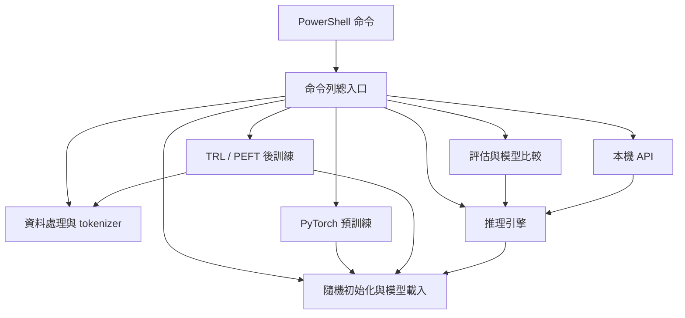
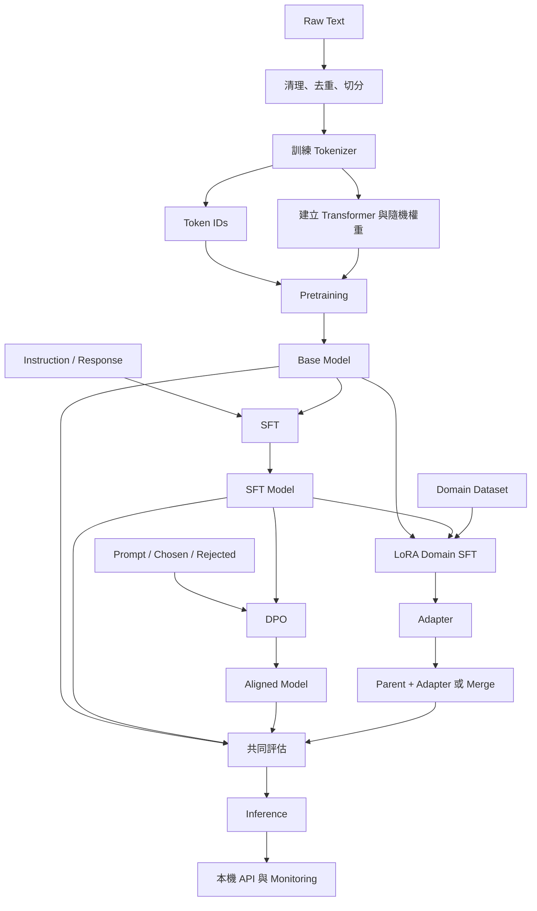

```mermaid
flowchart LR
    A[Issue 與驗收條件] --> B[Branch / Worktree]
    B --> C[Agent 修改與本機驗證]
    C --> D[Pull Request]
    D --> E[CI 與必要 GPU 證據]
    E --> F[Human Review]
    F --> G[受保護 main]
    G --> H[版本化發布候選]
    H --> I[Staging 驗證]
    I --> J[發布批准]
    J --> K[Production]
    K --> L[監控與 Rollback]
```

|                                                                 |     |
| --------------------------------------------------------------- | --- |
| [[#### 建立MiniLLM 並實際跑通完整訓練]]                                    |     |
| [[#### MiniLLM 檔案結構]]                                           |     |
| [[#### 詳細解釋parameters的意義及執行順序]]                                 |     |
| [[#### 怎麼訓練 Tokenizer]]                                         |     |
| [[#### 將 AI Coding Agent 整合進整個 Software Development Lifecycle]] |     |
| [[#### 細解釋並具體舉例要怎麼利用Codex or Claud or AI agent增加/修正code]]       |     |
| [[#### 用 AI 增加功能：近似去重的完整例子整解釋每一步驟]]                             |     |
|                                                                 |     |
|                                                                 |     |


#### 建立MiniLLM 並實際跑通完整訓練
```
我想在 Laptop 上建立一套完整的 Mini LLM在C:\LLM\MiniLLM  
從零預訓練 → 後訓練 → 微調 → 推理.  
要從 GitHub 的 MiniMind 開始，搭配 nanoGPT 與 Hugging Face TRL，建立一套能在 laptop 實際運作的 LLM Training Laboratory。  
目標不是單純下載一個小模型並與它聊天，而是親手操作完整的 LLM Lifecycle，包括：

- 從零建立 Transformer Model，理解 Pretraining 前的模型如何初始化。
- 準備 Raw Dataset，進行 Cleaning、Tokenization、Train/Validation Split。
- 執行 Pretraining，觀察 Loss、Gradient、Optimizer 與 Checkpoint。
- 執行 Supervised Fine-Tuning（SFT），讓 Base Model 學習遵循指令。
- 執行 LoRA Fine-Tuning，理解 Parameter-Efficient Fine-Tuning。
- 執行 DPO Preference Alignment，理解 Post-training。
- 執行 Inference，觀察 Temperature、Top-p、KV Cache 等設定。
- 保存所有 Dataset、Model Weights、Tokenizer、Configuration、Metrics，並比較各階段模型的差異。

要建立的完整 Pipeline  
Raw Text Dataset  
TXT / JSONL / Parquet

Data Processing  
Clean · Deduplicate · Split

Tokenizer Training  
Vocabulary · Token IDs

STAGE 1  
Pretraining from Scratch  
Random Weights → Next-token Prediction  
輸出：Base Model Checkpoint

STAGE 2  
Supervised Fine-Tuning (SFT)  
Instruction / Response Dataset  
輸出：Instruction Model

STAGE 3  
Preference Alignment (DPO)  
Prompt · Chosen · Rejected  
輸出：Aligned Model

STAGE 4 · OPTIONAL BRANCH  
Domain Adaptation (LoRA)  
Base/SFT Model + Domain Dataset  
輸出：LoRA Adapter

Evaluation → Inference → Deployment  
Metrics · Generation · API · Monitoring

注意：這是一條方便教學的主要流程，SFT、LoRA、DPO 不一定只能依照圖中的順序進行。LoRA 是參數更新方法，可以應用於 SFT 或其他訓練階段；DPO 通常從已完成 SFT 的模型開始。  
在每個階段，你都應保存獨立的 Model Checkpoint 與 Evaluation Results，才能清楚觀察每一種訓練對模型產生的影響
```
# 在 Laptop 上建立一套完整的 Mini LLM：從零預訓練 → 後訓練 → 微調 → 推理

我最推薦你從 GitHub 的 MiniMind 開始，搭配 nanoGPT 與 Hugging Face TRL，建立一套能在 laptop 實際運作的 LLM Training Laboratory。

你的目標不是單純下載一個小模型並與它聊天，而是親手操作完整的 LLM Lifecycle，包括：

- 從零建立 Transformer Model，理解 Pretraining 前的模型如何初始化。
    
- 準備 Raw Dataset，進行 Cleaning、Tokenization、Train/Validation Split。
    
- 執行 Pretraining，觀察 Loss、Gradient、Optimizer 與 Checkpoint。
    
- 執行 Supervised Fine-Tuning（SFT），讓 Base Model 學習遵循指令。
    
- 執行 LoRA Fine-Tuning，理解 Parameter-Efficient Fine-Tuning。
    
- 執行 DPO Preference Alignment，理解 Post-training。
    
- 執行 Inference，觀察 Temperature、Top-p、KV Cache 等設定。
    
- 保存所有 Dataset、Model Weights、Tokenizer、Configuration、Metrics，並比較各階段模型的差異。
    

這套流程可以在沒有昂貴 GPU 的情況下學習，但必須依照 laptop 的記憶體及 GPU 選擇模型規模。

## 一、我推薦的 5 個 GitHub Repository


1. [MiniMind](https://github.com/jingyaogong/minimind)

最推薦

完整從零訓練小型 LLM 的教學專案。 包含模型架構、Tokenizer、Pretraining、SFT、LoRA、DPO、RL 及 Inference。2026 年版本提供 64M 參數的 MiniMind-3，也有 26M 的舊版小模型，非常適合練習完整 pipeline。


GitHub

+1


2. [nanoGPT](https://github.com/karpathy/nanoGPT)

最適合理解 Transformer 和 Pretraining 的底層原理。 程式架構簡單，可以把模型縮到數百萬參數，在 CPU 上訓練。提供 Tiny Shakespeare Dataset、Training Script 與 Inference Script。原作者已將它定位為舊版教學專案。


GitHub

+1


3. [nanochat](https://github.com/karpathy/nanochat)

更現代的端到端 LLM Training Framework。 涵蓋 Tokenization、Pretraining、Finetuning、Evaluation、Inference，並能研究 Scaling Laws。官方主要 benchmark 針對高階 GPU，普通 laptop 應縮小模型及資料規模。


GitHub

+1


4. [SmolLM / SmolLM2](https://github.com/huggingface/smollm)

最適合學習如何使用現成 Pretrained Model。 具有 135M、360M 與 1.7B 等模型版本，可以練習 Load Weights、SFT、Evaluation、Inference，也提供訓練相關程式碼。


GitHub


5. [Hugging Face Smol Course](https://github.com/huggingface/smol-course)

最適合學習現代 Post-training。 涵蓋 SFT、Evaluation、DPO、RL 與 Synthetic Data，可與 Hugging Face Transformers、PEFT、TRL 配合。部分課程預設較大模型，需要縮小規模才能在普通 laptop 訓練。


GitHub

+1

### 如何選擇？

|你的學習目標|最佳 Repo|
|---|---|
|看懂並修改 Transformer、Attention、Loss、Backpropagation|nanoGPT|
|親手從 Random Weights 訓練出 Chat Model|MiniMind|
|學習較現代的 Pretraining Pipeline|nanochat|
|使用已預訓練模型練習 Fine-tuning|SmolLM2|
|熟悉 SFT、DPO、PEFT、Alignment|Smol Course|

我的建議是：

主要專案使用 MiniMind，第一個練習使用 nanoGPT，後續再把 Hugging Face TRL 整合進來。

這樣既可以看到完整訓練流程，也能理解真實企業 LLM Engineer 使用的軟體工具。

## 二、你要建立的完整 Pipeline

Raw Text Dataset

TXT / JSONL / Parquet

Data Processing

Clean · Deduplicate · Split

Tokenizer Training

Vocabulary · Token IDs

STAGE 1

Pretraining from Scratch

Random Weights → Next-token Prediction

輸出：Base Model Checkpoint

STAGE 2

Supervised Fine-Tuning (SFT)

Instruction / Response Dataset

輸出：Instruction Model

STAGE 3

Preference Alignment (DPO)

Prompt · Chosen · Rejected

輸出：Aligned Model

STAGE 4 · OPTIONAL BRANCH

Domain Adaptation (LoRA)

Base/SFT Model + Domain Dataset

輸出：LoRA Adapter

Evaluation → Inference → Deployment

Metrics · Generation · API · Monitoring

注意：這是一條方便教學的主要流程，SFT、LoRA、DPO 不一定只能依照圖中的順序進行。LoRA 是參數更新方法，可以應用於 SFT 或其他訓練階段；DPO 通常從已完成 SFT 的模型開始。

在每個階段，你都應保存獨立的 Model Checkpoint 與 Evaluation Results，才能清楚觀察每一種訓練對模型產生的影響。

## 三、Laptop 硬體需要多強？

要先區分兩個任務：

1. 訓練一個小模型以了解演算法：1M–30M 參數就很有學習價值。
    
2. 訓練一個可以正常回答各種問題的 LLM：即使只有 100M–500M 參數，也需要相對大量的高品質資料與運算。
    

你現在的目標是第一種，因此不需要一開始就使用 1B、7B 或 8B 模型。

依 Laptop 的 GPU 選擇模型

CPU only

4 GB VRAM

8 GB VRAM

16+ GB VRAM

建議：1M–10M 參數的 Tiny GPT使用 nanoGPT 的小模型設定。能操作 Pretraining、Checkpoint、Inference；小資料 SFT、DPO 可以嘗試，但訓練會比較慢。

以上是保守的起始實驗規模，不是硬體上限或保證能完整訓練的規格。實際可行性受到 RAM、序列長度、Batch Size、Optimizer、訓練精度與 Windows 環境影響。

在 Windows 11 可以先使用 PowerShell 查詢硬體：

```
# CPU 與記憶體
Get-CimInstance Win32_Processor |
  Select-Object Name

Get-CimInstance Win32_ComputerSystem |
  Select-Object TotalPhysicalMemory

# NVIDIA GPU（若已安裝 NVIDIA 驅動）
nvidia-smi
```

如果 laptop 沒有 NVIDIA GPU，我建議先以 CPU 跑 nanoGPT；如果有 NVIDIA GPU，則可以直接開始 MiniMind。

## 四、第一個實驗：用 nanoGPT 從零訓練 Transformer

這是我最推薦你先做的實際動手練習。

目標是建立約 1M–2M 參數級的 Tiny GPT，從 Random Initialization 開始 Pretraining，而不是下載 GPT-2 權重。

### Step 1：建立 Python 環境

在 Windows PowerShell 執行：

```
mkdir D:\LLM-Lab
cd D:\LLM-Lab

git clone https://github.com/karpathy/nanoGPT.git
cd nanoGPT

py -3.11 -m venv .venv
.\.venv\Scripts\Activate.ps1

python -m pip install --upgrade pip
pip install torch numpy transformers datasets tiktoken tqdm
```

這裡先以 CPU 版本作為通用起點；有 NVIDIA GPU 時，應依 [PyTorch 官方安裝頁](https://pytorch.org/get-started/locally/) 選擇對應 CUDA 版本，並驗證：

```
import torchprint(torch.__version__)print(torch.cuda.is_available())
```

### Step 2：產生 Pretraining Dataset

執行：

```
python data/shakespeare_char/prepare.py
```

這份小型 Shakespeare 資料會進行字元級 Tokenization，產生：

```
nanoGPT/
├── data/
│   └── shakespeare_char/
│       ├── input.txt
│       ├── train.bin
│       ├── val.bin
│       ├── meta.pkl
│       └── prepare.py
├── model.py
├── train.py
└── sample.py
```

各檔案的用途：

|檔案|作用|
|---|---|
|`input.txt`|原始文字|
|`prepare.py`|Tokenization 與 Train/Val 切分|
|`train.bin`|訓練 Token IDs|
|`val.bin`|驗證 Token IDs|
|`meta.pkl`|字元 Vocabulary 與映射資訊|
|`model.py`|Transformer 架構|
|`train.py`|Optimizer、Forward、Backward、Training Loop|
|`sample.py`|Autoregressive Inference|

這是實際存在於 nanoGPT 的入門資料處理路徑。


GitHub

### Step 3：開始 Pretraining

下面是我建議的 CPU 小模型設定：

```
python train.py config/train_shakespeare_char.py `
  --device=cpu `
  --compile=False `
  --dtype=float32 `
  --init_from=scratch `
  --n_layer=4 `
  --n_head=4 `
  --n_embd=64 `
  --block_size=64 `
  --batch_size=8 `
  --max_iters=500 `
  --lr_decay_iters=500 `
  --eval_interval=100 `
  --eval_iters=10 `
  --always_save_checkpoint=True
```

這個設定的重點是縮小：

- Transformer Layers：4
    
- Attention Heads：4
    
- Embedding Dimension：64
    
- Context Window：64 字元
    
- Training Iterations：500
    

它不是一個有實用聊天能力的模型，但非常適合觀察 Pretraining 的基本機制。

### Step 4：觀察訓練過程

在每次 Iteration，主要發生：

\[ X\rightarrow Embedding\rightarrow Transformer\rightarrow Logits \]

再計算：

\[ L=-\frac{1}{N}\sum_{i=1}^{N}\log P(x_{i+1}\mid x_{\le i}) \]

接著執行：

```
logits, loss = model(X, Y)loss.backward()optimizer.step()optimizer.zero_grad()
```

這段是概念化的 PyTorch 訓練循環；實際 nanoGPT 還有 Gradient Accumulation、Learning Rate Scheduling、Evaluation、Checkpoint Saving 等細節。

請特別觀察：

1. Training Loss 是否下降。
    
2. Validation Loss 是否下降。
    
3. Learning Rate 如何變化。
    
4. 每次訓練 Iteration 的耗時。
    
5. 是否發生 Overfitting。
    

### Step 5：執行 Inference

完成訓練後：

```
python sample.py `
  --out_dir=out-shakespeare-char `
  --device=cpu `
  --start="ROMEO:"
```

你可能得到一些模仿 Shakespeare 對話格式的文字，雖然語意未必通順。

這時你已經完成了一個真正的 LLM 原型：從零建立權重、準備 Dataset、Pretraining、儲存 Checkpoint、重新載入並產生文字。

### Step 6：認識 Model Checkpoint

Checkpoint 一般儲存在：

```
out-shakespeare-char/
└── ckpt.pt
```

可以用以下程式觀察模型參數（只載入可信來源的 checkpoint）：

```
import torchckpt = torch.load(    "out-shakespeare-char/ckpt.pt",    map_location="cpu",    weights_only=False,)print(ckpt.keys())print(ckpt["model_args"])print(ckpt.get("iter_num"))print(ckpt.get("best_val_loss"))
```

由於這個舊版 nanoGPT 使用了包含 Python 物件的 checkpoint 格式，上例設定 `weights_only=False`；不要用它讀取不可信的 `.pt` 檔案。

在這個階段，建議你再做三次實驗：改變 Transformer Layers（2、4、6）、改變 Context Length（32、64、128），以及比較不同 Learning Rate 對 Loss 的影響。

## 五、第二個實驗：MiniMind 完整 Pretraining → SFT → DPO

完成 nanoGPT 後，接下來就不只是模仿文章，而是要讓模型學習接受 Instructions，並嘗試偏好對齊。

MiniMind 是比較符合這個目標的選擇。

### Step 1：下載 MiniMind

```
cd D:\LLM-Lab

git clone https://github.com/jingyaogong/minimind.git

cd minimind

py -3.11 -m venv .venv
.\.venv\Scripts\Activate.ps1

pip install -r requirements.txt
```

MiniMind 2026 年已經有新版模型與新的 Dataset 格式，因此應遵照當前版本 README 對應的訓練程式，不應混用舊版 MiniMind2 的檔案配置與新版 MiniMind-3 模型。


GitHub

### Step 2：準備三種不同的 Dataset

這是理解完整 pipeline 最重要的地方。

A. Pretraining Dataset

學習目標：預測下一個 Token。

```
{"text":"The Earth revolves around the Sun."}
{"text":"A neural network consists of layers."}
{"text":"Machine learning uses training data."}
```

模型學的是文字分布與語言規律，而不是明確的問答規則。

B. SFT Dataset

學習目標：根據 User Instruction 產生 Assistant Response。

```
{
  "messages": [
    {"role":"user","content":"What is a GPU?"},
    {"role":"assistant","content":"A GPU is a processor designed for parallel computation."}
  ]
}
```

這是通用對話資料結構的示例。實際進入 Training Script 前，需要轉成該模型 Chat Template 接受的格式。

C. DPO Preference Dataset

學習目標：讓模型提高 Preferred Response 的相對機率。

```
{
  "prompt":"Explain overfitting.",
  "chosen":"Overfitting occurs when a model learns training-specific patterns and generalizes poorly.",
  "rejected":"Overfitting means training is always successful."
}
```

這三個欄位是典型 DPO 格式。實際使用前，應配合 Tokenizer 與 Chat Template 做前處理。

### Step 3：執行各階段訓練

MiniMind 的實際流程可以整理成：

```
Random Initialization
       |
       v
Pretraining
       |
       +--> pretrained_model/
       |
       v
Supervised Fine-tuning
       |
       +--> sft_model/
       |
       v
Direct Preference Optimization
       |
       +--> dpo_model/
       |
       v
Inference / Evaluation
```

另外可以由 Pretrained 或 SFT Model 分支進行：

```
Pretrained / SFT Model
       |
       v
LoRA Training
       |
       +--> lora_adapter/
       |
       v
Load Base + Adapter
       |
       v
Inference
```

這裡我建議你先以各階段 100–500 Steps 進行 Pipeline Smoke Test，確認完整執行、儲存、載入與推理，再決定是否增加訓練步數。

100–500 Steps 不代表模型會訓練成功，而是確認程式、資料、GPU 與 Checkpoint 的完整鏈路能運作。

## 六、我建議你建立的 LLM Laboratory 資料夾

實際學習時，我建議把程式、Dataset、模型權重、訓練紀錄分開保存，而不是全部混在 Repository 裡。

以下是你可以自行建立的實驗室結構，不是 MiniMind 原始 Repo 的預設目錄。

D:\LLM-Lab

repos/

nanoGPT、MiniMind、Smol Course 原始碼

datasets/raw/

原始文字資料

datasets/processed/

清理、切分及 Tokenization 後的資料

datasets/sft/

Instruction / Response 資料

datasets/preference/

DPO Chosen / Rejected 資料

tokenizer/

Tokenizer、Vocabulary、Chat Template

configs/

Model、Training、Optimizer、Scheduler 設定

checkpoints/pretrain/

Base Model 權重

checkpoints/sft/

SFT Model 權重

checkpoints/dpo/

DPO Model 權重

adapters/lora/

LoRA Adapter 權重

evaluations/

不同模型的測試結果

logs/

Loss、Learning Rate、Memory、Throughput

inference/

Inference Scripts、API、生成結果

### 各種訓練應保留哪些檔案？

|階段|主要輸入|主要輸出|
|---|---|---|
|Tokenizer|Raw text|`tokenizer.json`、Vocabulary|
|Pretraining|Token IDs、Model Config|Base Model Weights、Optimizer State|
|SFT|Base Model、Instruction Dataset|SFT Checkpoint|
|LoRA|Base Model、Domain Dataset|Adapter Weights、Adapter Config|
|DPO|SFT Model、Preference Dataset、Reference Policy|Aligned Model|
|Evaluation|Model、Test Dataset|Loss、Accuracy、Preference Metrics|
|Inference|Weights、Tokenizer、Generation Config|Generated Text、Latency Metrics|

還應保存資料版本、Random Seed、Git Commit、Package Versions、Training Config，以及用來恢復訓練的 Scheduler 和 RNG State（適用時）。這些是確保實驗可重現的關鍵。

## 七、建議完成的 8 個實驗

LLM Training Lab 進度

0 / 8

Experiment 1 — 從 Random Weights 建立 Tiny GPT

nanoGPT · 理解 Transformer、Embedding、Attention、Next-token Prediction

Experiment 2 — 研究 Tokenizer

nanoGPT / Hugging Face · 比較 Character、BPE、Vocabulary Size

Experiment 3 — Pretraining 與 Scaling

MiniMind · 比較模型參數量、資料量、Loss、Training Time

Experiment 4 — SFT Instruction Tuning

MiniMind / TRL · 比較 Base Model 與 SFT Model 的問答能力

Experiment 5 — Full Fine-tuning vs LoRA

MiniMind / PEFT · 比較 Trainable Parameters、VRAM、訓練結果

Experiment 6 — DPO Preference Alignment

TRL · 比較 Chosen / Rejected Response 的 Log Probability

Experiment 7 — Inference Optimization

PyTorch / Transformers · 測試 KV Cache、Temperature、Top-p、Tokens/sec

Experiment 8 — Evaluation 與 Deployment

Transformers / FastAPI · 比較 Checkpoints、建立本地 API

## 八、額外建議：用同一組問題比較各階段的 Model

訓練不同階段後，建議使用完全相同的 Held-out Test Set 評估。

例如在開始之前先保留 50–100 道測試問題，這些問題不能進入任何訓練資料。

|測試題目|Pretrained|SFT|DPO|
|---|---|---|---|
|What is machine learning?|記錄輸出|記錄輸出|記錄輸出|
|Explain gradient descent.|記錄輸出|記錄輸出|記錄輸出|
|What is overfitting?|記錄輸出|記錄輸出|記錄輸出|
|Explain a Transformer.|記錄輸出|記錄輸出|記錄輸出|

以上是測試設計，而不是預期結果。對非常小、訓練資料有限的模型，SFT 或 DPO 後未必會產生合理回答。

你應該比較的指標包括：

- Pretraining：Train Loss、Validation Loss、Perplexity。
    
- SFT：Held-out Answer Quality、Instruction Following。
    
- DPO：Preference Accuracy、Chosen vs Rejected Log-probability Margin。
    
- Inference：Time to First Token、Tokens/sec、Peak Memory。
    
- Training Efficiency：Steps/sec、Trainable Parameters、Peak VRAM。
    

另外，DPO 不是 Reinforcement Learning 的完整替代練習。如果未來想理解 RLHF、PPO、GRPO，應再增加 Reward Model、Rollout、Policy Optimization 等實驗。

## 九、最後的技術路線建議

第一階段：nanoGPT（CPU 也能開始）

先從 1M–2M 參數左右的小模型開始，真正理解 Model Architecture、Forward/Backward、Optimizer、Checkpoint、Inference。

第二階段：MiniMind（完整 Training Pipeline）

使用 26M–64M 模型，完成 Pretraining、SFT、LoRA、DPO，建立完整的 Dataset 與 Model Versioning。

第三階段：Hugging Face（較接近 Production）

使用 Transformers、Datasets、PEFT、TRL、Accelerate，學習模型部署、量化與訓練評估。從 SmolLM2-135M 等小模型開始。

這三個階段會讓你從「理解模型如何訓練」逐步進入「能設計、實驗和評估完整 LLM Pipeline」的程度。

### 我還需要確認你的 Laptop 規格

這會直接決定適合 2M、26M、64M 還是 135M 的模型，以及能不能在本機完成 SFT、DPO 與 LoRA。

CPU 型號

RAM

8 GB

16 GB

32 GB

64 GB+

GPU 型號或顯示記憶體

依硬體規格設計完整實作教學

最重要的是：我建議你最後不只得到一個可以聊天的模型，而是得到一套可以重複實驗的 LLM Training Laboratory。 每次修改 Dataset、Model Architecture、Loss Function、Learning Rate、SFT/DPO 策略，都能重新訓練、比較結果，這才是對學習 LLM Engineering 最有價值的部分。


#### MiniLLM 檔案結構
```
請詳細解釋這個repo的檔案結構每個檔案的作用是甚麼, 以及詳細解釋完整的 LLM Lifecycle的的每一步驟是甚麼以及跟那些檔案有關
```

這個 repo 可以分成三個層次來理解：

1. **實驗程式**：定義資料處理、模型初始化、訓練、評估與推理怎麼執行。
2. **實驗設定與原始資料**：決定模型大小、訓練步數，以及模型要學習什麼。
3. **實驗產物**：保存 tokenizer、權重、checkpoint、metrics 和各階段的比較結果。

其中，**MiniMind 提供主模型架構；我們的程式負責預訓練迴圈；TRL 負責 SFT、DPO；PEFT 負責 LoRA；nanoGPT 是獨立的預訓練對照模型。**

以下依照目前磁碟上的實際程式說明。我們建立的程式檔會逐一解釋；第三方套件、上游圖片與快取則按用途說明。

---

先看整個目錄的分工：

```
C:\LLM\MiniLLM\
│
├─ README.md                    操作手冊
├─ requirements.txt             主要 Python 套件版本
├─ requirements.lock.txt        完整套件版本快照
├─ upstream-lock.json           MiniMind / nanoGPT 的固定版本
├─ .gitignore                   不納入 Git 的檔案規則
│
├─ configs\                     實驗設定
│  ├─ smoke.json
│  ├─ laptop.json
│  └─ laptop-check.json
│
├─ minillm\                     實驗室的主要 Python 程式
│  ├─ __init__.py
│  ├─ __main__.py
│  ├─ common.py
│  ├─ data.py
│  ├─ modeling.py
│  ├─ pretrain.py
│  ├─ posttrain.py
│  ├─ evaluate.py
│  ├─ inference.py
│  └─ api.py
│
├─ scripts\                     PowerShell 入口與驗證工具
│  ├─ setup.ps1
│  ├─ lab.ps1
│  ├─ smoke.ps1
│  ├─ monitor.ps1
│  ├─ verify_services.py
│  └─ report_validation.py
│
├─ data\
│  └─ demo\                     原始教學資料
│
├─ artifacts\                   每次實驗的獨立產物
│  ├─ smoke\
│  └─ laptop-check\
│
├─ reports\                     環境、測試與服務驗證結果
├─ tests\                       行為正確性測試
├─ vendor\                      MiniMind / nanoGPT 原始碼
├─ .venv\                       本專案的 Python 執行環境
└─ .cache\                      套件、資料與測試快取
```

**最外層的五個檔案，負責操作與版本重現。**

|檔案|作用|
|---|---|
|[README.md](C:/LLM/MiniLLM/README.md)|繁中操作手冊，包含環境安裝、資料格式、各階段命令、續訓、推理與 API 操作。|
|[requirements.txt](C:/LLM/MiniLLM/requirements.txt)|固定主要依賴，例如 Transformers、TRL、PEFT、Datasets、TensorBoard、FastAPI。|
|[requirements.lock.txt](C:/LLM/MiniLLM/requirements.lock.txt)|記錄實際安裝後的完整套件版本，包含間接依賴，讓環境更容易重建。|
|[upstream-lock.json](C:/LLM/MiniLLM/upstream-lock.json)|固定 MiniMind、nanoGPT 的 GitHub URL、commit 和授權資訊，避免上游更新後行為改變。|
|[.gitignore](C:/LLM/MiniLLM/.gitignore)|排除虛擬環境、快取、模型產物、大型原始資料和 vendor 等檔案。這些檔案仍保存在磁碟，只是不預設交給 Git 管理。|

需要分清楚：**套件版本、上游程式版本、資料版本、模型設定，都是重現實驗的一部分。** 只保存模型權重，無法完整回答「這個模型是怎麼訓練出來的」。

---

**`minillm` 是整套 laboratory 的核心。**

|檔案|作用與主要內容|
|---|---|
|[__init__.py](C:/LLM/MiniLLM/minillm/__init__.py)|將目錄標示為 Python package，目前主要放套件說明。|
|[__main__.py](C:/LLM/MiniLLM/minillm/__main__.py)|命令列總入口。解析 `prepare`、`init`、`pretrain`、`sft`、`dpo`、`lora`、`infer` 等命令，再呼叫對應模組。|
|[common.py](C:/LLM/MiniLLM/minillm/common.py)|共用工具：JSON/JSONL 讀寫、SHA256、隨機種子、CPU/CUDA 選擇、精度選擇、實驗路徑、版本紀錄和硬體檢測。|
|[data.py](C:/LLM/MiniLLM/minillm/data.py)|原始資料讀取、格式統一、清理、去重、切分、教學資料生成、BPE tokenizer 訓練、token binary 建立，以及 SFT prompt/completion 格式化。|
|[modeling.py](C:/LLM/MiniLLM/minillm/modeling.py)|載入 MiniMind 模型類別，提供 `LabMiniMind` 相容層、隨機初始化、權重統計，以及完整模型／LoRA adapter 載入。|
|[pretrain.py](C:/LLM/MiniLLM/minillm/pretrain.py)|原生 PyTorch 預訓練：抽取 token windows、forward、loss、backward、AdamW 更新、梯度裁切、validation、checkpoint 和續訓。也負責 nanoGPT 對照訓練。|
|[posttrain.py](C:/LLM/MiniLLM/minillm/posttrain.py)|使用 TRL 執行 SFT、DPO，使用 PEFT 執行 LoRA。處理 completion masking、batch padding、累積梯度 loss、reference model、訓練紀錄與續訓身分檢查。|
|[evaluate.py](C:/LLM/MiniLLM/minillm/evaluate.py)|在相同評估資料上比較各階段模型：raw loss、perplexity、SFT/domain completion loss、偏好配對、固定 prompt 生成和 cache benchmark。|
|[inference.py](C:/LLM/MiniLLM/minillm/inference.py)|`Engine` 推理介面：載入模型與 tokenizer、套用 chat template、處理 sampling 設定、產生文字、計時，以及 cached/uncached 比較。|
|[api.py](C:/LLM/MiniLLM/minillm/api.py)|將推理引擎包成 FastAPI，提供健康檢查、文字生成與簡單服務 metrics。|

這些模組的呼叫關係是：

````

````

幾個特別值得閱讀的函式：

|函式／類別|你可以學到什麼|
|---|---|
|`clean()`|原始文字如何正規化。|
|`split_rows()`|為何相同文件或 prompt 必須留在同一個 partition。|
|`prepare()`|資料到 tokenizer、token stream 的完整轉換。|
|`fresh_model()`|模型如何依架構設定和實際 vocabulary 建立。|
|`LabMiniMind._init_weights()`|預訓練前的權重如何初始化。|
|`pretrain.train()`|一個真正的訓練 step 做了哪些事。|
|`CompletionCollator`|不同長度資料如何 padding，以及如何遮罩 prompt。|
|`completion_ce()`|如何只對回答計算 loss，並正確處理 gradient accumulation。|
|`posttrain.train()`|SFT、DPO、LoRA 的分支差異。|
|`Engine.generate()`|推理如何從 prompt 走到生成 token。|

---

**`scripts` 讓你不用每次手動處理 Python 路徑和啟動細節。**

|檔案|作用|
|---|---|
|[setup.ps1](C:/LLM/MiniLLM/scripts/setup.ps1)|檢查 Python 3.12、下載固定上游版本、建立 `.venv`、安裝 PyTorch 與依賴，最後執行環境檢查。|
|[lab.ps1](C:/LLM/MiniLLM/scripts/lab.ps1)|日常操作入口。切到專案根目錄，使用專案的 Python 執行 `python -m minillm`，並傳遞你的命令參數。|
|[smoke.ps1](C:/LLM/MiniLLM/scripts/smoke.ps1)|一次執行微型完整流程，再跑 nanoGPT，最後更新比較報告。|
|[monitor.ps1](C:/LLM/MiniLLM/scripts/monitor.ps1)|啟動 TensorBoard，讀取指定 run 的訓練曲線。|
|[verify_services.py](C:/LLM/MiniLLM/scripts/verify_services.py)|暫時啟動 API 和 TensorBoard，透過真正 HTTP 驗證，結束後關閉自己啟動的服務。|
|[report_validation.py](C:/LLM/MiniLLM/scripts/report_validation.py)|從已存在的實測產物整理驗證報告；它不會重新訓練模型。|

例如：

```
cd C:\LLM\MiniLLM
.\scripts\lab.ps1 pretrain --run my-lab
```

實際執行路徑是：

```
lab.ps1
  → 專案 .venv 的 Python
  → python -m minillm
  → __main__.py 解析 pretrain
  → pretrain.py 的 train()
```

`all` 命令包含 MiniMind 主流程和 LoRA 分支；**nanoGPT 是由 `smoke.ps1` 額外呼叫的**。`merge`、API 和 TensorBoard 也需要另外啟動。

---

**`configs` 決定一次實驗的規模。**

|檔案|設定與用途|
|---|---|
|[smoke.json](C:/LLM/MiniLLM/configs/smoke.json)|hidden 128、2 layers，執行 40 steps 預訓練、20 SFT、10 DPO、15 LoRA，快速驗證機制。|
|[laptop.json](C:/LLM/MiniLLM/configs/laptop.json)|hidden 512、8 layers，設定較長訓練：2000／500／200／300 steps。|
|[laptop-check.json](C:/LLM/MiniLLM/configs/laptop-check.json)|保留 laptop 架構與 batch 設定，但每階段只跑 2 steps，用於硬體適配檢查。|

各設定欄位的意義如下：

|欄位|意義|
|---|---|
|`seed`|隨機種子，影響資料切分、初始化、抽樣等。|
|`device`|`auto` 自動使用 CUDA，沒有 CUDA 時使用 CPU。|
|`vocab_size`|BPE 訓練的 vocabulary 目標上限。|
|`hidden_size`|每個 token 的內部向量維度。|
|`num_hidden_layers`|Transformer block 數量。|
|`num_attention_heads`|Query attention heads 數量。|
|`num_key_value_heads`|Key/Value heads 數量；少於 Query heads 時使用 GQA。|
|`intermediate_size`|Feed-forward network 的中間維度。|
|`block_size`|預訓練 prediction window，以及 SFT/DPO 配對長度限制。|
|`max_position_embeddings`|模型設定的最大位置容量。|
|`batch_size`|一次 microbatch 的資料數量。|
|`gradient_accumulation_steps`|累積幾個 microbatches 才更新一次權重。|
|`*_steps`|各階段的 optimizer update 次數。|
|`*_lr`|各階段 learning rate。|
|`warmup_ratio`|前面多少比例的 steps 用來逐漸提高 learning rate。|
|`weight_decay`|AdamW 的權重衰減強度。|
|`max_grad_norm`|梯度裁切門檻。|
|`save_steps` / `eval_steps`|保存與評估的間隔。|
|`lora_r` / `lora_alpha`|LoRA 的低秩維度與更新縮放設定。|
|`dpo_beta`|DPO loss 中，policy/reference 相對 log-probability 的尺度參數。|

**訓練長度與推理容量要分開看。** 例如 smoke 的 `block_size=128`，模型的位置容量是 512。推理可以接受容量內的序列，但短序列訓練不代表模型已經學會良好處理更長上下文。

另外，設定 `vocab_size=1024` 不表示最後一定有 1024 個 tokens。目前教學語料的實際 vocabulary 是 **835**；模型 embedding 依照這個實際數量建立。

---

**原始資料與處理後資料放在不同位置。**

目前原始教學資料位於 [data/demo](C:/LLM/MiniLLM/data/demo)：

|檔案|內容與用途|
|---|---|
|[pretrain.jsonl](C:/LLM/MiniLLM/data/demo/pretrain.jsonl)|一般文字文件，用來學習 next-token prediction。|
|[sft.jsonl](C:/LLM/MiniLLM/data/demo/sft.jsonl)|指令與正確回答，用來做 instruction tuning。|
|[dpo.jsonl](C:/LLM/MiniLLM/data/demo/dpo.jsonl)|同一 prompt 的 chosen/rejected 回答，用來學習偏好。|
|[domain.jsonl](C:/LLM/MiniLLM/data/demo/domain.jsonl)|LLM laboratory 領域問答，用於 LoRA domain SFT。|
|[source.json](C:/LLM/MiniLLM/data/demo/source.json)|資料來源、授權與教學用途說明。|

這些資料是本地程式生成的，目的在於驗證流程。預訓練資料還故意加入空白、控制字元和重複文件，以驗證清理功能。

你自己的語料可以另放在 `C:\LLM\MiniLLM\data\raw\`，再透過 `prepare` 指定來源。

---

**`artifacts` 是一次實驗的完整紀錄。**

`--run smoke` 對應 [artifacts/smoke](C:/LLM/MiniLLM/artifacts/smoke)，`--run laptop-check` 對應另一個獨立目錄。

```
C:\LLM\MiniLLM\artifacts\smoke\
│
├─ config.json
├─ data\
│  ├─ manifest.json
│  ├─ pretrain\
│  ├─ sft\
│  ├─ dpo\
│  └─ domain\
│
├─ tokenizer\
├─ initialized\
├─ base\
├─ sft\
├─ dpo\
├─ lora\
├─ merged\
├─ nanogpt\
├─ tensorboard\
├─ evaluation\
└─ api_requests.jsonl
```

各目錄代表模型生命週期的一個狀態：

|目錄|保存什麼|
|---|---|
|`initialized`|尚未訓練的隨機初始化模型。|
|`base`|完成預訓練的完整模型。|
|`sft`|完成指令微調的完整模型。|
|`dpo`|完成偏好對齊的完整模型。|
|`lora`|LoRA adapter，使用時需要它的 parent model。|
|`merged`|將 LoRA 更新合併後的完整模型。|
|`nanogpt`|獨立 GPT 架構的初始化、訓練結果和對照 metrics。|
|`tensorboard`|訓練曲線 event files。|
|`evaluation`|各階段評估、生成樣本與共同報告。|

產物裡有些檔名會反覆出現，因為每個階段都需要自己的獨立版本：

|檔案類型|作用|
|---|---|
|run 根目錄的 `config.json`|整次實驗的設定快照。|
|模型目錄的 `config.json`|模型架構設定，供載入權重時重建網路。|
|`model.safetensors`|完整模型權重。|
|`adapter_model.safetensors`|LoRA adapter 權重，不包含完整 parent model。|
|`adapter_config.json`|LoRA rank、alpha、target modules 等設定。|
|`tokenizer.json`|Vocabulary、BPE merges、編碼與解碼規則。|
|`tokenizer_config.json`|Hugging Face tokenizer 行為設定。|
|`special_tokens_map.json`|PAD、BOS、EOS 等特殊 token 的對應。|
|`chat_template.jinja`|user／assistant 訊息如何轉成文字序列。|
|`generation_config.json`|模型附帶的生成設定；本實驗室推理時還會明確傳入 CLI 設定。|
|`weight_stats.json`|每個參數 tensor 的名稱、形狀、數量、mean/std 與是否可訓練。|
|`lineage.json`|模型的 parent、階段、套件版本、上游 commit，以及後訓練的資料／parent 身分紀錄。|
|`metrics.jsonl`|隨訓練進行追加的逐步紀錄。|
|`initial_eval.json`|預訓練開始時的 validation 結果。|
|`final_metrics.json`|該階段完成後的 metrics 摘要。|
|`trainer_state.json`|HF Trainer 的 global step、log history 等狀態。|
|`training_args.bin`|HF Trainer 的訓練參數序列化檔。|
|模型產物中的 `README.md`|Trainer／PEFT 產生的模型卡或 adapter 說明，不是專案根目錄的操作手冊。|

處理後資料也有明確用途：

|檔案|作用|
|---|---|
|各資料類型的 `train.jsonl`|已清理、格式統一的訓練資料。|
|各資料類型的 `validation.jsonl`|保留用於評估的資料。|
|預訓練的 `train.bin` / `validation.bin`|`int32` token IDs，可用 memory map 讀取。|
|[manifest.json](C:/LLM/MiniLLM/artifacts/smoke/data/manifest.json)|資料來源 SHA256、清理計數、切分方式、token 數與 tokenizer 身分。|

**模型權重與訓練 checkpoint 的差別尤其重要。**

模型權重保存「模型現在知道什麼」；可續訓 checkpoint 還要保存「optimizer 現在走到哪裡」。

原生預訓練的 checkpoint，例如 [base/checkpoint-10](C:/LLM/MiniLLM/artifacts/smoke/base/checkpoint-10)，包含：

- 完整模型權重與 tokenizer。
- `training_state.pt`：optimizer、scheduler、step、CPU/CUDA RNG、配置與資料 manifest 身分。
- `metrics.json`：checkpoint 對應的評估紀錄。

TRL 的 checkpoint，例如 [sft/checkpoint-10](C:/LLM/MiniLLM/artifacts/smoke/sft/checkpoint-10)，使用分開的檔案：

|檔案|作用|
|---|---|
|`optimizer.pt`|AdamW 的動量與平方梯度等狀態。|
|`scheduler.pt`|Learning-rate scheduler 狀態。|
|`rng_state.pth`|隨機數狀態。|
|`trainer_state.json`|訓練步數與歷史紀錄。|
|`training_args.bin`|訓練參數。|
|模型或 adapter 權重|checkpoint 當下的可學習參數。|

**只載入權重再建立新 optimizer，屬於重新開始一段訓練；不等於精確續訓。**

nanoGPT 另使用 `initialized.pt`、`final.pt`、`model_config.json` 和 `generation.json`，因為它是另一套原生 PyTorch 模型。

---

**`reports` 與 `tests` 用來驗證實驗室本身。**

|檔案|作用|
|---|---|
|[tests/test_lab.py](C:/LLM/MiniLLM/tests/test_lab.py)|測試資料切分、tokenizer、masking、causal attention、KV cache、保存重載、LoRA 凍結、續訓一致性與 API。|
|[environment.json](C:/LLM/MiniLLM/reports/environment.json)|實際 GPU、RAM、CUDA 與套件版本。|
|[tests.txt](C:/LLM/MiniLLM/reports/tests.txt)|unittest 執行輸出。|
|[services.json](C:/LLM/MiniLLM/reports/services.json)|API HTTP 回應、服務 metrics 和 TensorBoard scalar tags 的驗證結果。|
|[api-server.log](C:/LLM/MiniLLM/reports/api-server.log)|API 驗證時的服務日誌。|
|[tensorboard-server.log](C:/LLM/MiniLLM/reports/tensorboard-server.log)|TensorBoard 驗證時的服務日誌。|
|[validation.md](C:/LLM/MiniLLM/reports/validation.md)|人類可閱讀的實测摘要。|
|[validation_summary.json](C:/LLM/MiniLLM/reports/validation_summary.json)|程式可讀取的驗證摘要。|

這裡要區分：

- **程式正確性測試**：確認梯度、mask、cache、續訓等機制正確。
- **模型能力評估**：確認模型回答是否有用、正確、符合需求。

目前 11 項測試通過，證明實作機制可運作；模型能力還需要更完整的資料與評估。

---

**`vendor` 保存上游原始碼，主流程只使用其中一部分。**

MiniMind 最重要的是 [model_minimind.py](C:/LLM/MiniLLM/vendor/minimind/model/model_minimind.py)，它定義實際的 Transformer：

|類別／函式|作用|
|---|---|
|`MiniMindConfig`|模型架構設定。|
|`RMSNorm`|對 hidden states 做 RMS normalization。|
|RoPE 相關函式|將位置資訊加入 Query/Key。|
|`Attention`|Q/K/V projections、causal attention、GQA 和 KV cache。|
|`FeedForward`|使用 gated activation 的前饋網路。|
|`MiniMindBlock`|Attention、normalization、MLP 和 residual connections。|
|`MiniMindModel`|Embedding、多個 blocks、最後 normalization。|
|`MiniMindForCausalLM`|加入輸出 head、next-token loss 和生成迴圈。|
|`MOEFeedForward`|上游的 MoE 實作；目前本實驗室設定沒有啟用。|

其他上游檔案的用途：

|上游檔案／群組|用途與目前關係|
|---|---|
|[model_lora.py](C:/LLM/MiniLLM/vendor/minimind/model/model_lora.py)|MiniMind 自己的 LoRA 實作；目前主流程使用 PEFT。|
|[lm_dataset.py](C:/LLM/MiniLLM/vendor/minimind/dataset/lm_dataset.py)|上游各種訓練資料類別；目前主流程使用我們的資料處理模組。|
|[train_tokenizer.py](C:/LLM/MiniLLM/vendor/minimind/trainer/train_tokenizer.py)|上游 tokenizer 訓練。|
|[train_pretrain.py](C:/LLM/MiniLLM/vendor/minimind/trainer/train_pretrain.py)|上游原生預訓練。|
|[train_full_sft.py](C:/LLM/MiniLLM/vendor/minimind/trainer/train_full_sft.py)|上游全參數 SFT。|
|[train_dpo.py](C:/LLM/MiniLLM/vendor/minimind/trainer/train_dpo.py)|上游原生 DPO。|
|[train_lora.py](C:/LLM/MiniLLM/vendor/minimind/trainer/train_lora.py)|上游原生 LoRA 訓練。|
|[trainer_utils.py](C:/LLM/MiniLLM/vendor/minimind/trainer/trainer_utils.py)|上游的 LR、logging、checkpoint、distributed training 等工具。|
|[train_distillation.py](C:/LLM/MiniLLM/vendor/minimind/trainer/train_distillation.py)|Teacher/student 蒸餾訓練。|
|[train_ppo.py](C:/LLM/MiniLLM/vendor/minimind/trainer/train_ppo.py)、[train_grpo.py](C:/LLM/MiniLLM/vendor/minimind/trainer/train_grpo.py)|上游更進階的 reinforcement learning 訓練。|
|[train_agent.py](C:/LLM/MiniLLM/vendor/minimind/trainer/train_agent.py)、[rollout_engine.py](C:/LLM/MiniLLM/vendor/minimind/trainer/rollout_engine.py)|Agent/tool-use 訓練與 rollout 支援。|
|[eval_llm.py](C:/LLM/MiniLLM/vendor/minimind/eval_llm.py)|上游模型測試入口。|
|[convert_model.py](C:/LLM/MiniLLM/vendor/minimind/scripts/convert_model.py)|上游模型格式轉換工具。|
|[serve_openai_api.py](C:/LLM/MiniLLM/vendor/minimind/scripts/serve_openai_api.py)、[chat_api.py](C:/LLM/MiniLLM/vendor/minimind/scripts/chat_api.py)、[web_demo.py](C:/LLM/MiniLLM/vendor/minimind/scripts/web_demo.py)|上游服務、API 客戶端和網頁展示工具。|
|[eval_toolcall.py](C:/LLM/MiniLLM/vendor/minimind/scripts/eval_toolcall.py)|上游 tool calling 評估。|

上游附帶的 tokenizer 檔也保留下來，但**目前實驗使用的是自己重新訓練的 tokenizer**。

nanoGPT 的主要檔案如下：

|檔案／群組|作用|
|---|---|
|[model.py](C:/LLM/MiniLLM/vendor/nanogpt/model.py)|GPT 模型定義；我們的對照訓練直接使用它。|
|[train.py](C:/LLM/MiniLLM/vendor/nanogpt/train.py)|上游原始訓練入口；我們目前使用共用預訓練迴圈。|
|[sample.py](C:/LLM/MiniLLM/vendor/nanogpt/sample.py)|上游文字生成入口。|
|[bench.py](C:/LLM/MiniLLM/vendor/nanogpt/bench.py)|訓練效能 benchmark。|
|[configurator.py](C:/LLM/MiniLLM/vendor/nanogpt/configurator.py)|上游的設定檔／命令列覆寫機制。|
|[config](C:/LLM/MiniLLM/vendor/nanogpt/config)|Shakespeare、GPT-2 訓練、微調和評估範例設定。|
|[data](C:/LLM/MiniLLM/vendor/nanogpt/data)|Shakespeare/OpenWebText 的原始資料準備範例。|
|[scaling_laws.ipynb](C:/LLM/MiniLLM/vendor/nanogpt/scaling_laws.ipynb)、[transformer_sizing.ipynb](C:/LLM/MiniLLM/vendor/nanogpt/transformer_sizing.ipynb)|模型大小、計算需求與 scaling 的探索 notebook。|

兩個上游的 README、LICENSE、圖片和 assets 是說明、授權與展示資料；它們不參與目前的訓練計算。

TRL、PEFT 等已安裝套件在 [`.venv`](C:/LLM/MiniLLM/.venv) 裡，不在 vendor。`__pycache__` 是 Python 自動產生的編譯快取，通常不需要閱讀或修改。

---

接著把這些檔案串成完整 LLM lifecycle：

````

````

**第一步：定義實驗與確認硬體。**

在訓練前，你先決定：

- 模型架構多大。
- 要使用哪個 tokenizer。
- 每次看多少 tokens。
- 一次更新使用多少資料。
- 訓練幾個 steps。
- 要記錄與比較哪些指標。

本 repo 由設定檔決定這些條件，`doctor` 則執行真實 CUDA 運算並記錄 GPU、RAM 和版本。

```
cd C:\LLM\MiniLLM
.\scripts\lab.ps1 doctor
```

相關程式是共用工具模組的 `doctor()`；結果寫到環境報告。

`prepare` 會將選用設定複製到該 run。之後各階段讀取這份快照，而不是一直依賴外部設定檔。

---

**第二步：取得 Raw Dataset。**

不同訓練目標需要不同資料。

預訓練使用一般文字：

```
{"text":"Transformer uses attention to connect tokens."}
```

SFT 使用指令與回答：

```
{"instruction":"Explain SFT.","output":"SFT trains a model on instruction-response examples."}
```

DPO 使用偏好配對：

```
{"prompt":"What is 2 + 3?","chosen":"5","rejected":"9"}
```

LoRA domain SFT 使用特定領域的指令與回答，格式可以和 SFT 相同。

資料模組的 `read_rows()` 支援：

- TXT：空白行分隔文件，供預訓練使用。
- JSONL：每行一個 JSON record。
- Parquet：以 batches 讀取欄位資料。

Raw data 在這個階段仍然是文字，還不是神經網路能直接計算的 tensor。

---

**第三步：Cleaning、Deduplication 和 Train/Validation Split。**

資料模組依序做三件事。

首先是清理：

- Unicode NFKC 正規化。
- 統一換行。
- 移除控制字元。
- 壓縮空白。
- 移除空紀錄。

接著統一資料格式，例如把 `instruction/output` 轉成 `messages`。

最後做精確去重和分組切分。切分概念是：

```
SHA256(seed + normalized document/prompt)
    → 固定分配到 train 或 validation
```

約 10% 的 hash buckets 用於 validation，因此不是精確的 90/10 筆數比例。

同一 prompt 的不同回答必須留在同一側，否則模型可能訓練時已見過相同題目，評估結果就容易被高估。

目前 smoke 的資料結果是：

|類型|Train|Validation|
|---|---|---|
|Pretraining|262 文件|19 文件|
|SFT|102 筆|18 筆|
|DPO|102 配對|18 配對|
|Domain|75 筆|5 筆|

這裡做的是**精確去重與相同 prompt 分組**，尚未消除近似、語意相同或模板相似的資料。目前也只有 train/validation，沒有另外建立獨立 test set。

---

**第四步：訓練 Tokenizer。**

Tokenizer 決定文字如何變成整數序列：

```
文字 → tokens → token IDs
```

Token 不一定是一個完整單字，也不一定是一個中文字；byte-level BPE 可以把文字拆成較小片段，再學習常見片段的合併規則。

本 repo 的 `prepare()`：

1. 建立 byte-level BPE。
2. 使用完整 byte alphabet。
3. 只從 pretraining 的 train partition 學習 vocabulary。
4. 加入 PAD、BOS、EOS 和 chat special tokens。
5. 保存 tokenizer 和 chat template。

**訓練 tokenizer 與訓練 Transformer 是兩件不同的事。** Tokenizer 學習文字切分規則；Transformer 學習 token 序列的條件機率。

所有模型階段使用相同 token IDs。若換 tokenizer，原本 embedding 的每一列就可能對應到不同文字，不能直接沿用原權重。

---

**第五步：Tokenization 與建立訓練輸入。**

預訓練文字經 tokenizer 轉換後，在每份文件末尾加入 EOS，接成 token stream，保存為 binary。

例如概念上：

```
文件 A 的 IDs → EOS → 文件 B 的 IDs → EOS
```

Memory map 讓程式能按位置讀取 token windows，而不必先把整個 binary 檔複製進一般 Python list。

目前 smoke 有：

- 8,388 個訓練 tokens。
- 678 個 validation tokens。

SFT 和 DPO 的格式不同，因此不直接使用這份預訓練 binary；它們在後訓練時，將 prompt 和回答 tokenization。

這個 repo 會對過長的 SFT/DPO 配對報錯，讓你明確決定增加 context 或縮短資料。

---

**第六步：建立 Transformer 並隨機初始化。**

這一步決定網路結構，但模型還沒有透過資料學習。

一個 token 經過模型的主要路徑是：

```
Token ID
  → Embedding vector
  → Transformer blocks
  → Final normalization
  → Output projection
  → Vocabulary logits
```

Transformer block 裡：

- **Attention**：讓目前位置利用前面 tokens 的資訊。
- **Causal mask**：阻止位置看到後面的答案。
- **RoPE**：提供位置資訊。
- **GQA**：讓多個 Query heads 分享較少的 Key/Value heads。
- **Feed-forward network**：對每個位置的表示做非線性轉換。
- **Residual connections**：幫助資訊與梯度通過多層網路。

`fresh_model()` 根據配置及实际 vocabulary 建立模型。

初始化規則在 `LabMiniMind._init_weights()`：

- Linear、Embedding：Normal(0, 0.02)。
- RMSNorm scale：1。
- Linear bias：若存在則設為 0。
- 輸入 embedding 和輸出 head 分享權重。

所以「隨機初始化」不表示每個 tensor 都是隨機數。

```
.\scripts\lab.ps1 init --run my-lab
```

輸出是 `initialized` 模型。你可以查看權重統計，或對它做推理，觀察尚未訓練時的輸出。

---

**第七步：Pretraining from Scratch。**

目標是學習：

> 已知前面的 tokens，下一個 token 應該是什麼？

假設一段 token sequence 是：

```
[t0, t1, t2, t3]
```

訓練目標包含：

```
看到 t0         → 預測 t1
看到 t0,t1      → 預測 t2
看到 t0,t1,t2   → 預測 t3
```

所有位置可以在同一次 forward 裡計算，causal attention 保證每個位置只使用允許的前文。

Loss 是 next-token cross entropy：

\[ L_{\text{pretrain}} = -\frac{1}{N}\sum_t \log p_\theta(x_{t+1}\mid x_{\le t}) \]

一次 optimizer step 的工作順序是：

1. 從訓練 token stream 抽取 windows。
2. Forward，取得 logits。
3. 計算正確下一個 token 的 loss。
4. Backward，計算每個可訓練參數的 gradient。
5. 累積 microbatch gradients。
6. 裁切 gradient norm。
7. AdamW 更新權重。
8. 更新 learning-rate scheduler。
9. 依間隔評估與保存 checkpoint。

**Gradient 告訴 optimizer，參數變動會如何影響 loss；optimizer 利用 gradient 與歷史狀態，決定實際更新。**

單 GPU 的有效 batch 數大致是：

\[ \text{effective batch} = \text{batch size} \times \text{gradient accumulation steps} \]

Laptop 設定是 \(2\times8=16\) 個 windows／optimizer update。預訓練每個 window 有 256 個 next-token targets，因此每次更新處理 4,096 個 targets。

MiniMind 使用 `L+1` 個輸入 tokens 計算 `L` 個 shifted targets；nanoGPT 則以 `L` 個輸入和右移 targets 計算相同數量的預測目標。

```
.\scripts\lab.ps1 pretrain --run my-lab
```

輸出為 Base Model。此時模型可能學會文字模式和一些知識，但不一定會遵循使用者指令。

---

**第八步：Supervised Fine-Tuning，讓 Base Model 學習回答指令。**

SFT 從 Base weights 接著訓練，架構與 tokenizer 不變。

指令會先套用 chat template：

```
<|im_start|>user
What is 2 + 3?<|im_end|>
<|im_start|>assistant
5<|im_end|>
```

我們希望模型讀懂問題，並學習生成回答。因此：

- Prompt 參與 forward，提供上下文。
- Prompt 不計入直接的 token loss。
- 回答與 EOS 計入 loss。
- Padding 不計入 loss。

`CompletionCollator` 將 prompt 和 padding 的 labels 設為 `-100`。這是 loss 的忽略標記，不是 vocabulary 中的 token ID。

Prompt 被遮罩後仍然能影響模型計算；它只是沒有被當成需要生成的監督目標。

`completion_ce()` 對回答 tokens 的 loss 求和，再按監督 token 數正規化。這能讓不同回答長度下的 gradient accumulation 對應到完整 batch 的計算。

TRL 的 `SFTTrainer` 負責訓練排程、optimizer、evaluation 和 checkpoint；completion-only training 也是 TRL 支援的正式訓練方式。[TRL SFT 文件](https://huggingface.co/docs/trl/v0.24.0/en/sft_trainer)

```
.\scripts\lab.ps1 sft --run my-lab
```

輸出為完整的 Instruction Model，這個分支更新全模型參數。

---

**第九步：DPO，從指令能力進一步學習偏好。**

SFT 示範一個回答；DPO 提供同一題的兩個回答，以及哪一個比較好。

本 repo 預設載入兩份 SFT 模型：

- **Policy model**：接受更新。
- **Reference model**：凍結，作為比較基準。

令 prompt 為 \(x\)，chosen 為 \(y^+\)，rejected 為 \(y^-\)，DPO 比較的是：

\[ \Delta = \left[ \log \pi_\theta(y^+\mid x) - \log \pi_{\text{ref}}(y^+\mid x) \right] - \left[ \log \pi_\theta(y^-\mid x) - \log \pi_{\text{ref}}(y^-\mid x) \right] \]

本 repo 使用 sigmoid loss：

\[ L_{\text{DPO}}=-\log \sigma(\beta\Delta) \]

它促使 policy 相對於 reference，更偏向 chosen 而不是 rejected。

DPO 不要求另外訓練一個獨立 reward model，也不需要像 PPO 那樣在這個訓練流程中執行 rollout。這是 DPO 原始方法的重要特性。[DPO 論文](https://arxiv.org/abs/2305.18290)

```
.\scripts\lab.ps1 dpo --run my-lab
```

輸出為 Aligned Model。要觀察的 metrics 包含 DPO loss、reward margin 和偏好 accuracy。

**DPO loss 和預訓練 cross entropy 是不同目標，數字不能直接互相比大小。** 而目前教學偏好是程式生成的加法配對，還不能代表廣泛的人類偏好。

---

**第十步：LoRA Domain Adaptation。**

LoRA 是「怎麼更新參數」的方法；SFT、DPO 是「用什麼目標訓練」。

本 repo 的 LoRA 分支使用 domain 指令資料，做 SFT：

```
SFT Model + Domain instruction data
    → PEFT LoRA
    → Adapter
```

對原始矩陣 \(W\)，LoRA 使用：

\[ W'=W+\frac{\alpha}{r}BA \]

其中原始 \(W\) 凍結，只有低秩矩陣 \(A\)、\(B\) 被更新。[LoRA 論文](https://arxiv.org/abs/2106.09685)

例如 \(W\) 是 \(512\times512\)：

- 全矩陣有 262,144 個參數。
- 若 \(r=8\)，兩個低秩矩陣合計 \(8\times512+512\times8=8,192\) 個參數。

本 repo 對 attention 和 MLP projections 加入 LoRA，包括 `q_proj`、`k_proj`、`v_proj`、`o_proj`、`gate_proj`、`up_proj`、`down_proj`。

```
.\scripts\lab.ps1 lora --run my-lab --parent sft
```

也可以選 Base 或 DPO 作 parent。

目前 smoke 的 adapter 有 38,912 個可訓練參數，約占包含 adapter 後模型的 7.21%。低比例可減少 optimizer state，但 forward 和 activation 計算仍然存在。

使用 adapter 推理時，載入程式會確認 parent weights 的 SHA256，避免把 adapter 接到錯誤模型。

若要產生獨立完整模型：

```
.\scripts\lab.ps1 merge --run my-lab
```

合併後權重寫到 `merged`，原始 parent 和 adapter 仍保留。

---

**第十一步：用共同評估資料比較各階段。**

各階段的訓練 loss 不同，因此需要共同評估協議。

評估程式對每個模型使用相同的：

- Raw validation windows。
- Held-out SFT 回答。
- Held-out domain 回答。
- DPO 配對。
- 固定生成 prompts。
- KV cache benchmark。

```
.\scripts\lab.ps1 evaluate --run my-lab
```

主要指標：

|指標|說明|
|---|---|
|Raw validation loss|模型對保留文字的 next-token prediction 表現。|
|Perplexity|在這個評估中是 `exp(loss)`；只有相同 tokenizer、資料與協議下才適合比較。|
|SFT completion loss|對保留指令回答的預測表現。|
|Domain completion loss|對領域回答的預測表現。|
|Chosen win rate|chosen 的回答 log-probability 是否高於 rejected。|
|Preference margin|chosen/rejected 的分數差異。|
|Generation samples|真正看模型生成什麼，補足單一數字看不到的問題。|

目前 [比較報告](C:/LLM/MiniLLM/artifacts/smoke/evaluation/comparison.md) 顯示：

|階段|Raw loss|SFT 回答 loss|Domain 回答 loss|
|---|---|---|---|
|Initialized|6.7693|6.8037|6.7083|
|Base|4.2932|6.4739|6.4639|
|SFT|4.3272|4.8764|6.0428|
|DPO|4.3283|4.9068|6.0253|
|LoRA|4.3388|4.9434|5.8047|

這可以觀察到各訓練目標的影響：預訓練降低 raw loss；SFT 改善指令回答；domain LoRA 改善領域回答。

但資料量很小且模板相似，所以這些結果是機制示範。偏好分數也使用整段回答的 log-probability sum，會受回答長度影響。

---

**第十二步：Inference，使用權重生成文字。**

推理不做 backward，也不更新模型權重。

過程是：

```
Prompt
  → Chat template
  → Token IDs
  → Forward
  → 選出下一個 token
  → 加到序列末端
  → 重複
  → Decode 成文字
```

訓練通常一次計算多個位置；生成則需要依序決定下一個 token，因為後面的輸入依賴剛產生的結果。

Sampling 設定控制如何選 token：

|設定|作用|
|---|---|
|Temperature|調整 logits 尺度；較低通常更集中，較高通常更分散。|
|Top-k|僅保留機率最高的 k 個候選；本實驗 `0` 表示關閉。|
|Top-p|保留累積機率達到門檻的候選集合。|
|Greedy|每次取最高分 token。|
|Max new tokens|限制本次新增 token 數。|
|EOS|生成終止標記。|

```
.\scripts\lab.ps1 infer --run smoke --stage sft `
  --prompt "Explain SFT." --temperature 0.8 --top-p 0.9
```

**KV cache 保存已處理 tokens 的 Key/Value tensors**，讓下一次生成不用重算全部前文的 K/V。它仍需要計算新 token，並讓新的 Query 與前文 Key/Value 做 attention。

這裡有三種完全不同的「cache／保存」：

- 磁碟 `.cache`：套件與資料快取。
- Training checkpoint：長期保存模型和訓練狀態。
- KV cache：一次生成過程中的暫時 attention 狀態。

`*_cache.json` 保存的是 benchmark 結果，不是實際 KV tensors。目前 KV cache 也不跨 API requests 沿用。

---

**第十三步：Deployment 與 Monitoring。**

API 將推理引擎變成可被其他程式呼叫的本機服務：

```
.\scripts\lab.ps1 serve --run smoke --stage dpo --port 8000
```

提供：

|Endpoint|作用|
|---|---|
|`/health`|查看服務與模型狀態。|
|`/v1/chat/completions`|發送單一 user message，取得生成結果。|
|`/metrics`|查看 request 數、生成 tokens 和累積生成時間。|

目前支援非串流、單一 user message，並以 lock 序列化模型生成。它是本機教學部署，不包含完整多使用者排程與公開服務功能。

訓練監控另由 TensorBoard 提供：

```
.\scripts\monitor.ps1 -Run smoke
```

你可以觀察 loss、gradient norm、learning rate，以及各階段的訓練指標。

服務監控的紀錄則存於 `api_requests.jsonl`，保存 token 數、延遲與生成設定，不保存 prompt/response。

**推理和監控不會自動讓模型學習。** 若要形成下一輪 lifecycle，需要另外整理新資料或偏好標註，建立新 run，重新訓練與評估。目前 repo 沒有自動回訓機制。

---

**nanoGPT 對照實驗是在同一份資料上，換一種模型架構重新訓練。**

```
.\scripts\lab.ps1 nanogpt --run smoke
```

它與 MiniMind 共用 tokenizer、token stream 和預訓練設定，但使用 GPT 的 LayerNorm、GELU 與 learned position embeddings 等設計；MiniMind 使用 RMSNorm、RoPE、GQA 和 gated MLP。

因此可以研究「相同資料與訓練規模下，不同架構的表現」，但兩者權重不能互換。nanoGPT 分支目前沒有接上本 repo 的 SFT/DPO/LoRA 主流程，也沒有提供 MiniMind 分支的 KV cache 功能。


#### 詳細解釋parameters的意義及執行順序
```
請詳細解釋configs/smoke.json裡面的parameters的意義及用在哪裡並舉例說明(data是data/demo/pretrain.jsonl裡面有283筆資料):  
"seed", "vocab_size", "block_size"=128, batch_size=4是1 bacth是跑四次pretrain.jsonl data=283x4筆資料是一個batch? pretrain_steps=40等於training stage跑40個batch資料? save_steps/eval_steps是甚麼? eval_batches=8代表eval stage跑8個batch? hidden_size是指token的dimension嗎? num_hidden_layers是指在Transformer有多少個block嗎? max_position_embeddings是甚麼?

在哪裡決定要使用哪個 tokenizer? 每次看多少 tokens? 一次更新使用多少資料? 訓練幾個 steps? 要記錄與比較哪些指標? 那統一資料格式，例如把 `instruction/output` 轉成 `messages`甚麼時候需要做要怎麼做? 做精確去重和分組切分。切分概念是SHA256(seed + normalized document/prompt)→ 固定分配到 train 或 validationg是甚麼意思? 這裡做的是精確去重與相同 prompt 分組，那要怎麼做消除近似、語意相同或模板相似的資料

所以要執行pretrain, sft, dpo, LORA有特別的順序嗎? 然後各要怎麼執行.
```
先釐清你最核心的疑問：

**`batch_size=4` 是一次處理 4 個訓練樣本；在這個 repo 的預訓練中，一個樣本是從 token 串流抽出的文字視窗。`pretrain_steps=40` 則是做 40 次 optimizer 更新。**

因此，這裡一次更新使用的預測目標數為：

```
batch_size × block_size × gradient_accumulation_steps
= 4 × 128 × 1
= 512 個 next-token 預測目標
```

下面都依照你目前 repo 的實際程式解釋，特別是 [smoke.json](C:/LLM/MiniLLM/configs/smoke.json)、[data.py](C:/LLM/MiniLLM/minillm/data.py)、[pretrain.py](C:/LLM/MiniLLM/minillm/pretrain.py) 與 [posttrain.py](C:/LLM/MiniLLM/minillm/posttrain.py)。

---

**一、283 筆原始資料，怎麼變成訓練 batch？**

你目前的實際資料統計保存在 [manifest.json](C:/LLM/MiniLLM/artifacts/smoke/data/manifest.json)：

|處理階段|數量|
|---|---|
|`data/demo/pretrain.jsonl` 原始紀錄|283 筆|
|移除空白紀錄|1 筆|
|移除清理後完全相同的紀錄|1 筆|
|保留下來的文件|281 筆|
|分配到 train|262 筆|
|分配到 validation|19 筆|
|train 編碼後，包含文件結尾 EOS|8,388 tokens|
|validation 編碼後，包含 EOS|678 tokens|

接下來，程式會把 train 文件依序編碼，串接成一條 token 串流：

```
文件 A 的 tokens → EOS →
文件 B 的 tokens → EOS →
文件 C 的 tokens → EOS → ……

共 8,388 tokens
```

保存在：

```
artifacts/smoke/data/pretrain/train.bin
```

**到了預訓練時，程式讀取的是這條 token 串流，不是逐筆讀取原始 283 筆 JSONL。**

`get_batch()` 會隨機選出 4 個起點，再從每個起點取出一段視窗。假設某次抽到：

```
起點 100：取 tokens[100:229]
起點 900：取 tokens[900:1029]
起點 3000：取 tokens[3000:3129]
起點 6000：取 tokens[6000:6129]
```

每段先取 **129 tokens**，才能組成 128 組「目前 token → 下一個 token」：

```
原始視窗：t0, t1, t2, …, t127, t128

輸入 x：  t0, t1, t2, …, t127
目標 y：  t1, t2, t3, …, t128
```

所以一個 batch 的概念是：

```
x.shape = [4, 128]
y.shape = [4, 128]
```

這 4 段可以重疊，也可以跨越文件邊界。這份程式利用 EOS 表示文件結尾，沒有另外建立文件邊界 attention mask。

**283 筆是原始文件數；4 是每個 batch 的視窗數；128 是每個視窗的預測目標數。它們是不同單位。**

---

**二、batch、step、epoch 分別是甚麼？**

|名詞|意義|在此 repo 的例子|
|---|---|---|
|Sample|一個訓練樣本|預訓練：一個 token 視窗；SFT：一組對話；DPO：一組偏好配對|
|Microbatch|一次 forward/backward 使用的樣本集合|`batch_size=4`|
|Optimizer step|累積梯度後，呼叫 optimizer 更新一次|`pretrain_steps=40`|
|Epoch|將訓練資料完整走訪一次|SFT 等使用 DataLoader 時有此概念|

目前：

```
gradient_accumulation_steps = 1
```

所以：

```
1 microbatch → backward → 1 optimizer step
```

如果改成：

```
"batch_size": 4,
"gradient_accumulation_steps": 8
```

則是：

```
microbatch 1：4 段文字 → backward
microbatch 2：4 段文字 → backward
……
microbatch 8：4 段文字 → backward

累積完 → optimizer 更新一次
```

單 GPU 的有效 batch 為：

```
4 × 8 = 32 個樣本／optimizer step
```

預訓練每次更新的預測目標數為：

```
4 × 8 × 128 = 4,096 tokens
```

但 `pretrain_steps=40` 仍然代表 **40 次 optimizer 更新**，此時總共會執行 320 個 microbatches。

對目前 smoke 配置：

```
40 steps × 4 視窗 × 128 預測目標
= 20,480 個訓練目標出現次數
```

相對於 8,388 個 train tokens：

```
20,480 ÷ 8,388 ≈ 2.44
```

這只是約 2.44 倍的 token 訓練量。**因為視窗是隨機抽取、有重疊，所以不能說程式把整份資料完整走訪了 2.44 個 epochs。**

---

**三、`smoke.json` 每個參數的意義，以及用在哪裡**

先看資料與執行設定：

|參數|目前值|意義與程式位置|
|---|---|---|
|`seed`|42|控制資料切分、隨機權重初始化、預訓練視窗抽樣、後訓練資料抽樣等。見 `common.seed_all()` 與 `data.split_rows()`|
|`device`|`"auto"`|有可用 CUDA 時使用 GPU，否則 CPU。見 `common.device_for()`|
|`vocab_size`|1024|訓練 BPE tokenizer 時的目標詞表大小。見 `data.prepare()`|
|`block_size`|128|預訓練每段視窗的預測目標數；SFT／LoRA 的完整序列長度上限；DPO 每個 prompt＋回答分支的長度上限|
|`batch_size`|4|一次 microbatch 的樣本數。預訓練為 4 段視窗，SFT／LoRA 為 4 組對話，DPO 為 4 組偏好配對|
|`gradient_accumulation_steps`|1|累積多少個 microbatches 後更新一次 optimizer|

`seed=42` 的主要作用是讓實驗比較有一致基準。相同資料、設定、軟體與硬體環境下，能盡量重現同樣的初始化、切分與抽樣；單靠 seed 並不保證跨硬體結果逐位元相同。

另外，`vocab_size=1024` 不代表一定產生 1,024 個 tokens。BPE 能學到多少合併，還受到資料量與 `min_frequency=2` 影響。你目前實際得到：

```
requested_vocab = 1024
actual_vocab = 835
```

模型建立時採用的是 **`len(tokenizer)=835`**，因此輸出層會預測 835 種 token。這個 BPE 參數的定義可參考 [Hugging Face Tokenizers 文件](https://huggingface.co/docs/tokenizers/en/api/trainers)。

模型結構參數如下：

|參數|目前值|意義|
|---|---|---|
|`hidden_size`|128|每個 token 的 embedding／hidden state 向量有 128 個維度|
|`num_hidden_layers`|2|堆疊 2 個 Transformer blocks|
|`num_attention_heads`|4|每個 block 使用 4 個 Query attention heads|
|`num_key_value_heads`|2|使用 2 組 Key／Value heads，由 4 個 Query heads 分組共用，稱為 GQA|
|`intermediate_size`|384|Feed-forward network 內部的展開維度|
|`max_position_embeddings`|512|模型位置編碼所支援的序列長度；目前推理程式也以此限制完整 context|

這些參數由 `modeling.fresh_model()` 傳入 MiniMind，實際結構在 [model_minimind.py](C:/LLM/MiniLLM/vendor/minimind/model/model_minimind.py)。

**你的理解是對的：`hidden_size` 是 token 表示向量的維度；`num_hidden_layers` 是 Transformer block 的數量。**

概念上的資料流：

```
token ID
   ↓
Embedding：128 維
   ↓
Transformer block 1
   ↓
Transformer block 2
   ↓
最終 normalization
   ↓
輸出 835 個 vocabulary logits
```

token ID 本身只是一個整數，例如 `317`。Embedding 才把它轉成：

```
[0.012, -0.028, 0.007, ……]  共 128 個數值
```

經過每個 block，同一個 token 的向量會根據前文改變。

每個 attention head 的維度為：

```
hidden_size ÷ num_attention_heads
= 128 ÷ 4
= 32
```

因此每個 token 有：

```
Query：4 heads × 32 維
Key：  2 heads × 32 維
Value：2 heads × 32 維
```

Feed-forward 則大致是：

```
128 維 → 384 維內部運算 → 128 維
```

**`block_size=128` 與 `max_position_embeddings=512` 的差別是：**

```
block_size：
這次訓練使用多長的序列／視窗。

max_position_embeddings：
模型的位置編碼與本 repo 推理介面支援多長的完整序列。
```

MiniMind 使用 RoPE，這裡不是建立一個傳統的可訓練 `512 × 128` position embedding 表，而是預先建立位置旋轉所需的數值。

例如推理時：

```
套用 chat template 後的 prompt：100 tokens
max_new_tokens：48

100 + 48 = 148 ≤ 512 → 允許
```

但只用短視窗訓練，不代表模型在接近 512 tokens 時已經學會良好使用長上下文。

預訓練程式會實際送入 129 tokens，再由模型內部 shift 計算 128 個目標，因此調整設定時也要讓這個額外 token 放得進模型 context。

---

訓練步數與 learning rate：

|參數|目前值|用途|
|---|---|---|
|`pretrain_steps`|40|預訓練總共呼叫 40 次 optimizer 更新|
|`sft_steps`|20|SFT 總共 20 次 optimizer 更新|
|`dpo_steps`|10|DPO 總共 10 次 optimizer 更新|
|`lora_steps`|15|LoRA 總共 15 次 optimizer 更新|
|`pretrain_lr`|0.0005|預訓練 learning rate 設定|
|`sft_lr`|0.0002|SFT learning rate 設定|
|`dpo_lr`|0.00005|DPO learning rate 設定|
|`lora_lr`|0.0005|LoRA learning rate 設定|
|`warmup_ratio`|0.1|前約 10% steps 使用 learning rate warmup|
|`weight_decay`|0.01|AdamW 的權重衰減強度|
|`max_grad_norm`|1.0|將整體梯度 norm 裁切到至多 1.0|

`learning_rate` 控制 optimizer 更新參數的幅度，但 AdamW 也會參考梯度的移動平均，因此不能簡化成「每個權重固定減去 learning rate」。

在原生預訓練迴圈中：

```
40 × 0.1 = 4 個 warmup steps
```

learning rate 先升高，再以 cosine schedule 下降。這份預訓練實作保留設定 learning rate 的 10% 作為下降下限；SFT／DPO／LoRA 使用 HF Trainer 的 cosine scheduler，細節不同。

`max_grad_norm=1.0` 的例子：

```
裁切前 grad norm = 3.0
→ 將所有梯度共同縮放，使整體 norm 約為 1.0
→ optimizer 再使用裁切後的梯度更新
```

log 中的 `grad_norm_before_clip` 記錄裁切前數值，方便觀察梯度是否突然放大。

---

保存與評估設定：

|參數|目前值|意義|
|---|---|---|
|`save_steps`|10|每隔 10 個 optimizer steps 保存 checkpoint|
|`eval_steps`|10|每隔 10 個 optimizer steps 執行 validation 評估|
|`eval_batches`|8|**目前只限制 raw text 評估最多使用的固定視窗數**|

`save_steps=10` 的預訓練產物：

```
base/checkpoint-10/
base/checkpoint-20/
base/checkpoint-30/
base/checkpoint-40/
```

其中包含模型與續訓需要的 optimizer、scheduler、step、RNG 等狀態。stage 根目錄另外保存最終模型。

`eval_steps=10` 則表示：

```
更新到 step 10 → 暫停更新，跑 validation
更新到 step 20 → 暫停更新，跑 validation
……
```

validation 使用 `eval()` 與不計算梯度的模式，**不會更新模型權重**。

預訓練還會在開始前評估一次，並在最後一步評估、保存。

---

**四、`eval_batches=8` 是否代表評估 8 個 batches？**

這個參數名稱容易誤導，必須依目前程式分三種情況看。

**1. Raw text 評估**

`pretrain.raw_loss()` 一次只處理 **1 個固定視窗**，沒有使用訓練的 `batch_size=4`。

你目前 validation 有 678 tokens，程式抽取：

```
起點 0：  tokens[0:129]
起點 128：tokens[128:257]
起點 256：tokens[256:385]
起點 384：tokens[384:513]
起點 512：tokens[512:641]
```

共 5 個視窗，每個計算 128 個預測目標：

```
5 × 128 = 640 個 validation 預測目標
```

所以目前 `eval_batches=8` 的實際效果是：

> 最多評估 8 個固定視窗，但資料只足以提供 5 個。

尾端未形成完整視窗的 tokens 不納入這個 raw loss。每次、每個模型階段都使用相同視窗，便於比較。

**2. SFT／DPO／LoRA 訓練期間的評估**

這些使用 HF Trainer：

```
per_device_eval_batch_size = batch_size = 4
```

而且會跑完整的各自 validation dataset，**不受 `eval_batches=8` 限制**。

|階段|Validation 數量|每 batch 4 筆時|
|---|---|---|
|SFT|18 組對話|5 batches：4＋4＋4＋4＋2|
|DPO|18 組偏好配對|5 batches|
|LoRA|5 組 domain 對話|2 batches：4＋1|

**3. 最後的共同比較**

`evaluate.py` 的 SFT／domain completion loss 和 preference 指標，也使用完整 held-out 資料；其中 completion loss 是逐筆計算，再依回答 token 數彙總。

---

**五、LoRA 與 DPO 的專用參數**

|參數|目前值|意義|
|---|---|---|
|`lora_r`|8|LoRA 更新矩陣的 rank|
|`lora_alpha`|16|LoRA 更新的縮放參數|
|`dpo_beta`|0.1|DPO 相對 reference model 的 log-probability 差值縮放係數|

LoRA 大致使用：

```
W_new = W_original + (alpha / r) × B × A
```

這裡：

```
alpha / r = 16 / 8 = 2
```

假設原本 Linear 的權重是 `128 × 128`：

```
全量權重：128 × 128 = 16,384 parameters

LoRA A：8 × 128
LoRA B：128 × 8

可訓練參數：1,024 + 1,024 = 2,048
```

原始 `W` 凍結，只更新 A、B。目前程式對 attention 與 feed-forward 的指定 projection 加入 LoRA。

DPO 則同時有：

```
policy model：接受更新
reference model：凍結，作為比較基準
```

`beta` 會乘上 policy 相對 reference 的 chosen／rejected 優勢，再進入 DPO loss。它同時影響 loss 尺度與最佳解，不能簡單理解成「越大就一定越準」或「越小就一定改得更多」。實際公式與用途見 [TRL 0.24 DPO 文件](https://huggingface.co/docs/trl/v0.24.0/en/dpo_trainer)。

---

**六、在哪裡決定 tokenizer？各階段會重新訓練嗎？**

決定 tokenizer 的地方是：

[data.py 的 `prepare()` (line 126)](C:/LLM/MiniLLM/minillm/data.py:126)

目前程式明確選擇：

```
Tokenizer(models.BPE(...))
pre_tokenizers.ByteLevel(add_prefix_space=False)
trainers.BpeTrainer(
    vocab_size=cfg["vocab_size"],
    min_frequency=2,
    ...
)
```

所以目前使用的是：

> 在本地資料上重新訓練的 Byte-level BPE tokenizer。

訓練語料只使用：

```
pretrain/train 的 262 筆 raw text
```

沒有使用 validation，也沒有拿 SFT／DPO／domain 回答一起訓練 tokenizer。

保存位置：

```
artifacts/<run>/tokenizer/
```

後續由：

[modeling.py 的 `tokenizer_at()` (line 60)](C:/LLM/MiniLLM/minillm/modeling.py:60)

載入同一個 tokenizer，供初始化、預訓練、SFT、DPO、LoRA、評估、推理共用。

**這條 pipeline 在 `prepare` 時訓練一次 tokenizer；後續各 stage 不重新訓練。**

原因是 token ID 與 embedding 有固定對應。例如：

```
token ID 317 ↔ 某個字串片段 ↔ embedding 第 317 列
```

如果中途换 tokenizer，ID 317 可能變成另一個片段，原來模型學到的對應就會錯亂。

想改成現成 tokenizer，需要修改 `prepare()` 的建立方式，同時確認特殊 tokens、chat template 和模型 vocabulary。從零訓練實驗則應建立新 run，重新初始化模型。

---

**七、每次看多少 tokens、一次更新多少資料？各階段不同**

|階段|一個樣本代表甚麼|`batch_size=4`、accumulation=1 的一次更新|
|---|---|---|
|Pretrain|隨機 token 視窗|4 段，固定共 512 個預測目標|
|SFT|一組 prompt＋answer 對話|4 組對話，實際 token 數隨長度不同|
|DPO|prompt＋chosen＋rejected|4 組偏好配對，policy 與 reference 都需要計算回答分數|
|LoRA|一組 domain prompt＋answer|4 組 domain 對話，只更新 adapter|

SFT／LoRA 的 `block_size=128` 是**長度上限**：

```
chat template + prompt + answer + EOS ≤ 128 tokens
```

例如某個 batch 的 4 筆長度為：

```
32、41、35、50 tokens
```

collator 會 padding 到：

```
input_ids.shape = [4, 50]
```

這裡沒有把每筆補到 128，也沒有 packing 多筆樣本成一段。

此外，prompt 與 padding 的 labels 設為 `-100`，只計算最後 assistant 回答與 EOS 的 loss。Prompt 仍然是模型產生回答所需的上下文。

如果某筆對話超過 128 tokens，目前程式會報錯，要求增加 context 或縮短資料，不會默默截斷。

DPO 長度限制則是分別检查：

```
prompt + chosen + EOS ≤ 128
prompt + rejected + EOS ≤ 128
```

不是把三個欄位全部串成一個 128-token 序列。

---

**八、`instruction/output` 何時轉成 `messages`？要怎麼做？**

在這個 repo，**執行 `prepare` 時已經自動轉換**。

位置是 `data.canonical_row()`，而且在去重、分組、切分之前執行。

原始 SFT 資料：

```
{"instruction":"Calculate 1 + 4. Answer with a number.","output":"5"}
```

會變成：

```
{
  "messages": [
    {
      "role": "user",
      "content": "Calculate 1 + 4. Answer with a number."
    },
    {
      "role": "assistant",
      "content": "5"
    }
  ]
}
```

若有 `input`：

```
{
  "instruction": "將文字翻譯成英文",
  "input": "你好",
  "output": "Hello"
}
```

目前程式會把 user content 組成：

```
將文字翻譯成英文
你好
```

核心做法是：

```
prompt = row["instruction"]

if row.get("input"):
    prompt += "\n" + row["input"]

messages = [
    {"role": "user", "content": clean(prompt)},
    {"role": "assistant", "content": clean(row["output"])}
]
```

此 repo 也接受現成的 `messages`，不需要先另寫轉檔程式。TRL 支援多種資料格式；這裡為了統一清理、切分和 loss masking，先轉成自己的 canonical 格式，再預先 tokenize 後交給 Trainer。相關格式見 [TRL 0.24 SFT 文件](https://huggingface.co/docs/trl/v0.24.0/en/sft_trainer)。

不同訓練目標保留不同格式：

```
Pretrain：{"text": "..."}
SFT／domain：{"messages": [...]}
DPO：{"prompt": "...", "chosen": "...", "rejected": "..."}
```

若資料集用 `question/answer`、`human/gpt` 等不同欄位或角色名稱，就要先轉成程式支援的欄位／角色，或擴充 `canonical_row()`。

多輪 `messages` 也可以使用，但目前只把**最後一個 assistant 回答**作為 completion，前面的訊息都作為 context。

---

**九、精確去重與「SHA256 分组切分」是甚麼？**

它們是兩個不同動作。

**精確去重：清理後，整筆紀錄完全相同才移除。**

先做：

```
Unicode NFKC 正規化
→ 統一換行
→ 移除部分控制字元
→ 整理空白
→ 移除空資料
```

再把紀錄轉成欄位順序固定的 JSON 字串，比較是否相同。

例如：

```
{"instruction":"解釋 LoRA","output":"LoRA 使用低秩矩陣微調。"}
{"instruction":"  解釋 LoRA  ","output":"LoRA 使用低秩矩陣微調。"}
```

清理後相同，留下其中一筆。

但如果同一問題有不同回答：

```
{"instruction":"解釋 LoRA","output":"LoRA 使用低秩矩陣微調。"}
{"instruction":"解釋 LoRA","output":"LoRA 凍結原始權重，只更新 adapter。"}
```

會保留兩筆，因為整筆內容不同。

**分組切分：相同問題的所有回答，放在同一側。**

上面兩筆會形成同一個 prompt group：

```
group =「解釋 LoRA」
  ├─ 回答 A
  └─ 回答 B
```

整組分配到 train 或 validation，避免：

```
train 已看過問題＋回答 A
validation 再用相同問題＋回答 B
```

對多輪 SFT，group key 是最後回答之前的完整 context。對 pretrain，key 是清理後的完整文件；對 DPO，key 是 prompt。

單輪 user prompt 在 SFT／domain／DPO 使用相同 key，所以同一個精確 prompt 在這些資料集中會分到同一側。

切分程式的核心是：

```
digest = hashlib.sha256(f"{seed}:{key}".encode()).digest()
number = int.from_bytes(digest[:8], "big")
bucket = number % 10

if bucket == 0:
    validation
else:
    train
```

例如你問過的這個 prompt：

```
Calculate 2 + 3. Answer with a number.
```

用 seed 42 計算：

```
SHA256 的輸入：
42:Calculate 2 + 3. Answer with a number.

前 8 bytes：
b9750d778ffc1b10

轉成整數後 % 10：
2

因此分到 train
```

SHA256 在此提供的是**固定的分桶規則，不是在判斷語意**。

它的優點是：

- 相同 seed＋key 永遠分到同一側。
- 重排資料列，不會改變已有群組的歸屬。
- 加入新資料，不會重新洗牌所有舊資料。
- 同一 group 不會跨越 train／validation。

10 個 buckets 中選 1 個當 validation，所以比例期望約 10%，但不是強制精確 90／10。你目前是：

```
train：262
validation：19

validation 比例約 6.76%
```

還要留意：**這只能防止相同 key 跨 split，不能保證預訓練語料沒有包含 validation 問題的答案。** 示範資料的 raw arithmetic 文件，本來就包含與 SFT 題目相關的算式，所以這些評估適合驗證流程。

---

**十、怎麼消除近似、語意相同、模板相似資料？**

目前 repo 尚未實作這三類去重。可以在 `canonical_row()` 清理完成後、正式 train／validation 切分前加入。

建議把「刪掉冗餘資料」與「讓相似資料同側」分開處理：

```
清理與統一格式
→ 精確去重
→ 近似／語意／模板比對
→ 確認哪些是真的冗餘，選擇保留樣本
→ 對仍保留的相關樣本建立 group
→ 以 group key 分配 train／validation
→ 訓練 tokenizer
```

|類型|例子|可採用的方法|
|---|---|---|
|文字近似|同一篇文章改幾個字、加編號|字元／詞 n-gram、Jaccard；大資料量用 MinHash＋LSH|
|語意重複|「解釋預訓練」與「甚麼是從零訓練語言模型？」|用獨立 embedding model 產生向量，再找相似候選|
|模板相似|`Lab question 0/1/2: explain LoRA.`|移除非語意性的編號、網址、樣板欄位，建立模板 key|

近似比對可以先切成字元 n-grams，計算：

```
Jaccard(A, B) = 共有 n-grams 數量 ÷ 合併後 n-grams 數量
```

在 283 筆的小資料上，可以直接兩兩比較，最多約 4 萬組。資料大量增加後，再用 MinHash／LSH 先找候選，避免所有資料兩兩比較；[Hugging Face DataTrove](https://github.com/huggingface/datatrove) 提供相關 pipeline 範例。

語意比對則需要一個額外的 embedding model：

```
文本 A → 向量 A
文本 B → 向量 B
→ cosine similarity
→ 相似候選
→ 確認是否冗餘
```

這個模型只用於資料處理；你的 MiniMind 仍然可以從隨機權重開始訓練。向量相似度只是候選判斷依據，需要人工抽查或其他規則確認，尤其要保護否定詞、數字與不同事實。這類方法可參考 [SemDeDup 論文](https://arxiv.org/abs/2303.09540)。

你目前 demo 很適合觀察模板重複：

```
Lab question 0: explain Transformer.
Lab question 8: explain Transformer.
```

移除 `Lab question <number>:` 後，它們的問題与回答相同，可以考慮只保留一筆。

但：

```
Calculate 1 + 2.
Calculate 1 + 3.
```

雖然模板相似，答案不同，數字又是任務核心，不能直接刪成一筆。

這類資料可依評估目標選擇：

```
測試同一題目的不同說法：
相同運算元的改寫題目放同一組。

測試對新數值的泛化：
保留部分數值或運算元組合，專門作 validation／test。
```

也不宜把所有算術題僅因共用同一模板就全部放進一個 group，否則可能無法形成有效的 train／validation 切分。

若要擴充 repo，主要修改 `data.split_rows()` 的分組邏輯，並在 manifest 增加去重方法、門檻、保留策略與移除數量。新流程也應以新 run 重新準備資料。

---

**十一、要記錄與比較哪些指標？**

目前已有的訓練記錄：

|指標|用途|
|---|---|
|Train loss|訓練目標是否下降|
|Validation loss|在未用來更新權重的資料上表現如何|
|Gradient norm|是否出現梯度突然放大、長期大量裁切|
|Learning rate|對照 warmup／scheduler 與 loss 變化|
|Tokens／samples per second|訓練吞吐量|
|Runtime|實驗所需時間|
|Peak VRAM|比較各階段配置的 GPU 記憶體需求|
|SFT token accuracy／entropy|觀察回答 token 的預測行為|
|DPO chosen／rejected rewards、margin|觀察偏好學習是否朝 chosen 移動|

記錄位置：

```
artifacts/<run>/<stage>/metrics.jsonl
artifacts/<run>/<stage>/final_metrics.json
artifacts/<run>/tensorboard/<stage>/
```

跨階段比較則使用同一評估基準：

|比較項目|希望觀察的改變|
|---|---|
|Raw validation loss／perplexity|預訓練是否改善語言建模|
|SFT completion loss|是否更會產生指定回答|
|Domain completion loss|LoRA 是否改善領域回答|
|Chosen win rate／log-prob margin|偏好回答是否更受模型偏好|
|固定 prompts 的生成結果|實際輸出是否符合期待|
|KV cache token 一致性與時間|cache 是否正確、是否加速|
|參數數量與可訓練比例|比較全量更新與 LoRA|

目前結果可見 [comparison.md](C:/LLM/MiniLLM/artifacts/smoke/evaluation/comparison.md)。例如：

```
initialized raw loss：6.7693
base raw loss：       4.2932
```

表示在同一 raw validation protocol 上，預訓練有改善。

```
base SFT completion loss：6.4739
sft SFT completion loss： 4.8764
```

表示 SFT 改善了這份 instruction／response 評估。

**不同訓練目標的 loss 不能直接比數字大小。** DPO loss 0.69 與預訓練 loss 4.29，意義與尺度不同。

如果目標是算術正確性，還應另外加入「回答是否等於正確數值」的 task accuracy。目前的 token loss 或 chosen win rate，不能直接取代這個指標。

---

**十二、Pretrain、SFT、DPO、LoRA 有固定順序嗎？**

對從零建立模型的主要教學流程，建議：

```
prepare
   ↓
隨機初始化 initialized
   ↓
pretrain → base
   ↓
SFT → sft
   ├─ DPO → dpo
   └─ 領域 LoRA → lora
```

這也正是目前 repo 的預設：

|執行階段|預設 parent|資料|
|---|---|---|
|Pretrain|initialized|pretrain|
|SFT|base|sft|
|DPO|sft|dpo|
|LoRA|sft|domain|

所以即使先執行 DPO，再執行 LoRA，**預設 LoRA 仍從 SFT 載入，不會自動接在 DPO 後面。**

概念上：

- Pretraining：訓練目標是 next-token prediction。
- SFT：訓練目標是學習指定的回答。
- DPO：訓練目標是學習 chosen／rejected 偏好。
- LoRA：決定用甚麼方式更新參數。

因此 LoRA 可以用來執行 SFT 或 DPO，並不一定是一個最後才做的階段。

不過目前 repo 的 `lora` 命令具體代表：

> 使用 domain instruction／response 資料，做 LoRA SFT。

目前 `dpo` 命令做的是全量參數更新；要做 LoRA DPO，需要另外擴充 `posttrain.py`。

你也可以選擇：

```
base → SFT → DPO → domain LoRA
```

對應命令：

```
.\scripts\lab.ps1 lora --run <run名稱> --parent dpo
```

領域微調可能改變原本的偏好表現，因此最後仍要重新評估兩者。

---

**十三、各階段怎麼執行？**

在 `C:\LLM\MiniLLM` 的 PowerShell 執行。下面用新的實驗名稱，保留已完成的 `smoke` 結果：

```
$labRun = 'lesson-20261013'
```

如果這個名稱已使用，換成另一個未使用的名稱。

**1. 準備資料、去重、切分、訓練 tokenizer**

```
.\scripts\lab.ps1 prepare --run $labRun --config .\configs\smoke.json
```

預設讀取：

```
data/demo/pretrain.jsonl
data/demo/sft.jsonl
data/demo/dpo.jsonl
data/demo/domain.jsonl
```

輸出：

```
artifacts/lesson-20261013/config.json
artifacts/lesson-20261013/data/
artifacts/lesson-20261013/tokenizer/
```

**2. 建立與保存隨機初始化模型**

```
.\scripts\lab.ps1 init --run $labRun
```

保存 `initialized/`，方便與後續模型比較。

**3. 執行預訓練**

```
.\scripts\lab.ps1 pretrain --run $labRun
```

使用 40 steps，輸出 `base/`。

**4. 從 base 執行 SFT**

```
.\scripts\lab.ps1 sft --run $labRun --parent base
```

使用 20 steps，輸出 `sft/`。

**5. 從 SFT 執行 DPO**

```
.\scripts\lab.ps1 dpo --run $labRun --parent sft
```

使用 10 steps，輸出 `dpo/`。

**6. 從 SFT 建立 domain LoRA 分支**

```
.\scripts\lab.ps1 lora --run $labRun --parent sft
```

使用 15 steps，輸出 `lora/` adapter。

如果你希望 LoRA 接在 DPO 後面，就在執行此階段前把 parent 改成 `dpo`。同一個 run 的 `lora/` 已完成後，程式會阻止覆寫。

**7. 重新產生共同比較**

```
.\scripts\lab.ps1 evaluate --run $labRun
```

結果位於：

```
artifacts/lesson-20261013/evaluation/comparison.md
```

各個訓練命令也會自動評估剛完成的 stage，並保留其他已保存的比較結果。

**8. 推理比較**

Base 可以先觀察原始文字續寫：

```
.\scripts\lab.ps1 infer --run $labRun --stage base --raw-prompt --prompt "Arithmetic example:" --greedy
```

再比較聊天階段：

```
.\scripts\lab.ps1 infer --run $labRun --stage sft --prompt "Calculate 2 + 3. Answer with a number." --greedy

.\scripts\lab.ps1 infer --run $labRun --stage dpo --prompt "Calculate 2 + 3. Answer with a number." --greedy

.\scripts\lab.ps1 infer --run $labRun --stage lora --prompt "Explain LoRA." --greedy
```

**9. 查看訓練曲線**

在另一個 PowerShell 視窗：

```
.\scripts\monitor.ps1 -Run lesson-20261013
```

如果想一次執行預設主流程：

```
.\scripts\lab.ps1 all --run lesson-all-20261013 --config .\configs\smoke.json
```

它依序執行：

```
prepare → init → pretrain → SFT → DPO → LoRA(parent=SFT) → compare
```

nanoGPT 是另外的架構對照分支：

```
.\scripts\lab.ps1 nanogpt --run $labRun
.\scripts\lab.ps1 evaluate --run $labRun
```

最後，`prepare` 會把設定保存到該 run 的 `config.json`，後續訓練使用這份設定。**修改原始 `configs/smoke.json` 不會改變已準備好的 run；調整詞表、模型結構、context 或資料處理規則時，應建立新 run。**


#### 怎麼訓練 Tokenizer
```
請詳細介紹要怎麼訓練 Tokenizer, 怎麼理解這句話: Token 不一定是一個完整單字，也不一定是一個中文字；byte-level BPE 可以把文字拆成較小片段，再學習常見片段的合併規則, 以及在repo的prepare(). 1. 建立 byte-level BPE。

2. 使用完整 byte alphabet。

3. 只從 pretraining 的 train partition 學習 vocabulary。

4. 加入 PAD、BOS、EOS 和 chat special tokens。

5. 保存 tokenizer 和 chat template。

以具體例子詳細介紹. 以及是否有通用 tokenizer, 不然如果做transfer learning或因要對齊兩個model或其他原因換 tokenizer, 那不就embedding 的每一列就可能對應到不同文字, 要怎麼解決這類問題?
```
訓練 Tokenizer 的核心目標是建立一本「字典」，讓模型能將人類的文字轉換成神經網路能理解的數字（Token IDs）。

### 第一部分：理解「Token 不一定是完整單字或中文字，Byte-level BPE 是如何運作的」

**Byte-Level BPE (Byte-Pair Encoding)** 的核心思想是：**由下而上，從最基本的 Byte（位元組）開始，統計相鄰片段出現的頻率，將最常一起出現的片段合併成一個新的 Token。**

#### 具體例子解析：

1. **為什麼不一定是完整單字（以英文為例）：**
    
    - 假設我們有一句話："unhappiness is everywhere"。
        
    - 如果字典裡沒有 "unhappiness" 這個完整單字，BPE 演算法在訓練時會發現 "un"（字首）、"happi"（字根）、"ness"（字尾）這幾個片段在語料庫中很常出現。
        
    - 因此，"unhappiness" 可能會被切分成三個 Token：`["un", "happi", "ness"]`。
        
    - **好處：** 模型可以用有限的字典大小（例如 32,000 個 Token），透過組合字根字首，去理解並生成無限的罕見字或新造詞，而不會遇到 OOV（Out-Of-Vocabulary，未知詞）問題。
        
2. **為什麼不一定是完整中文字（以中文與 Byte 為例）：**
    
    - 在電腦底層，文字是透過 UTF-8 編碼儲存的。一個英文字母佔 1 個 Byte，而**一個中文字通常佔 3 個 Bytes**。
        
    - 例如：「我」的 UTF-8 十六進位編碼是 `E6 88 91`（三個 Bytes）。
        
    - **常見字：** 如果「我」在訓練語料中出現頻率極高，BPE 會將 `E6`、`88`、`91` 這三個 Bytes 合併，並在字典中給它一個獨立的 Token ID（例如 ID: 5312）。這時，一個 Token 就是一個完整的中文字。
        
    - **罕見字或 Emoji：** 假設遇到極罕見的字「龘」（編碼為 `E9 BE 98`）。因為出現頻率太低，BPE 演算法沒有將它們合併。這時，「龘」就會被拆解成 3 個基礎的 Byte Token：`[<Byte_E9>, <Byte_BE>, <Byte_98>]`。這時，Token 就不是一個完整的中文字，而是位元組片段。
        

### 第二部分：詳解 `prepare()` 腳本中的 5 個步驟

這五個步驟是從零訓練一個標準 LLM Tokenizer 的標準流程（例如 Llama、Qwen 等模型底層的做法）：

#### 1. 建立 byte-level BPE

- **實作意義：** 選擇 BBPE 演算法作為基礎架構。相比於 WordPiece（BERT 使用）或 Unigram，BBPE 能完美處理多語言和程式碼，並且透過 Byte 級別保證資訊不遺失。
    

#### 2. 使用完整 byte alphabet (0~255)

- **實作意義：** 字典的最初始狀態（Base Vocabulary）就是這 256 個基本的 Bytes（`0x00` 到 `0xFF`）。
    
- **具體例子：** 即使模型遇到完全沒見過的外星文字或亂碼，只要它是電腦檔案，底層一定是這 256 個 Bytes 的組合。這樣做徹底消滅了 `<UNK>`（未知 Token），確保模型可以編碼與解碼任何二進位資料。
    

#### 3. 只從 pretraining 的 train partition 學習 vocabulary

- **實作意義：** 嚴格遵守機器學習的資料隔離原則（Data Leakage Prevention）。
    
- **具體例子：** Tokenizer 也是從資料中「學習」出來的（學習哪些片段最常合併）。如果你把 Validation 或 Test set 的資料也拿去訓練 Tokenizer，Tokenizer 就會對測試集中的特定專有名詞產生「過度優化」的合併規則，導致評估模型真實泛化能力時失準。
    

#### 4. 加入 PAD、BOS、EOS 和 chat special tokens

- **實作意義：** 語言模型需要結構化的控制訊號，這些訊號不屬於日常自然語言，必須手動強行加入字典，並且**設定為不可被分割（never_split）**。
    
- **具體例子：**
    
    - `<pad>`：補齊長度用的填充符號（Padding）。
        
    - `<s>` (BOS - Begin of Sentence)：告訴模型句子開始。
        
    - `</s>` (EOS - End of Sentence)：告訴模型句子結束，模型生成這個 Token 時就會停止輸出。
        
    - `<|im_start|>` / `<|im_end|>`：Chat 模式專用的角色標記。例如 `<|im_start|>user\n你好<|im_end|>`，幫助模型區分人類提示和系統預設詞。
        

#### 5. 保存 tokenizer 和 chat template

- **實作意義：** 訓練完成後，將合併規則（Merges）和字對應表（Vocabulary）存成檔案（通常是 `tokenizer.json` 或 `tokenizer.model`）。同時保存 Chat Template（通常是 Jinja2 語法），確保推論時，使用者的對話能被正確格式化加上 Special Tokens。
    

### 第三部分：是否有「通用 Tokenizer」與 Transfer Learning 的 Embedding 對齊問題

你的直覺**完全正確**。如果強行換掉 Tokenizer，原本 Pre-trained Model 的 Embedding Layer（詞向量矩陣）每一列對應的意義就會徹底錯亂，模型會瞬間變成智障，因為權重和詞彙對不上了。

#### 1. 有沒有通用的 Tokenizer？

**嚴格來說，沒有單一的通用 Tokenizer。** 每個模型家族都有自己訓練出來的 Tokenizer。

- OpenAI 有 `tiktoken` (例如 `cl100k_base`，涵蓋 10 萬個 Token)。
    
- LLaMA 有自己的 SentencePiece 模型 (32k 詞表)。
    
- Qwen 有自己優化的 BBPE (高達 152k 詞表，對多語言支援極佳)。
    

雖然沒有絕對通用，但很多新模型為了省麻煩或為了相容性，會**直接沿用** OpenAI 的 `tiktoken` 規則，或者 LLaMA 的 Tokenizer。

#### 2. 如果要做 Transfer Learning 或 Domain Adaptation，該怎麼解決 Embedding 對不上的問題？

業界解決這類問題，絕對不會「憑空換掉」整個 Tokenizer，而是採用「詞表擴充」（Vocabulary Extension）的策略。

**具體解決方案與例子（以 Chinese-LLaMA 為例）：** 原始的 LLaMA 主要是針對英文訓練的，詞表大小只有 32,000。它懂中文，但效率極差（一個中文字可能會被拆成 3 個 Byte Tokens，導致算力浪費且 Context Length 縮水）。

如果你想把 LLaMA 遷移到中文領域（Transfer Learning），你會這樣做：

1. **保留原始 Tokenizer 與 Embedding：** 原來的 32,000 個 Tokens 及其在模型中的 Embedding 矩陣（Shape: `[32000, 4096]`）**完全保持不變**。這保留了模型原本強大的英文與邏輯能力。
    
2. **訓練並加入新的 Tokens：** 拿大量的中文語料去訓練一個新的 Tokenizer，選出最常見的 20,000 個中文詞彙（例如：「人工」、「智能」、「台灣」）。
    
3. **合併 Tokenizer（擴充詞表）：** 把這 20,000 個新詞彙加到原來的字典後面，新的 Tokenizer 詞表大小變成 `52,000`。
    
4. **擴充 Embedding 矩陣（關鍵對齊步驟）：** 將模型的 Embedding 矩陣擴充為 `[52000, 4096]`。
    
    - 前 32,000 列：直接複製 LLaMA 原本的預訓練權重。
        
    - 後 20,000 列（新加的中文詞）：通常會**將它們初始化為組成這些詞的原本 Byte Token 的 Embedding 平均值**（Mean Pooling），或者採用較小的隨機常態分佈初始化。
        
5. **繼續 Pre-training (Continual Pre-training, CPT)：** 凍結或以極小的 Learning Rate 更新前 32k 的權重，重點訓練那 20,000 個新詞的 Embedding，讓模型學會將新詞向量對齊到原有的語義空間中。
    

總結來說：**你無法在保留模型權重的情況下「替換」Tokenizer，你只能**「擴充」它。擴充時，舊矩陣不動，新矩陣追加在後方並重新訓練對齊，這是目前 LLM 在做跨語言或特殊領域（如醫療、程式碼）遷移學習的標準作法。


#### 將 AI Coding Agent 整合進整個 Software Development Lifecycle
```
我要將MiniLLM repo(C:\LLM\MiniLLM)加入一套可重複使用、可測試、可追蹤、可協作，而且不容易破壞 Production 的 AI Software Engineering System, 將 AI Coding Agent 整合進整個 Software Development Lifecycle（SDLC）

以下是之前chatgpt提供的建議步驟. 那這些步驟是否合理還是有優化的地方? 請按照MiniLLM repo提供你的建議先不要修改code:
Step 2 — 每次開發建立獨立 Branch
Step 3 — 建立 AI Agent 專用的 Repository 結構
Step 4 — 撰寫最重要的 AGENTS.md
Step 5 — Claude Code 設定 CLAUDE.md
Step 6 — 設定 Codex 的 Sandbox、Approval 和 Reasoning
Step 7 — Claude Code 設定 Permissions
Step 8 — 建立Codex Skill
Step 9 — 不要只依賴 Skills，加入確定性的 Verification
Step 10 — 建立 GitHub Actions(建立 GitHub CI/CD，讓 AI 產生的 Code 不能直接進 Production)
Step 11 — AI Code Review 不等於 Human Approval
```
這些步驟方向合理，但對 MiniLLM，我建議調整優先順序：**先建立可重現的測試與發布邊界，再加入 Agent 指引、Skills 和自動化。**

你要保護的資產除了程式碼，還包括 dataset、tokenizer、模型權重、訓練設定與實驗結果。因此需要同時管理：

```
Software SDLC：需求 → 開發 → 測試 → Review → 程式發布
Model Lifecycle：資料 → 訓練 → 評估 → 模型發布 → 監控
```

這次只有讀取與分析，沒有修改檔案、執行訓練或變更 GitHub 設定。

---

**一、MiniLLM 目前的基礎，以及優先需要補上的部分**

我檢查到：

|項目|現況|建議|
|---|---|---|
|Git|已初始化，目前在 `main`，工作目錄乾淨|加入 branch／PR 工作流程|
|GitHub remote|已設定 `George-wu509/MiniLLM`|設定伺服器端合併規則；目前未核實線上 rulesets|
|依賴版本|有 `requirements.txt`、lock file|分離 CPU CI 與 CUDA laptop 環境|
|上游程式|MiniMind／nanoGPT 固定 commit|保留此機制，CI 也驗證來源|
|資料追蹤|manifest 記錄來源、切分、tokenizer 與 hash|加入 schema／清理規則版本|
|模型追蹤|lineage 記錄 parent、設定與部分 hash|補上 MiniLLM 自身的 commit、實驗 ID|
|測試|有 11 個測試方法，涵蓋重要訓練行為|改為能在全新 checkout 執行|
|Agent 規範|沒有 repo `AGENTS.md`／`CLAUDE.md`|建立精簡、共用的規範|
|CI／發布|沒有 `.github/workflows`|先做 CI，再設計發布|
|Production|現有 API 是 localhost 教學服務|定義正式服務與實驗環境的分界|

最重要的缺口在 [test_lab.py (line 23)](C:/LLM/MiniLLM/tests/test_lab.py:23)：

```
cls.lab_run = ROOT / "artifacts" / "smoke"
```

測試需要已有的 tokenizer、資料及各階段模型，但 `artifacts/` 被 Git 忽略。**新協作者或 GitHub runner clone repo 後，無法直接執行這套測試。**

另外：

- [setup.ps1](C:/LLM/MiniLLM/scripts/setup.ps1) 的 CPU 模式使用主要 requirements；現有 lock 則包含 `torch==2.9.1+cu128`。兩種環境尚未具有各自完整的解析鎖定。
- [report_validation.py](C:/LLM/MiniLLM/scripts/report_validation.py) 讀取已有報告，並檢查固定的「11 tests」文字。它適合整理歷史結果，未來 CI 應以**本次執行的 exit code 和結構化測試結果**為準。
- `reports/` 中的機器資訊、server logs 和測試紀錄已被 Git 追蹤。應區分保留的基準報告與每次執行產生的紀錄，避免舊結果被誤認為目前版本的證據。

---

**二、你列出的步驟，哪些保留、哪些調整？**

|原步驟|我的判斷|對 MiniLLM 的優化|
|---|---|---|
|Step 2：獨立 Branch|保留|多個 Agent 或同時開發時，搭配 worktree 隔離檔案|
|Step 3：Agent repo 結構|保留，但保持精簡|加入規範、驗證入口、PR 模板，不需要大量 Agent 文件|
|Step 4：`AGENTS.md`|保留|寫專案不變條件、工作邊界、驗證方法|
|Step 5：`CLAUDE.md`|視工具需求|共用 `AGENTS.md`，避免維護兩套相互矛盾的政策|
|Step 6：Codex 設定|保留|Sandbox／權限與 reasoning 分別管理|
|Step 7：Claude permissions|保留|Windows 特別注意：permissions 與 OS sandbox 能力不同|
|Step 8：Codex Skill|延後|先讓驗證腳本可靠，再讓 Skill 呼叫|
|Step 9：確定性 Verification|提前|這是目前最值得優先改善的部分|
|Step 10：GitHub Actions|保留並拆分|CI、合併保護、模型發布、Production 部署分開|
|Step 11：Human Approval|保留|人類審查合併與發布；日常修改、短測試可以自主完成|

原清單還缺少四項：

1. **需求與驗收條件**：Agent 開始前，如何知道任務完成？
2. **可重現的開發環境**：新 checkout 如何跑起來？
3. **模型發布與回滾**：哪組 code＋model＋tokenizer 可以部署？
4. **變更追蹤**：Issue、PR、commit、實驗、評估、release 如何連起來？

---

**三、Branch 與 worktree：保護程式修改，也要保護實驗產物**

建議採用簡單流程：

```
main
  └─ feat/<issue>-<topic>
       └─ PR → CI → Review → merge
```

例如：

```
feat/12-near-duplicate-cleaning
fix/18-dpo-context-validation
chore/21-cpu-ci
```

每個 branch 對應一個可以獨立審查的工作，不需要為每一行修改建立 branch，也不必一開始引入複雜 GitFlow。

多個 Agent 同時工作時，建議：

```
一個任務 → 一個 branch → 一個 worktree
```

因為 **branch 只隔離 Git 歷史；兩個 Agent 在同一 checkout 切換 branch，仍然會互相影響檔案。**

MiniLLM 還有一個重要限制：

```
.venv/
vendor/
artifacts/
.cache/
```

都被忽略，新的 worktree 不會自動取得它們。

因此 worktree 必須有明確 bootstrap：

- 依 `upstream-lock.json` 取得固定版本 vendor。
- 建立適合該環境的 Python venv。
- 建立自己的測試 fixtures。
- 使用自己的實驗 run。
- 大型 cache 可以設計共用，但模型輸出與可變測試資料應隔離。

不能只加入「必須用 worktree」的指令，卻讓新 worktree 無法執行測試。

同時，**`.gitignore` 不會阻止 Agent 寫入或刪除資料**。如果正式模型放在開發 workspace 裡，Git branch 並不能保護它。正式服務應使用獨立目錄或儲存空間，透過權限控制只讀取已批准的 release。

---

**四、Repository 結構：建議增加甚麼？**

以下是建議結構，尚未建立：

```
MiniLLM/
├─ AGENTS.md
├─ CLAUDE.md
├─ CONTRIBUTING.md
├─ pyproject.toml
│
├─ .agents/
│  └─ skills/
│     ├─ minillm-change-verification/
│     │  └─ SKILL.md
│     └─ minillm-experiment-comparison/
│        └─ SKILL.md
│
├─ .claude/
│  └─ settings.json
│
├─ .github/
│  ├─ CODEOWNERS
│  ├─ pull_request_template.md
│  └─ workflows/
│     ├─ ci.yml
│     └─ release.yml
│
├─ docs/
│  ├─ architecture.md
│  ├─ development.md
│  ├─ releases.md
│  └─ decisions/
│
├─ scripts/
│  └─ verify.ps1
│
├─ tests/
│  ├─ fixtures/
│  ├─ unit/
│  └─ integration/
│
└─ 現有 minillm/、configs/、data/ 等
```

各項責任：

|檔案／目錄|責任|
|---|---|
|`AGENTS.md`|Agent 共用的 repo 規範|
|`CLAUDE.md`|Claude 專用補充與共用規範匯入|
|`CONTRIBUTING.md`|人類與 Agent 都能理解的開發／PR 流程|
|`pyproject.toml`|Python tooling、lint、測試等設定|
|`.agents/skills/`|重複工作的操作流程|
|`scripts/verify.ps1`|本地與 CI 共用的驗證入口|
|`CODEOWNERS`|指定敏感區域的審查責任|
|PR template|需求、行為改變、驗證、模型影響與回滾資訊|
|`docs/decisions/`|保留重要設計決策與理由|
|`docs/releases.md`|程式與模型的發布、驗證、回滾流程|

Issue、PR 和 Git 已能保存大量工作歷史，不需要把每次對話全文都加入 repo。

---

**五、`AGENTS.md` 應寫 MiniLLM 的哪些規則？**

建議保持精簡，把詳細說明連到相關文件。OpenAI 官方文件支援全域及 repo 目錄層級的指引；根目錄規範可以再由子目錄細化。[AGENTS.md 官方說明](https://learn.chatgpt.com/docs/agent-configuration/agents-md)

我建議至少涵蓋以下內容。

**1. 專案定位與入口**

```
MiniLLM 是 Windows laptop 上的 LLM lifecycle laboratory。
核心程式位於 minillm/。
CLI 入口是 python -m minillm。
上游來源依 upstream-lock.json 固定。
```

**2. 必須維持的訓練不變條件**

|範圍|應保護的行為|
|---|---|
|資料|相同 prompt group 不跨 train／validation|
|Tokenizer|僅使用 pretrain train partition 訓練|
|Token IDs|不在既有模型中途更換對應|
|SFT|Prompt／padding 不納入 completion loss|
|DPO|Reference model 凍結，chosen／rejected 不顛倒|
|LoRA|原始權重凍結，只更新指定 adapter|
|Resume|config、資料與 parent 身分須相符|
|推理|Context 限制、cache 與 causal behavior 正確|

這些都和現有測試直接相關，比泛泛寫「產生高品質程式碼」更有用。

**3. 工作與資源邊界**

建議允許 Agent 自主：

- 修改任務範圍內的程式與文件。
- 執行短測試和限定步數的 smoke。
- 在新 run／暫存目錄產生驗證結果。

另外定義需要明確授權的工作：

- 長時間訓練與大型下載。
- 刪除既有實驗或模型。
- 修改發布權限、合併、發布正式模型、Production 部署。

保護重點是讓日常迭代流暢，同時對成本與正式資產有清楚邊界。

**4. 驗證與交付**

Agent 應報告：

```
改變了甚麼行為
跑了甚麼檢查、結果如何
有哪些未執行的檢查
是否影響 tokenizer／checkpoint／API 相容性
相關 Issue／PR／實驗 ID
```

`AGENTS.md` 是工作指引。真正的禁止行為仍應由 sandbox、帳號權限、GitHub 規則和發布流程執行。

---

**六、`CLAUDE.md`、Codex 設定與 Claude permissions**

**`CLAUDE.md` 建議只維護工具專用差異。**

例如：

```
@AGENTS.md

Claude-specific guidance:
- 使用專案指定的驗證入口。
- 本機設定不得提交。
```

目前 Claude Code 官方文件已描述直接載入 `AGENTS.md` 的支援，但行為受版本與 Project instructions 設定影響。保留 AGENTS.md 匯入可兼容不同環境，避免複製整套政策。[Claude 專案記憶文件](https://code.claude.com/docs/en/memory)

**Codex 日常開發建議採 workspace 範圍的寫入與按需批准。**

以下是設定方向示例：

```
sandbox_mode = "workspace-write"
approval_policy = "on-request"
model_reasoning_effort = "medium"

[sandbox_workspace_write]
network_access = false
```

純分析可以使用 read-only；checkpoint、loss、masking 等複雜修改可以提高 reasoning effort。**Reasoning effort 是分析資源設定，不會提供發布隔離或取代測試。**

目前 Codex 也有 permission profiles；若使用 profiles，官方要求不要和 `sandbox_mode`／`sandbox_workspace_write` 混用。正式落地前應依安裝版本與 app 管理政策選一套設定。[Codex 設定參考](https://learn.chatgpt.com/docs/config-file/config-reference)

CI 若使用 `approval_policy="never"`，代表不互動詢問，**不代表關閉 sandbox**。[Codex sandbox 與 approvals](https://learn.chatgpt.com/docs/agent-approvals-security)

**Claude permissions 建議按能力設定：**

|行為|建議|
|---|---|
|讀取程式、Git diff、短驗證|在限定範圍內允許|
|安裝依賴、網路下載、長訓練|按工作授權|
|刪除實驗、force push、部署|嚴格限制|
|Secrets／Production 資產|從 Agent 執行環境移除或用 OS 權限隔離|

共享 `.claude/settings.json`，個人的 `.claude/settings.local.json` 不提交；團隊設定仍可能被個人設定覆蓋，真正需要強制的政策應使用 managed settings。[Claude 設定文件](https://code.claude.com/docs/en/settings)

你使用 Windows，這點尤其重要：**Claude 官方目前說明原生 Windows 的 shell commands 不受其 Bash sandbox 保護；WSL2 支援該 sandbox。** 路徑 deny 規則也不能攔住所有任意 Python subprocess 的間接讀寫。因此要保護 Production，應搭配獨立環境與檔案權限。[Claude permissions](https://code.claude.com/docs/en/permissions)、[sandbox 文件](https://code.claude.com/docs/en/sandboxing)

---

**七、先建立可靠 Verification，再包裝成 Skill**

MiniLLM 現有測試內容值得保留，尤其是：

- Completion masking。
- 不同回答長度下 gradient accumulation 的等價性。
- Causal attention／KV cache。
- LoRA 僅更新 adapter。
- 模型保存與重載一致。
- Pretrain、SFT、DPO、LoRA 的 resume 一致性。
- API 輸入與輸出行為。

優先改善的是測試組織與 fixture 來源。

建議分三層：

|層級|內容|執行時機|
|---|---|---|
|快速檢查|Lint、設定驗證、資料切分、masking 等|本地開發及每個 PR|
|CPU integration|Tiny model、保存重載、短訓練、resume、API|每個 PR|
|GPU／實驗驗證|CUDA、BF16、記憶體、吞吐量、模型品質|相關變更、發布前或授權執行|

**測試 fixture 應自行建立。**

```
暫存資料
→ prepare tiny tokenizer
→ 建立 tiny random model
→ 需要時跑 2～4 steps
→ 測試行為
→ 清理自己的暫存產物
```

避免依賴開發者已完成的 `artifacts/smoke`，也不要為了 CI 而把大型模型提交到 Git。

確定性驗證應確認：

```
Loss／gradient 有限
輸出結構正確
凍結權重未改變
錯誤 lineage 被拒絕
保存／重載與 resume 符合預期
```

不能一概要求「每次短訓練 loss 必須下降」，因為隨機 batch 的 loss 不一定逐步下降。品質回歸則應使用固定評估集、協定与合理容許範圍。

再加入兩個初始 Skills 即可：

|Skill|責任|
|---|---|
|`minillm-change-verification`|依修改範圍選擇並執行既有驗證入口|
|`minillm-experiment-comparison`|檢查兩個 run 的資料、tokenizer、設定與評估是否可比|

Codex repo Skills 的官方位置是 `.agents/skills/`。[Skills 文件](https://learn.chatgpt.com/docs/build-skills)

Skill 應呼叫同一套可測試腳本；CI 也直接呼叫那些腳本。這樣即使 Agent 沒有使用 Skill，驗證仍能執行。

---

**八、GitHub Actions、合併保護與 Human Approval 要一起設計**

只新增 `ci.yml`，還不能阻止不合格修改進入 `main`。

建议在 GitHub 設定：

- 合併必須經過 PR。
- 指定 required status checks。
- 多人協作時要求人工 approval。
- 新 commit 加入後，重新確認 review／CI。
- 限制 force push 與 bypass。
- 對 workflow、依賴、訓練核心與發布設定指定 CODEOWNERS。

這些是 GitHub 伺服器端規則，不能只寫在 `AGENTS.md`。[GitHub rulesets](https://docs.github.com/en/repositories/configuring-branches-and-merges-in-your-repository/managing-rulesets/available-rules-for-rulesets)、[CODEOWNERS](https://docs.github.com/en/repositories/managing-your-repositorys-settings-and-features/customizing-your-repository/about-code-owners)

如果目前只有你一位維護者，需要注意 GitHub PR 作者不能批准自己的 PR。可以先實施 required CI 和明確人工檢查流程；真正的獨立 reviewer 要等第二位協作者加入，避免設定成永遠無法合併。

MiniLLM 的 CI 建議：

```
PR
 ├─ static checks
 ├─ CPU unit／integration tests
 ├─ dependency／upstream validation
 └─ 保存本次測試報告
```

CPU CI 使用 Python 3.12 與 CPU PyTorch，先支持一個主要 runner，再加入 Windows 驗證 PowerShell 腳本。一般 PR 不需要下載大型語料或執行長訓練。

**不要讓所有 PR 自動在你的日常 laptop GPU runner 執行。** PR 程式和測試本身可以執行任意程式碼，自架 runner 可能接觸本機 credentials 和模型。初期用 GitHub-hosted CPU runner；GPU 驗證針對已

這些步驟方向合理，但針對 MiniLLM，我建議調整優先順序，並補上兩個重要環節：

1. **先建立可從全新 checkout 執行的驗證流程，再把它包裝成 Skills、CI 和 Agent 工作流程。**
2. **把程式發布與模型發布分開管理。** 程式測試通過，只證明實作符合檢查條件；模型還需要獨立的品質評估才能成為服務使用的版本。

你要的系統可以分成四層：

|層級|負責甚麼|主要機制|
|---|---|---|
|工作規範|告訴 Agent 如何開發|`AGENTS.md`、任務規格、Skills|
|執行限制|限制 Agent 能操作的範圍|Sandbox、Permissions、獨立 worktree、OS 權限|
|驗證關卡|判斷變更是否符合要求|Tests、靜態檢查、CI、模型評估|
|發布控制|決定甚麼能進入正式環境|GitHub rulesets、Human approval、版本化產物、rollback|

**這四層應相互配合。`AGENTS.md` 和 Skills 本身不會阻止程式進入 Production。**

我已檢查本機 repo；這次沒有修改任何程式或設定，也沒有重新執行訓練或測試。

---

**一、MiniLLM 目前有哪些基礎，還缺甚麼？**

目前本機：

- 已是 Git repository，位於 `main`，工作目錄乾淨。
- 已設定 GitHub remote：`George-wu509/MiniLLM`。
- 沒有 repo 內的 `AGENTS.md`、`CLAUDE.md`、`.github/workflows`。
- 尚未建立統一的 lint／format／verification 設定。
- 已有固定套件版本、上游 commit、資料 hash、模型 lineage 和行為測試。

具體而言：

|現況|我的評估|
|---|---|
|[upstream-lock.json](C:/LLM/MiniLLM/upstream-lock.json) 固定 MiniMind／nanoGPT commits|應保留，適合作為重現與供應鏈管理基礎|
|[requirements.txt](C:/LLM/MiniLLM/requirements.txt) 與 lock 固定版本|應保留，但 CPU CI 與 CUDA laptop 環境要分開處理|
|[tests/test_lab.py](C:/LLM/MiniLLM/tests/test_lab.py) 已有 11 個測試方法|涵蓋實際訓練行為，值得保留|
|測試固定讀取 `artifacts/smoke`|**目前最需要先改善的 CI 障礙**|
|資料 manifest／stage lineage 已記錄來源與 hash|可擴充成完整實驗與發布追蹤|
|API 綁定 `127.0.0.1`|符合目前本機教學用途|
|`artifacts/`、`vendor/`、`.venv/` 被 Git 忽略|新 clone／worktree 必須自行準備這些內容|
|`reports/` 有已提交的實測報告與 logs|可作歷史紀錄，但不能代表目前 commit 已通過驗證|

我沒有查詢 GitHub 伺服器上的 rulesets、帳號方案或部署設定，因此不能判定遠端目前是否已經有保護。

---

**二、原本 Step 2～11，哪些應保留、哪些應調整？**

|原步驟|建議|MiniLLM 的調整方式|
|---|---|---|
|Step 2：每次開發獨立 Branch|保留|多個 Agent／開發者同時工作時，加上獨立 worktree|
|Step 3：Agent 專用 repo 結構|保留，但精簡|保留現有程式結構，只補工程規範、驗證入口與 PR 模板|
|Step 4：`AGENTS.md`|優先建立|寫 MiniLLM 的真實限制、驗證方式與發布邊界|
|Step 5：`CLAUDE.md`|視使用情況加入|共用規範集中在 `AGENTS.md`，避免兩份文件內容漂移|
|Step 6：Codex Sandbox／Approval／Reasoning|保留|執行权限與模型思考強度分開設計|
|Step 7：Claude Permissions|保留|Windows 原生環境需要額外注意 OS 隔離能力|
|Step 8：Codex Skill|延後|先讓驗證腳本穩定，再用 Skill 引導 Agent 呼叫|
|Step 9：確定性 Verification|**提前**|成為本機、Agent、CI 共用的工程核心|
|Step 10：GitHub Actions|分成 CI 與發布流程|CI 搭配 required checks；Production 另有發布批准|
|Step 11：AI review ≠ Human approval|保留|清楚定義作者、reviewer、合併者與發布者的責任|

還應補上：

```
需求與驗收條件
→ 開發與驗證
→ PR 與 review
→ 發布
→ 監控
→ rollback／問題回饋
```

這樣才涵蓋完整 SDLC。

---

**三、Branch 很重要，但 MiniLLM 更需要 worktree 與產物隔離**

建議維持簡單的開發流程：

```
main：經過驗證的整合版本
feature/...：功能開發
fix/...：問題修正
```

例如：

```
feature/near-dedup
fix/dpo-context-validation
chore/ci-bootstrap
```

每個 PR 處理一個明確問題，避免同時更動資料清理、訓練 loss、API 與依賴版本。

當 Codex 和 Claude 同時工作時，兩者應使用不同 worktree。Branch 只隔離 Git 歷史；如果共用同一 checkout，兩個 Agent 仍然會修改同一批檔案。

MiniLLM 還有另一個特性：

```
程式在 Git 裡
模型、tokenizer、optimizer checkpoints 大多在 Git 外
```

所以需要另外規定：

- 每個實驗使用獨立 run ID。
- 已完成的實驗產物保持不可變。
- 新 worktree 自行建立環境與測試 fixtures。
- 共用大型模型時，透過明确的唯讀來源與 hash 驗證載入。
- 不讓不同工作同時寫入同一個 run。

例如：

```
artifacts/issue-23-baseline/
artifacts/issue-23-candidate/
```

避免大家共用：

```
artifacts/smoke/
```

另外，**`.gitignore` 只控制 Git 是否追蹤檔案，不提供檔案保護。** Agent 仍可能修改被忽略的模型或資料。因此正式服務使用的產物，應放在開發工作區之外，由服務帳號唯讀存取、發布帳號負責更新。

---

**四、建議加入甚麼 repo 結構？**

保留現有的 `minillm/`、`configs/`、`scripts/`、`tests/`。建議逐步新增下列內容；這些檔案目前尚未建立：

```
MiniLLM/
├─ AGENTS.md
├─ CLAUDE.md                         # 使用 Claude 時的共用規範入口
├─ CONTRIBUTING.md
├─ pyproject.toml                    # lint、format 等工具設定
│
├─ .agents/
│  └─ skills/
│     ├─ minillm-change-verification/
│     │  └─ SKILL.md
│     └─ minillm-experiment-review/
│        └─ SKILL.md
│
├─ .claude/
│  └─ settings.json                 # 團隊共用設定
│
├─ .github/
│  ├─ CODEOWNERS
│  ├─ pull_request_template.md
│  └─ workflows/
│     ├─ ci.yml
│     └─ gpu-validation.yml
│
├─ docs/
│  ├─ engineering.md                # 日常開發與驗證方式
│  ├─ release.md                    # 發布、版本、rollback
│  └─ decisions/                    # 重要架構決策
│
├─ scripts/
│  ├─ verify.ps1                    # 統一驗證入口
│  └─ ...現有 scripts
│
└─ tests/
   ├─ fixtures/                     # 小型、可版本控制的輸入
   └─ ...測試模組
```

一開始不必把所有文件一次建完。最先需要的是：

```
AGENTS.md
統一 verification 入口
自足的測試 fixtures
CI
main 分支保護
```

`docs/decisions/` 適合記錄會影響重現或相容性的決定，例如：

- 為甚麼 SFT 只計算最後一個 assistant 回答的 loss？
- 為甚麼 tokenizer 只用 pretrain train partition？
- 為甚麼 LoRA 預設從 SFT 分支開始？
- checkpoint 格式変更是否能向後相容？

---

**五、MiniLLM 的 `AGENTS.md` 應該寫甚麼？**

我建議它保持精簡，放「每次開發都需要知道的規則」，詳細背景連到 README 或工程文件。Codex 官方支援 repo 與子目錄範圍的指令文件，但不需要一開始就在每個目錄放一份。[官方 AGENTS.md 文件](https://learn.chatgpt.com/docs/agent-configuration/agents-md)

對 MiniLLM，最有價值的是以下內容：

|規範|原因|
|---|---|
|保持從隨機初始化開始的教學主流程|避免 Agent 為了改善結果而偷偷換成外部預訓練模型|
|不直接修改 `vendor/`|上游版本已固定；相容修改優先放在 `minillm/modeling.py`|
|tokenizer／資料變更建立新 run|token ID、embedding、資料切分必須可追蹤|
|保持 train／validation 分離|防止資料處理改動造成洩漏|
|保持 prompt／padding loss masking|這是目前 SFT 行為的重要契約|
|resume 必須保持 parent、config、dataset 身分一致|避免不同實驗被混成一次訓練|
|已完成模型與資料不得原地覆寫|保留比較、重現與 rollback 能力|
|驗證依變更範圍選擇|API 變更與文件變更需要不同檢查|
|不以降低測試要求來掩蓋失敗|驗收條件變動應有明確理由與 review|
|指出實際執行與未執行的驗證|避免把歷史報告當成當前證據|

也應明確允許 Agent 自主完成已授權的：

```
程式修改
小型 fixtures 建立
相關測試
短時間 smoke validation
PR 草稿整理
```

把人工確認保留給明確的發布、破壞性操作或超出既定資源預算的訓練，避免每個小步驟都中斷工作。

**執行這些規範的程式、權限和 CI，也應接受 review。** 單純在 Markdown 寫「不得修改 Production」不會形成 OS 或 GitHub 層面的限制。

---

**六、`CLAUDE.md`、Codex 設定與 Claude Permissions 怎麼安排？**

共用工程規範集中在 `AGENTS.md`。

若使用 Claude，可以讓 `CLAUDE.md` 保持很薄：

```
@AGENTS.md

Claude 專用補充：
- 使用本 repo 的統一 verification 入口。
- 遵循已設定的工具權限與工作區邊界。
```

目前 Claude 官方文件已說明特定版本與設定下能直接讀取 `AGENTS.md`，AGENTS.md import 仍可保留作為相容入口；實際應確認使用中的 Claude Code 版本及載入來源。[Claude 專案記憶文件](https://code.claude.com/docs/en/memory)

對 Codex，互動開發可考慮下列配置方向：

```
sandbox_mode = "workspace-write"
approval_policy = "on-request"
approvals_reviewer = "user"

[sandbox_workspace_write]
network_access = false
```

含義是：在工作區內完成開發與驗證，超出邊界的操作透過批准處理。套件下載與環境準備可以分成明確的 bootstrap 步驟。

這是配置建議；實際還要核對 App／CLI 版本與管理政策。官方也提供 permission profiles，不能和上述 sandbox 設定混用。另外，`approval_policy="never"` 表示不出現批准提示，**不等於取消 sandbox**。[Codex 配置參考](https://learn.chatgpt.com/docs/config-file/config-reference)、[批准與安全文件](https://learn.chatgpt.com/docs/agent-approvals-security)

Reasoning 建議按任務調整：

|任務|建議思考強度|
|---|---|
|文件、簡單 CLI 修正|一般|
|dataset split、masking、checkpoint|較高|
|DPO loss、gradient accumulation、模型相容性|較高，搭配數值與行為測試|

Reasoning 是品質與成本選擇，不是發布保護。

Claude 的權限可分成：

|操作|建議策略|
|---|---|
|讀取程式、Git diff|一般允許|
|指定 verification 命令|在既定隔離環境內允許|
|套件安裝、對外網路、長訓練|依任務與資源授權|
|force push、刪除基準模型、正式發布|不提供日常自動權限|
|Production secrets／正式模型目錄|以帳號與 OS 權限隔離|

共享設定放 `.claude/settings.json`；個人例外放未提交的 local settings。共享檔可被個人設定覆蓋，因此不能把它視為組織級強制政策。[Claude settings 文件](https://code.claude.com/docs/en/settings)

**你的 Windows 環境有一個重要差異：Claude 官方目前說明，原生 Windows shell 命令沒有其 Bash sandbox；需要 WSL2 等支援環境才能使用該 sandbox。** Permissions 仍有用，但不能把它當作所有 subprocess 的 OS 隔離。[Claude sandbox 文件](https://code.claude.com/docs/en/sandboxing)

因此，若 Claude 要操作高價值模型或部署環境，建議使用隔離帳號、WSL2／VM／容器與獨立資料目錄，並驗證實際的檔案存取邊界。

---

**七、Verification 應該先怎麼改善？**

目前最優先的問題在：

[tests/test_lab.py (line 23)](C:/LLM/MiniLLM/tests/test_lab.py:23)

```
cls.lab_run = ROOT / "artifacts" / "smoke"
```

測試還會從該目錄複製 `base`、`sft`、`dpo` 等產物。由於 `artifacts/` 沒進 Git，新 clone 無法直接執行這些測試。

我建議改成：

```
版本控制中的小型 fixture
→ temporary directory
→ 訓練小 tokenizer／建立 tiny model
→ 必要的短訓練
→ 執行行為測試
→ 清理
```

現有測試已經會建立暫存目錄，可以沿用這個方向，逐步移除對 laptop 歷史產物的依賴。

驗證分成三層：

|層級|內容|觸發時機|
|---|---|---|
|快速檢查|Python／設定語法、lint、相關純邏輯測試|本機開發、每個 PR|
|CPU 行為驗證|tokenizer、masking、causal attention、LoRA 凍結、save/load、resume、API|程式 PR|
|GPU 驗證|BF16／CUDA、各階段短訓練、VRAM、推理與 cache|訓練核心變更、發布候選|

值得保留的現有行為測試包括：

- 不同回答長度下，gradient accumulation 是否等價。
- LoRA 是否只更新 adapter。
- resume 是否恢復 optimizer 與 RNG。
- KV cache 與完整 forward 的 logits 是否一致。
- save/load 是否保留權重與輸出。

这些比只檢查「程式沒有拋錯」更有價值。

建議建立一個統一入口，例如未來的：

```
.\scripts\verify.ps1 -Profile Fast
.\scripts\verify.ps1 -Profile CPU
.\scripts\verify.ps1 -Profile GPU
```

Agent、開發者和 CI 呼叫同一套實作，避免維護三份不同的測試邏輯。

現有 [report_validation.py](C:/LLM/MiniLLM/scripts/report_validation.py) 會讀取歷史 logs，並檢查固定的「11 tests」。應將它定位成報告產生器；當前 CI 是否通過，應根據當次程序 exit code 和結構化測試結果決定。

GPU 驗證也應使用合理容差與固定環境。跨 GPU／library 版本，不能把所有數值都要求逐位元一致；短訓練 loss 也不宜要求每一步必須下降。

---

**八、Skills 怎麼設計才真正可重複使用？**

先建立兩個就足夠：

|Skill|觸發條件|工作內容|
|---|---|---|
|`minillm-change-verification`|程式、訓練設定或依賴変更|判斷影響範圍，呼叫對應 verification，整理證據|
|`minillm-experiment-review`|dataset／tokenizer／訓練行為変更|檢查 baseline／candidate 的 lineage、評估與相容性|

repo-local Codex skills 放在 `.agents/skills/`，官方支援將其版本控制並按需要載入。[Codex Skills 文件](https://learn.chatgpt.com/docs/build-skills)

Skill 應負責：

```
判斷甚麼需要驗證
→ 呼叫已測試的工具
→ 解讀結果
→ 呈現限制
```

驗證腳本則負責：

```
實際執行檢查
→ 成功或失敗
→ 輸出可追蹤的證據
```

不要讓 Skill 自行決定哪些失敗可以忽略。例外應有清楚理由、期限與人工 review。

---

**九、GitHub Actions 與 Production 要怎麼隔開？**

建議先建立 CI，之後才加入真正的 deployment。

````

````

**CI 層**

每個程式 PR 在乾淨環境：

- 使用 Python 3.12。
- 安裝固定版本的 CPU 依賴。
- 依 `upstream-lock.json` 準備上游原始碼。
- 建立自足 fixtures。
- 執行快速與 CPU 行為驗證。
- 保存當次 logs、測試結果與必要的小型產物。

目前 lock 包含 `torch==2.9.1+cu128`，而 `setup.ps1 -CpuOnly` 採用另一條安裝路徑。建議明確建立並驗證 CPU／CUDA 各自的依賴解析結果，避免 CI 依靠 laptop 的 CUDA 環境。

**main 分支保護層**

CI workflow 之外，還要在 GitHub 設定：

- 合併必須經 PR。
- 必要 status checks 必須通過。
- 核心変更由指定人員 review。
- 更新後使過期 approval 失效。
- 阻擋 force push。
- 限制 bypass 權限。

`CODEOWNERS` 本身只定義負責人；要搭配要求 code-owner review 的規則才有強制效果。[GitHub rulesets](https://docs.github.com/en/repositories/configuring-branches-and-merges-in-your-repository/managing-rulesets/available-rules-for-rulesets)、[CODEOWNERS 文件](https://docs.github.com/en/repositories/managing-your-repositorys-settings-and-features/customizing-your-repository/about-code-owners)

優先指定 review 的路徑：

```
.github/
AGENTS.md
.agents/
依賴與 upstream lock
minillm/data.py
minillm/posttrain.py
minillm/modeling.py
發布設定
```

如果只有你一位維護者，要避免設計成「要求另一個人批准，但根本沒有另一個人」而永久卡住。此時可保留 CI、PR 紀錄與人工發布決策，但要如實承認它沒有獨立雙人 review。

**GPU 驗證層**

初期建議由 laptop 手動執行、保存與 commit 對應的報告。若日後加入 runner，也不要讓未受信任的 PR 任意在日常使用的 laptop 上執行。GitHub 官方特別指出 self-hosted runner 可能被 workflow code 持續入侵，環境 approval 也不會提供程序隔離。[GitHub Actions 安全文件](https://docs.github.com/en/actions/reference/security/secure-use)

同樣應避免讓 PR 測試接觸 deployment secrets，並將第三方 Actions 固定到驗證過的完整 commit SHA。

**發布層**

發布工作使用單獨 credentials，部署已驗證的相同產物，不在 Production 現場重新訓練或重新解析依賴。

GitHub environment 可以提供發布 approval，但可用功能取決於方案與 repo 可見性；需要確認你的帳號條件。[GitHub environments 文件](https://docs.github.com/en/actions/reference/workflows-and-actions/deployments-and-environments)

---

**十、MiniLLM 的模型發布還要補哪些追蹤資訊？**

目前 `provenance()` 記錄 library versions 和兩個上游 commits，但沒有記錄 MiniLLM 自身的 commit。建議形成完整追蹤鏈：

```
Issue
→ PR
→ MiniLLM commit
→ Verification run
→ Training run
→ Model release
→ Deployment
```

每個模型發布至少固定：

|項目|要記錄的內容|
|---|---|
|程式|MiniLLM commit；開發實驗是否有未提交修改|
|環境|依賴 lock、Python、OS、CUDA／GPU|
|資料|manifest、來源、處理版本、hash|
|Tokenizer|完整檔案、hash、chat template|
|模型|weights hash、config、parent lineage|
|LoRA|adapter hash 與精確 parent weights|
|評估|評估資料版本、protocol、metrics、生成樣本|
|發布|批准人、時間、上一個可回復版本|

hash 記錄與 hash 驗證也要分開考慮：發布或載入時，應確認實際檔案與發布 manifest 相符，不能只依賴目錄裡存在一份 hash 紀錄。

另外，原生 resume 使用：

[pretrain.py (line 107)](C:/LLM/MiniLLM/minillm/pretrain.py:107)

```
torch.load(..., weights_only=False)
```

這是載入訓練狀態的信任邊界。應只接受可信來源的 checkpoint；正式推理發布包則優先使用模型 safetensors、tokenizer 和明確 config，讓 optimizer／RNG 狀態留在實驗與續訓環境。

正式版本應可直接切回上一個已驗證的「程式＋模型＋tokenizer」組合。單獨 `git revert` 無法回復 Git 外的模型產物。

目前 [api.py](C:/LLM/MiniLLM/minillm/api.py) 是本機教學服務。若未來要公開使用，還需要依實際使用情境補服務存取控制、容量限制、錯誤監控和發布回復流程；現在可以先建立版本化的本機服務發布流程。

---

**十一、我建議你依這個優先順序落地**

|階段|優先工作|完成條件|
|---|---|---|
|第一階段：可驗證|自足 fixtures、統一 verification、`AGENTS.md`、基本 CI|新 clone 不靠既有 `artifacts/smoke`，可以執行驗證|
|第二階段：可協作|Branch／worktree 規範、PR 模板、CODEOWNERS、main rulesets、Agent 權限|變更有範圍、證據、review 與合併關卡|
|第三階段：可追蹤|MiniLLM commit provenance、實驗比較、模型發布 manifest|每個模型能追溯到程式、資料、tokenizer 與評估|
|第四階段：可安全發布|Staging、發布批准、唯讀正式產物、監控、rollback|正式服務使用可驗證且能回復的版本|
|第五階段：可重複操作|將成熟流程包成 Skills|換 Agent／開發者仍使用同一套工程流程|

**對目前 MiniLLM，第一個實作 PR 最適合聚焦在「測試不依賴歷史 artifacts＋統一 verification＋基本 CPU CI」。** 第二個 PR 再加入 Agent 規範和協作控制，之後擴充實驗與模型發布追蹤。這樣每一步都有可檢查的成果，也比較容易發現是哪一層出了問題。


#### 細解釋並具體舉例要怎麼利用Codex or Claud or AI agent增加/修正code
```
請按照你的建議修改code, 並一項項解釋你的修正以及怎麼設定(譬如Skills). 並詳細解釋並具體舉例要怎麼利用Codex or Claud or AI agent增加/修正code, 然後在Software Development Lifecycle（SDLC）要做甚麼事
```
已在 `C:\LLM\MiniLLM` 完成修改，目前位於 **`chore/ai-sdlc-system`** 分支，變更尚未 commit 或 push。

這次加入了 Agent 規範、Skills、自足測試、統一驗證入口、實驗追蹤、GitHub CI，以及模型候選版本的打包與檢查。原有的 `artifacts/smoke` 和固定版本的 MiniMind／nanoGPT 保留。

實際驗證結果：

- **19 個測試通過**：7 個快速測試、12 個 CPU 行為與 lifecycle 測試。
- 在你的 NVIDIA RTX 4000 Ada Laptop GPU 上，完成 Pretraining、SFT、DPO、LoRA 各兩個 steps 的短訓練驗證。
- Ruff、依賴檢查、設定檔檢查、KV Cache 一致性與候選模型服務測試通過。
- 驗證前後的原始碼 SHA256 相同。
- 四個 Codex／Claude Skill 檔案通過結構驗證。

完整證據在 [summary.json](C:/LLM/MiniLLM/reports/verification/gpu-5a50662f6d3a/summary.json)。這些結果證明流程可以運作；兩個 steps 的 synthetic training 不代表模型已具備實用語言能力。

我也把詳細操作教學放進 [engineering.md](C:/LLM/MiniLLM/docs/engineering.md)，發布與 rollback 流程放進 [release.md](C:/LLM/MiniLLM/docs/release.md)。

**這次每一類修改的作用如下。**

|修改與檔案|解決的問題，以及使用方式|
|---|---|
|[AGENTS.md](C:/LLM/MiniLLM/AGENTS.md)|Codex 的共用開發契約：指定驗證命令、訓練不變條件、實驗隔離與 review 重點。Agent 不必每次重新猜測 repo 的規則。|
|[CLAUDE.md](C:/LLM/MiniLLM/CLAUDE.md)|透過 AGENTS.md 共用規範，避免 Codex 和 Claude 各維護一份容易分歧的指令。|
|`.agents/skills/`、`.claude/skills/`|加入「程式變更驗證」與「實驗比較」兩套工作流程；Claude 的入口會讀取同一份核心指令。|
|[verify.ps1](C:/LLM/MiniLLM/scripts/verify.ps1)、[verify.py](C:/LLM/MiniLLM/scripts/verify.py)|建立 Fast／CPU／GPU 統一驗證入口。失敗會回傳非零 exit code，每次保存新的來源識別、結果與 logs。|
|[check_repository.py](C:/LLM/MiniLLM/scripts/check_repository.py)|檢查 Python／JSON／YAML／TOML、模型維度與 context 設定、依賴 pins，以及 upstream 版本與是否被修改。|
|[pyproject.toml](C:/LLM/MiniLLM/pyproject.toml)、[requirements-dev.txt](C:/LLM/MiniLLM/requirements-dev.txt)|固定 Ruff 版本並加入程式正確性檢查；沒有對教學程式做大規模排版重寫。|
|[configs/ci.json](C:/LLM/MiniLLM/configs/ci.json)、[fixtures.py](C:/LLM/MiniLLM/tests/fixtures.py)|使用小型 CPU 模型，在暫存目錄建立資料、tokenizer、隨機權重。新的 checkout 不再依賴你以前訓練的 checkpoint 才能測試。|
|[test_lab.py](C:/LLM/MiniLLM/tests/test_lab.py)|保留 masking、cache、LoRA、save/load、resume、API 測試，改成使用自足 fixtures。|
|[test_data.py](C:/LLM/MiniLLM/tests/test_data.py)|測試資料格式轉換、精確去重、prompt 分組與資料重排後的切分穩定性。|
|[test_engineering.py](C:/LLM/MiniLLM/tests/test_engineering.py)|測試不合法設定、資料竄改、路徑越界、候選包修改與品質 policy 失敗。|
|[test_lifecycle.py](C:/LLM/MiniLLM/tests/test_lifecycle.py)|從零測試 Pretraining → SFT → DPO、LoRA、nanoGPT、merge、evaluation、候選打包與服務載入。|
|[gpu_smoke.py](C:/LLM/MiniLLM/scripts/gpu_smoke.py)|使用 laptop-check 模型結構進行有上限的 GPU 驗證；沒有 CUDA 就失敗，不會偷偷改跑 CPU。|
|[bootstrap_upstreams.py](C:/LLM/MiniLLM/scripts/bootstrap_upstreams.py)|在新環境重建固定 commit 的 MiniMind／nanoGPT；遇到既有不同版本或修改會停止，不會直接 reset。|
|[setup.ps1](C:/LLM/MiniLLM/scripts/setup.ps1)、[requirements-cpu.lock.txt](C:/LLM/MiniLLM/requirements-cpu.lock.txt)|新增開發工具安裝選項與 CPU 依賴路徑，讓 GitHub runner 能重建環境。|
|[common.py](C:/LLM/MiniLLM/minillm/common.py)|provenance 新增 MiniLLM commit、branch、dirty、來源 hash、Python／OS、依賴 lock hashes。未提交的實驗也能辨識實際來源。|
|[data.py](C:/LLM/MiniLLM/minillm/data.py)、[pretrain.py](C:/LLM/MiniLLM/minillm/pretrain.py)、[posttrain.py](C:/LLM/MiniLLM/minillm/posttrain.py)|新資料 manifest 記錄 tokenizer 相關檔案 hashes；初始化與訓練前重新核對 prepared data，避免資料被修改後沿用舊紀錄。|
|[evaluate.py](C:/LLM/MiniLLM/minillm/evaluate.py)、[compare_runs.py](C:/LLM/MiniLLM/scripts/compare_runs.py)|評估綁定實際權重、tokenizer、資料與評估來源。不同 tokenizer／validation／protocol 或過期評估會拒絕直接比較。|
|[release.py](C:/LLM/MiniLLM/minillm/release.py)、[CLI](C:/LLM/MiniLLM/scripts/release.py)|打包完整推理模型，保存配置、tokenizer、lineage、評估與 hashes；排除 raw corpus、optimizer／RNG `.pt`。|
|[serve_release.py](C:/LLM/MiniLLM/scripts/serve_release.py)、[api.py](C:/LLM/MiniLLM/minillm/api.py)|載入前檢查候選包，health／request metadata 帶 `release_id`，runtime logs 放在包外。|
|[ci.yml](C:/LLM/MiniLLM/.github/workflows/ci.yml)|PR 與 main 使用 Windows／Ubuntu CPU CI，保存當次驗證證據。Actions 固定 commit SHA，token 僅有讀取權限。|
|[CODEOWNERS](C:/LLM/MiniLLM/.github/CODEOWNERS)、PR／Issue 模板、[ruleset 範例](C:/LLM/MiniLLM/configs/github-main.ruleset.json)|把需求、驗收、驗證證據與人工 review 放進協作流程。Ruleset 仍須在 GitHub 啟用。|
|[.gitignore](C:/LLM/MiniLLM/.gitignore)、[CONTRIBUTING.md](C:/LLM/MiniLLM/CONTRIBUTING.md)|排除本機 secrets、報告、候選權重與個人 Agent 設定，補上貢獻流程。|

`modeling.py` 另外移除了未使用的 import，沒有修改模型架構。

**你現在可以直接使用統一驗證命令。**

目前 `.venv` 已安裝這次需要的 Ruff，不需要重裝 CUDA：

```
Set-Location C:\LLM\MiniLLM

.\scripts\verify.ps1 -Profile Fast
.\scripts\verify.ps1 -Profile CPU
.\scripts\verify.ps1 -Profile GPU
```

|Profile|適合的變更|執行內容|
|---|---|---|
|Fast|資料轉換、工具、設定的初步檢查|語法、設定、依賴 pins、upstream、Ruff、7 個快速測試|
|CPU|API、checkpoint、runtime、依賴變更|Fast + 依賴檢查 + 12 個行為與 lifecycle 測試|
|GPU|loss、model forward、precision、cache、訓練變更|CPU + 真正 CUDA 四階段短訓練與評估|

每次產生新的 `reports/verification/<id>/`。Agent 必須引用**本次修改對應的報告**，不能拿以前通過的報告證明新的程式正確。

新 Windows checkout 可以使用：

```
.\scripts\setup.ps1 -Python C:\Python312\python.exe -Development
```

沒有 GPU 的獨立環境加 `-CpuOnly`。請在新的 checkout／venv 建立 CPU 環境，避免把現有 CUDA 環境切換掉。

**Skills 已建立，但 Skills 與測試的責任不同。**

目前有兩個核心技能：

|Skill|何時使用|
|---|---|
|[minillm-change-verification](C:/LLM/MiniLLM/.agents/skills/minillm-change-verification/SKILL.md)|修改 code、config、dependency 後，選擇並執行適當驗證，回報來源與證據。|
|[minillm-experiment-review](C:/LLM/MiniLLM/.agents/skills/minillm-experiment-review/SKILL.md)|修改資料、tokenizer、context、loss 或訓練設定後，確認 baseline／candidate 是否可比。|

Skill 是 Agent 的工作指引；真正的判定由 scripts、tests、CI 執行。即使 Agent 忘記使用 Skill，CI 仍會執行同一個 verifier。

在 repo root 啟動新的 Codex session，可以輸入：

```
使用 $minillm-change-verification，
檢查這次修改並完成 CPU 驗證。
回報實際命令、source hash、報告路徑與未驗證項目。
```

Claude Code 使用：

```
/minillm-change-verification
```

也可以明確要求讀取該 `SKILL.md`。如果技能尚未出現在 selector，重啟 session。Repo Skills 的設定方式可參考 [Codex 官方 Skills 文件](https://learn.chatgpt.com/docs/build-skills)。

你之後增加 Skill 時，應讓 `SKILL.md` 描述「何時使用、執行哪個既有工具、如何判讀結果」，把可確定執行的邏輯放在 Python／PowerShell，而不是把所有檢查寫成自然語言。

**Codex 與 Claude 的權限設定也已分開處理。**

[configs/codex.example.toml](C:/LLM/MiniLLM/configs/codex.example.toml) 是設定範例，**尚未套用至你的個人或 managed 配置**：

```
sandbox_mode = "workspace-write"
approval_policy = "on-request"
approvals_reviewer = "user"

[sandbox_workspace_write]
network_access = false
```

它表示一般工作限制在工作區；需要超出範圍時提出批准。實際生效來源須依你的 Codex client 和管理政策確認，不能只把範例放進 repo 就視為已啟用。[官方設定文件](https://learn.chatgpt.com/docs/config-file/config-reference)

Claude 的 [.claude/settings.json](C:/LLM/MiniLLM/.claude/settings.json) 已加入 repo：

- 一般檔案修改使用 `acceptEdits`。
- 指定的讀取與 Fast／CPU 驗證命令可以允許執行。
- push、reset、clean 等命令要求批准。
- 對 `.env`、secrets 設定讀取限制。
- 個人例外放 `.claude/settings.local.json`，已被 gitignore。

啟動 Claude 後，使用 `/status`、`/permissions` 和 `claude doctor` 確認實際載入與支援情況。本機目前沒有可用 Claude CLI，因此這次確認的是設定檔格式與 Skill 結構，尚未實際執行 Claude。

原生 Windows Claude 的 shell 不具備 Bash OS sandbox；工具的 Read deny 也不能完整限制任意 Python subprocess。需要 OS 隔離時使用受支援的 WSL2 sandbox／VM，並把 Production credentials 留在開發環境之外。[Claude 官方 sandbox 文件](https://code.claude.com/docs/en/sandboxing)

**GitHub 還需要完成伺服器設定，CI 才會成為合併關卡。**

新增 workflow 本身不會禁止直接修改 main。建議按以下順序：

1. Review 本次 diff，commit、push 此分支並建立 PR。
2. 讓 GitHub 首次執行 CI。
3. 在 **Settings → Rules → Rulesets** 匯入 [github-main.ruleset.json](C:/LLM/MiniLLM/configs/github-main.ruleset.json)。
4. 確認保護 `main`，要求 PR、禁止 force push／刪除、解決 review threads。
5. 設定 required checks：`CPU (ubuntu-latest)`、`CPU (windows-latest)`，並要求分支更新至最新 main。
6. 確認 CODEOWNERS 的 `@George-wu509` 是正確帳號且具備 write 權限。

範例要求一位 reviewer 與最新 push 由他人批准。**PR 作者不能批准自己**：如果目前只有你一人維護，先使用 0 approvals，關閉 code-owner／latest-push approval，保留 PR 與 CI；等有第二位 reviewer 再啟用獨立人工 review。[GitHub 規則說明](https://docs.github.com/en/repositories/configuring-branches-and-merges-in-your-repository/managing-rulesets/available-rules-for-rulesets)

這次已完成本機 Windows CPU／GPU 驗證；GitHub Windows／Ubuntu jobs 尚未在伺服器執行。也尚未設定正式部署目標，所以沒有加入自動 Production deployment。

**實際利用 AI 增加功能，可以把需求拆成設計、實作、review 三個任務。**

例如，你先前問到近似去重。以下是下一個功能的具體工作方式；**本次沒有實作近似去重**。

先給 Codex／Claude 設計任務：

```
請為 MiniLLM 設計可選的近似去重，目前先不修改 code。

目前有 exact dedup 和相同 prompt 分組切分。
新增方法預設關閉。

驗收案例：
1. 只有題目編號不同、內容與答案相同的資料可以識別為冗餘。
2. Calculate 1+2 和 Calculate 1+3 必須保留。
3. 同一相似群組不能跨 train/validation。
4. 輸入重排後，結果仍然穩定。

請提出算法、threshold、保留策略、影響檔案和測試案例。
先使用 synthetic fixtures，不下載 embedding model。
```

確認設計後，在新的 feature branch 給實作任務：

```
依已確認設計實作可選的近似去重。

主要範圍：minillm/data.py、設定與資料測試。
預設關閉時，維持目前 exact dedup 的結果。
manifest 記錄算法、threshold、刪除數量。

不修改 vendor 或 artifacts/smoke，不做長時間訓練。
使用 $minillm-change-verification 完成 CPU 驗證。
最後提供 diff 說明、驗收證據、限制與 PR 草稿。
```

Claude 將 [$minillm-change-verification](C:\\LLM\\MiniLLM\\.agents\\skills\\minillm-change-verification\\SKILL.md) 換成 `/minillm-change-verification`。

再給另一個 session 唯讀 review：

```
請 review feature/near-dedup 相對 main 的 diff，先不修改檔案。

檢查：
- 數字或否定語意是否被誤刪；
- 相似群組是否跨 split；
- 設定和 manifest 是否足以重現結果；
- 測試是否覆蓋需求；
- 是否削弱既有測試或 CI。

每項問題提供具體輸入、預期結果、檔案位置和影響。
```

第二個 Agent 可以找缺陷，但最後仍由人類判斷資料刪除策略是否符合需求。多人或多 Agent 同時寫入時，使用不同 worktree；同一 checkout 保持一個寫入者。

**修 bug 時，要求 AI 先重現問題，再決定是否修改。**

例如 API context 邊界：

```
請調查 prompt + max_tokens 超過 context 的 API 行為。

先用 temporary random model 重現，
使用 tokenizer 計算包含 chat template 的實際 token 數。

驗收：
- context 邊界內允許；
- 超過時回傳明確 400；
- max_tokens 無效時回傳 422；
- 不默默截斷 prompt；
- 失敗請求後服務仍健康。

若現有程式已正確，只補缺少的邊界測試並說明。
完成 CPU 驗證，提供根因、修正與證據。
```

這種 API 修正通常不需要重新 Pretraining。如果影響 model forward 或 cache，再增加 GPU 驗證。這能避免 Agent 為了「做出修改」而更動原本正確的程式。

**在整個 SDLC，AI、人類與系統的分工如下。**

|階段|AI Agent 做甚麼|人類／系統的責任|
|---|---|---|
|需求|整理問題、before／after、驗收案例與未知條件|決定目標、資料來源、資源預算與驗收|
|設計|找影響檔案，提出相容性、測試與 rollback 方案|決定架構與有影響的產品取捨|
|開發|在 branch／worktree 實作，建立 fixtures 與行為測試|控制範圍，避免多個寫入者互相覆蓋|
|驗證|執行 shared verifier，分析失敗並修正|CI 針對最新 commit 重跑|
|Review|提供可重現缺陷與修正建議|人類 review，決定是否合併|
|模型實驗|建立新 run，保存 lineage，比較可比的指標|決定是否值得投入更長訓練|
|發布|整理候選包、hash、評估證據與風險|審查實際品質並批准部署|
|維運|分析 release ID、錯誤、延遲與品質回饋|決定 rollback，將修正帶回 Issue／PR|

對 MiniLLM，要同時追蹤**程式版本**與**模型版本**。程式合併進 main，不應自動替換正式模型；資料或 tokenizer 修改後，通常要建立新 training run。

**候選模型的具體操作也已實作。**

以下使用新 run 示範，`ci.json` 是兩個 steps 的 CPU 教學配置：

```
.\scripts\lab.ps1 all --run release-demo-01 --config configs/ci.json

.\.venv\Scripts\python.exe scripts/release.py bundle `
  --run release-demo-01 `
  --stage sft `
  --destination releases/release-demo-01

.\.venv\Scripts\python.exe scripts/release.py check `
  --bundle releases/release-demo-01 `
  --policy configs/release-policy.lab.json
```

候選包保持 `candidate-not-approved`。LoRA 必須先 merge，再打包 `merged` stage。

通過檢查後，可以啟動本機服務：

```
.\.venv\Scripts\python.exe scripts/serve_release.py `
  --bundle releases/release-demo-01 `
  --policy configs/release-policy.lab.json `
  --logs .cache/runtime/release-demo-01 `
  --port 8000

Invoke-RestMethod http://127.0.0.1:8000/health
```

[release-policy.lab.json](C:/LLM/MiniLLM/configs/release-policy.lab.json) 目前只檢查合理的數值範圍與完整性。真正發布需要另外定義獨立 held-out 任務、正確率與其他品質門檻；hash 能識別檔案變動，不能代替人工批准。

發生 regression 時，rollback 要恢復上一版的 **code、dependency environment、model、tokenizer**。只做 `git revert` 不會恢復被 gitignore 的模型權重。這套流程已在 [release.md](C:/LLM/MiniLLM/docs/release.md) 提供操作與紀錄方式。


#### 用 AI 增加功能：近似去重的完整例子整解釋每一步驟
```
請以"7. 用 AI 增加功能：近似去重的完整例子"的例子完整解釋當我們在這個repo在Codex windows下 prompt之後一直到AI Coding Agent在Software Development Lifecycle（SDLC）完成任務的每一步驟. 請詳細解釋每一步驟是跟哪些files有關係(譬如AGENTS.md), 這些files是否在下prompt之前就要設定好(Skill)或者在下prompt由程式自動完成或之後再輸入? 以及code做了哪些事情? 以及這個步驟是修改code or test code or unit test or CI/CD. 並將結果列表並最後總結 不要修改code
```

以下依照 [engineering.md 第 7 節 (line 167)](C:/LLM/MiniLLM/docs/engineering.md:167) 的「近似去重」例子，說明在 **Codex Windows** 中，從輸入 prompt 到完成 SDLC 的整個流程。

**本次只讀取與核對檔案，沒有修改 code，也沒有執行近似去重開發。** 下文會清楚區分「repo 現在已有的行為」與「未來執行這個任務時應新增的行為」。

先掌握整體順序：

```
準備共用規範與環境
  → 輸入設計 prompt
  → Codex 讀取規範、Skills、現有程式
  → 提出設計與驗收案例
  → 人類確認需求
  → 輸入實作 prompt
  → 建立任務分支
  → 新增測試、修改功能
  → 本機驗證與修正
  → AI Review
  → Commit／Push／PR
  → GitHub CI
  → Human Review／Merge
  → 必要時另做模型實驗、發布與維運
```

**不是每一步都會由一個 prompt 自動完成。** 設計、開發、提交 PR、合併與部署的授權範圍不同；而且目前 repo 有 CI，但尚未建立真正的 Production 自動部署。

---

**1. 下 prompt 前，哪些檔案應該先準備？**

這些是可重複使用的工程基礎，通常準備一次、後續任務共用，不需要每增加一個功能就重寫。

|檔案／設定|下 prompt 前是否應準備|誰使用、何時使用|本次近似去重任務是否通常需要修改|
|---|---|---|---|
|[AGENTS.md](C:/LLM/MiniLLM/AGENTS.md)|建議先準備；本 repo 已有|Codex 的 repo 規範來源|通常不用|
|[驗證 Skill](C:/LLM/MiniLLM/.agents/skills/minillm-change-verification/SKILL.md)|若要求使用此 Skill，應先存在；已建立|Agent 決定驗證方式時讀取|通常不用|
|[實驗 Review Skill](C:/LLM/MiniLLM/.agents/skills/minillm-experiment-review/SKILL.md)|要比較模型實驗時先準備；已建立|Agent 比較 baseline／candidate 時讀取|通常不用|
|[verify.ps1](C:/LLM/MiniLLM/scripts/verify.ps1)、[verify.py](C:/LLM/MiniLLM/scripts/verify.py)|應先有穩定入口；已建立|本機 Agent、人類與 CI 執行|通常不用|
|[pyproject.toml](C:/LLM/MiniLLM/pyproject.toml)|已建立|Ruff 執行時讀取|無新 lint 需求通常不用|
|[requirements-dev.txt](C:/LLM/MiniLLM/requirements-dev.txt)|套件需先安裝；目前已安裝|開發環境與 CI|不新增 dependency 就不用|
|[configs/ci.json](C:/LLM/MiniLLM/configs/ci.json)|已建立|小型 CPU lifecycle 測試|可能另加啟用功能的測試配置|
|[ci.yml](C:/LLM/MiniLLM/.github/workflows/ci.yml)|PR 驗證前應存在；已建立|GitHub Actions|通常不用|
|[PR template](C:/LLM/MiniLLM/.github/pull_request_template.md)|建 PR 前應存在；已建立|建立 PR 時提供欄位|通常不用|
|[CODEOWNERS](C:/LLM/MiniLLM/.github/CODEOWNERS)|人工 review 流程前設定|GitHub 指派相關 reviewer|通常不用|
|[GitHub ruleset 範例](C:/LLM/MiniLLM/configs/github-main.ruleset.json)|強制合併關卡前需在網站啟用|GitHub 伺服器|不會因 prompt 自動啟用|
|[Codex 設定範例](C:/LLM/MiniLLM/configs/codex.example.toml)|實際權限應先確認|Codex client／managed 環境|範例檔本身不會生效|
|[CLAUDE.md](C:/LLM/MiniLLM/CLAUDE.md)、`.claude/`|使用 Claude 才需要|Claude Code|Codex 任務通常不用|

`AGENTS.md` 和 Skills 並非 Codex 能寫程式的必要條件；它們讓任務具有一致的規則與工作方式。這個 repo 已有兩個通用 Skill，**不需要先建立一個「近似去重專用 Skill」才能開發近似去重**。

也不應讓每個功能任務隨意修改 `AGENTS.md`、Skills 或 CI，否則 Agent 可能連同驗收規則一起改掉，降低驗證的可信度。

---

**2. 開啟 repo 後，Codex 如何取得規範？**

在 Codex Windows 選擇工作目錄：

```
C:\LLM\MiniLLM
```

Codex 會依指令探索規則載入適用的 `AGENTS.md`。全域與更深層目錄的規範也可能影響任務；不能只假設 repo root 的檔案是唯一來源。[OpenAI 官方 AGENTS.md 文件](https://learn.chatgpt.com/docs/agent-configuration/agents-md)

這個 repo 的 [AGENTS.md](C:/LLM/MiniLLM/AGENTS.md) 告訴 Agent：

- 使用任務分支，並行寫入使用不同 worktree。
- 保留固定版本的 `vendor`。
- 不依賴或修改歷史 `artifacts/smoke`。
- 保留 train／validation 分組與 train-only tokenizer training。
- 使用共用 verifier。
- 資料變更建立新 run，不能覆寫完成的實驗。
- 通過驗證不等於已獲准 merge 或 release。

**這一步是讀取指令，不是執行程式。**

`AGENTS.md` 不會自己建立 branch、不會呼叫測試，也不會設定 Windows ACL。Agent 讀取規範後，才使用 Git、PowerShell、檔案修改工具等完成動作。

你可以先輸入：

```
請列出這個任務適用的 AGENTS.md 規範、
可用的 MiniLLM Skills，以及工作目錄和 Git 狀態。
先不修改檔案。
```

這是確認環境的可選步驟，不必每次重複。

---

**3. 第一個 prompt：先定義功能與驗收，不修改 code**

可以輸入：

```
請依 docs/engineering.md 第 7 節，
為 MiniLLM 設計可選的近似去重，目前先不修改 code。

請先讀取 AGENTS.md 與現有資料處理、資料測試。

需求：
- 預設關閉，維持目前 exact dedup 的行為。
- Lab question 編號不同，但同題同答的資料可以識別為冗餘。
- Calculate 1+2 和 Calculate 1+3 必須保留。
- 同一相似群組不能跨 train/validation。
- manifest 記錄算法、threshold、保留／移除數量。
- 使用 synthetic fixtures，不下載 embedding model。

請提出：
算法、配置方式、影響檔案、驗收案例、
可能誤刪的情況與驗證計畫。
```

這個 prompt 明確限定「先不修改 code」，因此 Agent 應完成設計後停止，不應自行進入實作。

相關檔案：

|檔案|Agent 讀取目的|
|---|---|
|[AGENTS.md](C:/LLM/MiniLLM/AGENTS.md)|確認不可破壞的條件與驗證要求|
|[data.py](C:/LLM/MiniLLM/minillm/data.py)|理解 cleaning、格式轉換、去重、切分與 tokenizer training|
|[test_data.py](C:/LLM/MiniLLM/tests/test_data.py)|理解現有資料行為與測試|
|[__main__.py](C:/LLM/MiniLLM/minillm/__main__.py)|理解 CLI 如何載入 config 並呼叫 `prepare()`|
|[check_repository.py](C:/LLM/MiniLLM/scripts/check_repository.py)|理解配置驗證的位置|
|[engineering.md](C:/LLM/MiniLLM/docs/engineering.md)|取得完整開發流程|

**分類：需求分析與設計。沒有修改功能，也沒有執行模型訓練。**

GitHub Issue 可以使用 [change.yml](C:/LLM/MiniLLM/.github/ISSUE_TEMPLATE/change.yml) 記錄相同內容，但輸入 prompt 不會自動建立 Issue；必須明確要求或自行建立。

---

**4. Agent 先解釋現有 code，才能決定插入位置**

目前 [data.py](C:/LLM/MiniLLM/minillm/data.py) 的資料準備順序是：

```
read_rows()
  → canonical_row()／clean()
  → split_rows()
  → 用 pretrain/train 訓練 tokenizer
  → 寫出 JSONL、pretraining BIN
  → 寫出 manifest、config 與 hashes
```

各函式現在的工作：

|函式|現有行為|與近似去重的關係|
|---|---|---|
|`read_rows()`|讀取 TXT／JSONL／Parquet|通常保持不變|
|`clean()`|Unicode、換行、控制字元與空白清理|相似度比較前使用的文字基礎|
|`canonical_row()`|將 instruction／output 等轉成統一格式|讓比較不同來源資料時使用一致欄位|
|`split_rows()`|精確去重、相同 prompt 分組、hash 切分|近似分組最主要的整合位置|
|`prepare()`|串接資料流程、訓練 tokenizer、寫入輸出|讀取新設定、記錄新 manifest|
|`verify_prepared()`|重新核對 prepared data／tokenizer hashes|不負責判斷資料是否語意重複|
|`prompt_completion()`|tokenization、completion mask、長度檢查|通常不需要因近似去重而修改|

目前 `split_rows()` 的精確去重是：

```
清理並統一格式後的整筆 row
  → JSON serialization
  → 是否已出現在 seen 集合
```

因此這兩筆資料現在仍是不同資料：

```
{"instruction":"Lab question 1: explain LoRA.","output":"LoRA freezes base weights."}
{"instruction":"Lab question 9: explain LoRA.","output":"LoRA freezes base weights."}
```

相同 prompt 的不同回答會保留，並分到同一側：

```
{"instruction":"Explain LoRA.","output":"Answer A"}
{"instruction":"Explain LoRA.","output":"Answer B"}
```

這是重要的現有行為。**近似 prompt 分組與刪除近似 records 應分開設計**：相似的 prompt 可以同組，但答案不同不代表應直接刪除。

---

**5. 設計結果：把近似分組放在切分之前**

合理的候選設計可以是：

```
清理與格式轉換
  → 精確去重
  → 可選的近似比較
  → 建立相似群組
  → 依明確策略保留／移除 records
  → 用穩定 group ID 做 hash split
  → tokenizer training 與輸出
```

例如使用字元 n-gram Jaccard similarity：

```
similarity(A, B) = 共同 n-grams 數量 / 聯集 n-grams 數量
```

這是可重現的文字近似方法，**不能保證消除所有語意相同的資料**。

設計還必須處理：

|問題|必須決定的行為|
|---|---|
|數字不同|保護數值題，避免 `1+2`／`1+3` 被誤刪|
|否定語意|避免 `do`／`do not` 因字面相似被當成相同|
|回答不同|明確區分「同群」與「可刪除」|
|DPO 資料|保留不同 chosen／rejected 偏好關係|
|資料重排|群組與保留代表應採固定規則|
|相似度傳遞|A 接近 B、B 接近 C，不代表 A 接近 C；群組算法須說明|
|跨 SFT／DPO 分組|若要求跨階段相似群組一致，需共用群組映射，不能各自隨意計算|
|運算成本|小型資料可全配對；大型資料須避免無限制 O(n²)|

新增配置可能長這樣：

```
{
  "near_dedup": {
    "enabled": false,
    "method": "char_ngram_jaccard",
    "ngram_size": 5,
    "threshold": 0.9
  }
}
```

**這是設計示例，目前 repo 沒有這組已生效的參數。** 最終名稱、數值與策略要在實作任務中確認。

---

**6. 確認設計後，第二個 prompt 才授權實作**

你確認「保留策略、切分策略、驗收案例」後，可以輸入：

```
依剛才確認的設計實作近似去重。

請先檢查 Git 狀態，保留既有變更。
使用 feature/near-dedup 任務分支。

主要範圍：
minillm/data.py、配置驗證、資料測試與使用文件。

驗收：
- 預設關閉時維持現有行為。
- 編號不同但同題同答可以識別為冗餘。
- 數字或答案不同的資料不能被誤刪。
- 同一相似群組不跨 train/validation。
- 輸入重排後群組與保留結果穩定。
- manifest 記錄算法、threshold 與統計。

使用 $minillm-change-verification 完成 CPU 驗證。
不修改 vendor、歷史 artifacts/smoke，不做長訓練。
先完成本機開發、驗證與 PR 草稿，不 push、merge 或 deploy。
```

最後一句明確定義任務完成邊界。若你希望 Agent 也 commit、push、建立 PR，可以直接在 prompt 中授權；不用把每個常規開發動作都拆成批准。

這個任務開始時，Agent 應確認上一輪的工程基礎變更是否已整理到適當的基準版本，避免把兩個不同任務的未提交修改混在一起。

**分類：任務授權與版本隔離，尚未改功能。**

---

**7. Skill 在這時如何被使用？**

[$minillm-change-verification](C:\\LLM\\MiniLLM\\.agents\\skills\\minillm-change-verification\\SKILL.md) 是明確要求 Agent 使用既有 Skill。

Codex 先知道可用 Skill 的名稱、描述與路徑，使用時才讀取完整 `SKILL.md`。也可以依任務描述自動選用，但明確指定更容易確認你的意圖。[OpenAI 官方 Skills 文件](https://learn.chatgpt.com/docs/build-skills)

本 repo 的 Skill 會要求：

```
選擇 Fast／CPU／GPU
  → 執行既有 verifier
  → 使用本次報告與 exit code
  → 保留歷史 run
  → 回報來源與未驗證項目
```

它不會直接實作近似去重。

|動作|是否自動發生|
|---|---|
|探索既有 Skill|Codex 的技能探索機制|
|讀取完整 Skill|Agent 使用該 Skill 時|
|執行驗證|Agent 按 Skill 指引呼叫工具|
|建立新 Skill|除非任務要求，否則不用|
|啟用 GitHub ruleset|不會|
|部署 Production|不會|

你也可以在實作完成後再輸入：

```
使用 $minillm-change-verification 驗證目前修改。
```

但更方便的方式是在實作 prompt 就要求它，讓 Agent 自行完成「修改 → 測試 → 修正」迴圈。

---

**8. Agent 新增測試：定義什麼才算正確**

本功能主要新增到 [test_data.py](C:/LLM/MiniLLM/tests/test_data.py)，必要時增加整合測試。

應包含以下案例：

|測試案例|預期結果|測試類型|
|---|---|---|
|未指定新配置|維持原有 exact dedup|相容性 unit test|
|`enabled=false`|不啟用近似去重|Unit test|
|同題同答、編號不同|按策略移除冗餘／建立同群|Unit test|
|`1+2` 與 `1+3`|都保留|Unit test|
|相同 prompt、不同回答|按已確認策略保留|Unit test|
|群組內 records|不跨 train／validation|分組行為測試|
|輸入反向排序|保留代表、群組與切分結果符合穩定性要求|Unit test|
|threshold 不合法|明確拒絕|配置測試|
|啟用後執行 `prepare()`|manifest、hashes、tokenizer 輸出正確|Integration test|
|啟用後短訓練|prepared data 能接上 lifecycle|Integration／smoke test|

「維持輸出」要說清楚是保持 records、切分成員，還是連輸出順序與檔案 bytes 都一致。目前資料重排測試比較的是切分集合，**沒有證明輸出檔案 bytes 完全相同**。

建議先新增可以重現需求的測試，看到未實作功能造成失敗，再實作到通過；這是 TDD 的做法，但不是所有任務都必須嚴格採用。

**這一步是在修改 test code；執行 test 則是另一個動作。**

---

**9. Agent 修改功能程式與文件**

可能的實際修改範圍如下：

|檔案|可能新增的 code|
|---|---|
|[data.py](C:/LLM/MiniLLM/minillm/data.py)|n-gram、similarity、穩定群組、代表選擇、切分前整合|
|[check_repository.py](C:/LLM/MiniLLM/scripts/check_repository.py)|檢查 method、threshold、ngram size|
|`configs/`|新增示範配置；舊配置缺少新欄位時仍走原流程|
|[test_data.py](C:/LLM/MiniLLM/tests/test_data.py)|新功能與相容性測試|
|[test_engineering.py](C:/LLM/MiniLLM/tests/test_engineering.py)|配置與 manifest 整合測試，視設計需要|
|[test_lifecycle.py](C:/LLM/MiniLLM/tests/test_lifecycle.py)|必要時驗證啟用功能後的短 lifecycle|
|[README.md](C:/LLM/MiniLLM/README.md)、[engineering.md](C:/LLM/MiniLLM/docs/engineering.md)|使用方式、限制、範例|

如果設定完全透過 JSON 傳入，CLI 不一定需要修改。只有新增命令列旗標時，才需要更動 [__main__.py](C:/LLM/MiniLLM/minillm/__main__.py)。

`prepare()` 未來執行時才會產生：

```
新 run/data/.../train.jsonl
新 run/data/.../validation.jsonl
新 run/data/manifest.json
新 run/tokenizer/...
新 run/config.json
```

這些是**程式執行產物**，不是 Agent 應手工填寫的實驗證據。Agent 修改的是「如何產生它們」的程式。

---

**10. 執行局部測試，失敗就修正**

Agent 可以先執行：

```
.\.venv\Scripts\python.exe -m unittest tests.test_data -v
```

實際過程：

```
Python 載入 test_data.py
  → 呼叫 data.py 的函式
  → 比較實際值與預期值
  → 輸出成功／失敗與 exit code
```

如果 `1+2` 和 `1+3` 被誤刪，Agent 應修正比較或保留策略，再跑相關測試。

不能只把測試改成接受誤刪結果。驗收條件改變需要有需求上的理由。

**分類：執行 unit tests＋修正功能。這是本機測試，不是 CI。**

---

**11. 執行完整 verifier，保存本次證據**

局部測試通過後，本例要求：

```
.\scripts\verify.ps1 -Profile CPU
```

實際呼叫關係：

```
verify.ps1
  → 選擇 repo 的 .venv Python
  → verify.py --profile cpu
  → repository checks
  → Ruff
  → 快速測試
  → pip check
  → test_lab／test_lifecycle
  → summary.json
```

[verify.py](C:/LLM/MiniLLM/scripts/verify.py) 現在已實作：

- 建立新的證據目錄。
- 記錄驗證前的 commit、branch、dirty、source hash。
- 將各命令的 stdout／stderr 寫入 logs。
- 保存 exit code 與時間。
- 某個 check 失敗就停止後續 checks。
- 驗證結束再取得來源狀態。
- 若驗證期間來源改變，整體判定失敗。

`summary.json` 和 logs 是程式自動生成，不能由 Agent 手工寫一個 `passed=true` 當證據。

近似去重的啟用路徑必須由新增測試真正涵蓋。既有 `configs/ci.json` 沒有啟用它，單純保留原 lifecycle 測試，無法證明新功能接上訓練後仍正常。

**分類：本機工程驗證，包含 unit、integration、smoke tests 與 lint；尚未進入 GitHub CI。**

---

**12. AI Review：檢查需求與實作是否吻合**

開發 Agent 完成後，可以在另一個 Codex session 輸入：

```
請 review feature/near-dedup 相對已確認基準的 diff，
先不修改檔案。

重點：
- 數字與否定語意是否被誤刪；
- 相似分組是否在 split 前完成；
- 是否保留不同答案與 DPO 偏好；
- 預設行為是否相容；
- manifest 是否能重現結果；
- 測試是否真的啟用新功能；
- 是否削弱 CI 或測試。

每項問題提供具體輸入、預期行為、檔案位置與影響。
```

Reviewer 讀取功能、測試、配置與 `AGENTS.md`。必要時可以在明確授權下執行測試，但 AI review 本身不是 unit test，也不會自動提供 Human Approval。

如果 review 後修改了 code，先前的驗證對應的是舊來源，應重新跑相關 checks。

**分類：Code Review；發現問題後回到開發與驗證。**

---

**13. Commit、Push、PR：把本機成果交給協作流程**

如果任務只授權本機開發，Agent 此時提供 diff、證據與 PR 草稿，任務即可完成。

如果你明確授權 commit、push、建立 PR，Agent 才執行相應工具。

[PR template](C:/LLM/MiniLLM/.github/pull_request_template.md) 要求記錄：

- 問題與 resulting behavior。
- 驗證命令、報告、commit／source hash。
- 未跑的 checks 與原因。
- dataset／tokenizer／context 影響。
- baseline／candidate 的比較方式。
- rollback 與 review findings。

模板只提供欄位，不會替你執行測試；文字「已通過」仍需對應證據。

**分類：版本控制與協作交付。Push／建立 PR 是外部操作，不是測試。**

---

**14. GitHub CI：在乾淨環境重新驗證**

PR 建立或更新後，GitHub 根據 [ci.yml](C:/LLM/MiniLLM/.github/workflows/ci.yml) 自動執行：

|CI 動作|使用檔案／工具|實際工作|
|---|---|---|
|Checkout|GitHub Actions|取得該次待驗證程式|
|Python setup|Workflow|建立 Python 3.12|
|安裝 dependencies|[CPU lock](C:/LLM/MiniLLM/requirements-cpu.lock.txt)、dev requirements|建立 CPU 環境|
|Bootstrap vendor|[bootstrap_upstreams.py](C:/LLM/MiniLLM/scripts/bootstrap_upstreams.py)、[upstream-lock.json](C:/LLM/MiniLLM/upstream-lock.json)|取得固定 upstream commits|
|驗證|`verify.py --profile cpu`|執行同一套工程檢查|
|保存報告|upload-artifact|上傳當次 evidence，包含失敗 logs|

分別在 Windows 與 Ubuntu 執行。

CI 不會問 Codex 是否認為程式正確，也不會讀 Skill 後讓 AI 決定 pass。它依測試與命令 exit code 判定。

新增測試若放在目前 verifier 已執行的模組中，就會跟著 CI 跑；若新增另一個測試模組，需將它加入 verifier 或使用適當 discovery，否則「有 test file」不代表 CI 有執行。

**分類：Continuous Integration。目前沒有 Production Continuous Deployment。**

---

**15. Human Review 與 Merge：由 GitHub 規則執行關卡**

GitHub 的責任分工是：

|機制|工作|
|---|---|
|`CODEOWNERS`|指定相關程式的 owner／reviewer|
|Required checks|要求 CI 通過|
|PR approval|保存人工 review|
|Ruleset|控制是否允許合併、force push 等|
|`AGENTS.md`|指導 Agent 行為，不是 GitHub 合併權限|

[github-main.ruleset.json](C:/LLM/MiniLLM/configs/github-main.ruleset.json) 是匯入範例，必須在 GitHub 啟用後才會強制執行。

人類在近似去重任務中特別要看：

- 誤刪策略是否可接受。
- 數字、否定與不同答案的案例。
- 近似群組是否真的避免 split leakage。
- 是否增加不可接受的運算成本。
- 預設關閉是否維持相容。
- 測試是否只涵蓋容易通過的案例。

CI 通過與 AI review 沒有發現問題，都不能代替這些決策。

**分類：人工驗收與整合。**

---

**16. 合併後是否要重新訓練、部署？取決於任務範圍**

「新增近似去重功能」和「證明使用它後模型變好」是兩個不同驗收目標。

前者可以在功能、測試、文件、CI 與 review 完成後結案。後者需要另外授權模型實驗：

```
建立 baseline／candidate 新 run
  → 分別準備資料
  → 訓練需要的階段
  → 評估資料刪除與模型品質
  → 保存比較結果
```

相關檔案包括：

- [實驗 Review Skill](C:/LLM/MiniLLM/.agents/skills/minillm-experiment-review/SKILL.md)
- [data.py](C:/LLM/MiniLLM/minillm/data.py)
- [pretrain.py](C:/LLM/MiniLLM/minillm/pretrain.py)
- [posttrain.py](C:/LLM/MiniLLM/minillm/posttrain.py)
- [evaluate.py](C:/LLM/MiniLLM/minillm/evaluate.py)
- [compare_runs.py](C:/LLM/MiniLLM/scripts/compare_runs.py)

近似去重可能改變 validation 與 tokenizer；此時 `compare_runs.py` 可能拒絕直接比較，這是預期行為。要評估模型品質，需要固定、獨立且可比的 held-out 任務，而不是直接比較不同 tokenization 下的 loss。

只有另行要求模型發布時，才進入 [release.md](C:/LLM/MiniLLM/docs/release.md) 的候選打包、品質審查、部署與 rollback。合併近似去重程式不會自動替換模型權重。

---

以下將整個流程與結果集中列表：

|步驟|SDLC 工作|主要 files|讀取／修改／執行|結果|
|---|---|---|---|---|
|1|工程基礎準備|AGENTS、Skills、verify、CI|預先設定，共用|可重複開發環境|
|2|載入 repo 規範|AGENTS.md、Skills metadata|Codex 探索／讀取|任務規則與可用流程|
|3|需求定義|engineering、Issue template|Prompt／讀取|驗收條件|
|4|現況調查|data、tests、CLI|讀取 code|找到整合位置|
|5|設計|data、config、manifest 設計|提案|算法與保留／分組策略|
|6|授權實作與隔離|Git branch／worktree|Git 操作|任務工作區|
|7|使用驗證 Skill|SKILL.md|讀取指令|選擇驗證計畫|
|8|新增測試|test_data、integration tests|修改 test code|可執行驗收案例|
|9|功能實作|data、config checks、docs|修改 code／文件|可選的近似去重|
|10|局部測試|test_data、data|執行 unit tests|快速發現行為錯誤|
|11|完整本機驗證|verify、Ruff、所有指定 tests|執行 checks|當次 summary 與 logs|
|12|AI Review／修正|Diff、code、tests|Review；必要時修改|缺陷與修正證據|
|13|提交協作|Git、PR template|Commit／Push／PR，需授權|可 review 的變更|
|14|GitHub CI|ci.yml、locks、verify|GitHub 自動執行|Windows／Ubuntu checks|
|15|人工驗收／Merge|CODEOWNERS、ruleset、PR|人工決策與 GitHub enforcement|已接受的程式版本|
|16|可選模型實驗|training、evaluation、experiment Skill|新 run／訓練／評估|模型效果證據|
|17|可選發布／維運|release、serve、policy、logs|另行授權|模型版本、監控與 rollback|

總結來說，**prompt 定義本次任務；`AGENTS.md` 保存長期規範；Skill 指導可重複工作流程；code 實作功能；tests 定義與驗證行為；verifier 保存證據；CI 在乾淨環境重跑；GitHub ruleset 和人類決定是否整合。**

這個近似去重例子的本機開發完成標準，是「需求已實作、預設相容、新功能確實被測試、當次驗證通過、文件與限制清楚」。PR 合併、模型品質實驗與 Production 發布各有自己的完成條件，需依你授權的任務範圍繼續。